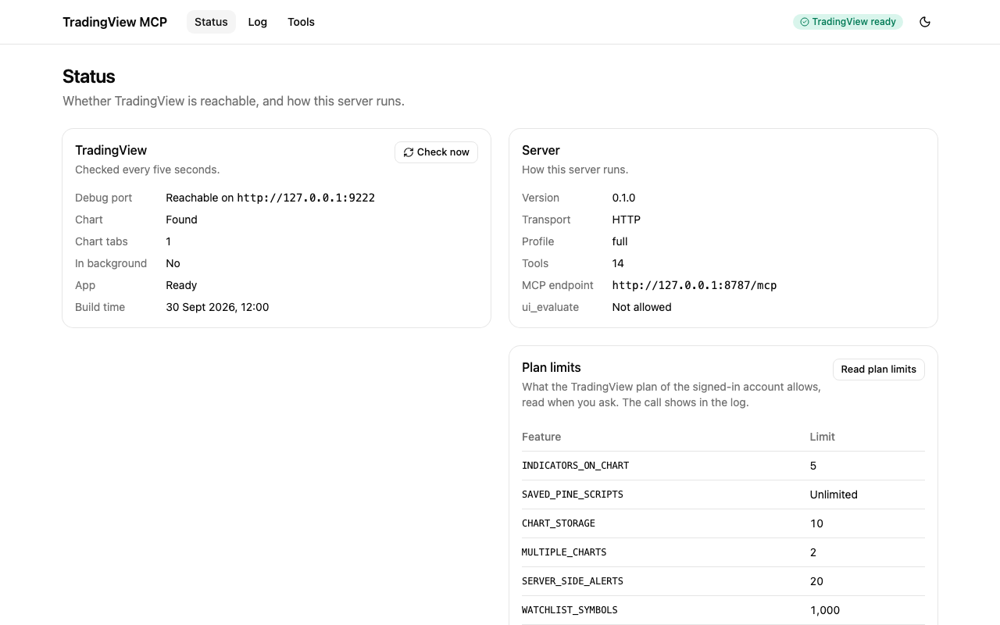
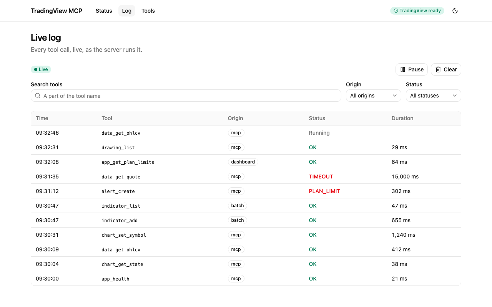
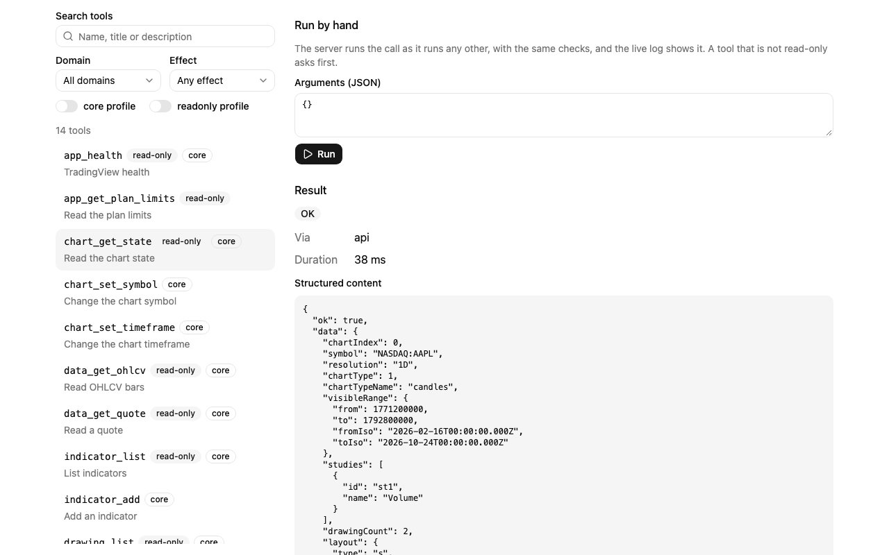

# tradingview-desktop-mcp

[](https://www.npmjs.com/package/tradingview-desktop-mcp)
[](https://github.com/Mochamad-Rizky/tradingview-desktop-mcp/actions/workflows/ci.yml)
[](https://codecov.io/gh/Mochamad-Rizky/tradingview-desktop-mcp)
[](LICENSE)

An [MCP](https://modelcontextprotocol.io) server that lets AI assistants read and control the
TradingView Desktop app on your own machine. It drives the app you are already logged in to over the
Chrome DevTools Protocol, through the debug port the app opens when it starts with
`--remote-debugging-port`. It only automates the local app: it does not log in for you, get around
plan limits, or call TradingView's servers.

> **Status: pre-1.0.** Tool names and options may change before 1.0. Install the package from npm,
> as below, or run the server [from source](#quick-start-from-source). It has been tried on macOS;
> Windows and Linux are best effort.

The server offers app tools (launch, health, discovery, interface state, plan limits, reconnect),
chart tools (state, symbol, timeframe, chart type, visible range, scrolling), market data tools
(bars, quotes, symbol info and search), indicator tools (list, search, add, remove, inputs,
visibility, values), Pine Script tools (the editor and saved scripts, compile, smart compile with
rule-based fixes, offline analysis, the console, and the lines, labels, boxes and tables that
scripts draw), Strategy Tester tools (results, trades, equity), drawing, alert and watchlist tools,
layout, multi-chart and tab tools, bar replay, screenshots, low-level interface tools (click, hover,
type, keys, scroll, find, panels, fullscreen, and JavaScript in the chart page when you allow it)
and `batch_run`, which runs several tools in one call. It also offers resources (the app health,
the chart state and bars, the Pine source and the last compile result, the strategy report, the
active watchlist), each along with the tool it shares its data with, and five prompts for common
jobs. A web dashboard shows the calls live and runs tools by hand (see [Dashboard](#dashboard)).

Contents: [Install by asking your AI app](#install-by-asking-your-ai-app), [Install](#install),
[Connect your AI app](#connect-your-ai-app), [Remote clients and tunnels](#remote-clients-and-tunnels),
[Quick start from source](#quick-start-from-source), [Use it](#use-it),
[Troubleshooting](#troubleshooting), [Dashboard](#dashboard), [Contributing](#contributing).

## Install by asking your AI app

You do not have to type any commands yourself. If your AI app can run commands on your computer,
as Claude Code, Cursor, VS Code, Windsurf, Gemini CLI and Codex CLI can, it can do the setup for
you. First:

1. Install [TradingView Desktop](https://www.tradingview.com/desktop/) and log in.
2. Install [Node.js](https://nodejs.org) (the LTS version), if you do not have it yet.

Then copy this prompt, paste it into your AI app and send it:

```text
Install the TradingView MCP server for me. It is the npm package tradingview-desktop-mcp
(https://github.com/Mochamad-Rizky/tradingview-desktop-mcp). Follow these steps and explain each one
to me in simple words, because I am not a programmer:

1. Check that Node.js 20.19 or newer is installed. If it is not, stop and tell me how to install it.
2. Run "npx -y tradingview-desktop-mcp config <client>", with <client> being the app you are
   running in (claude-code, cursor, vscode, windsurf, gemini-cli or codex-cli). Do what it prints
   to add the server to my configuration, and keep any other servers that are already there.
3. Start TradingView with "npx -y tradingview-desktop-mcp launch". If it says TradingView is
   already running without the debug port, ask me first, and only when I agree run it again
   with --restart, because that closes TradingView and I may lose unsaved changes.
4. Run "npx -y tradingview-desktop-mcp doctor" and tell me whether all checks pass. If the
   chart check fails, tell me to bring the chart tab to the front in TradingView.
5. Tell me whether I have to restart you, or open a new chat, before the TradingView tools show up.
```

When it is done, restart the app or open a new chat if it told you to, and ask "Check that
TradingView is connected." Then try the [prompts below](#try-these-prompts).

Using Claude Desktop? It cannot run commands, but Claude Code, Cursor and the other apps above can
set it up for you: add "Set it up for Claude Desktop (config claude-desktop), not for this app." to
the end of the prompt. ChatGPT and the OpenAI API need a tunnel, which you set up by hand (see
[Remote clients and tunnels](#remote-clients-and-tunnels)). If the assistant gets stuck, follow the
steps below yourself.

## Install

You need:

- TradingView Desktop, installed and logged in.
- Node.js 20.19 or newer, which provides `npx`.

Nothing else is installed: the clients below start the server with `npx -y tradingview-desktop-mcp`,
which fetches the package on first use. Start TradingView with its debug port. The `launch` command
finds the app and starts it that way:

```sh
npx -y tradingview-desktop-mcp launch
```

TradingView allows only one instance. If it is already running without the debug port, `launch`
stops and says so; `launch --restart` quits it politely and starts it again with the port, and
TradingView may ask you to save changes first. Check that the server can reach the app:

```sh
npx -y tradingview-desktop-mcp doctor
```

`doctor` fails its chart check while the chart tab is in the background, behind the New tab page or
another tab without a chart, so bring the chart tab to the front.
`npx -y tradingview-desktop-mcp --help` lists the options, and [.env.example](.env.example) the
environment variables.

## Connect your AI app

`config <client>` prints the configuration snippet of a client and says where it goes. Each tutorial
below holds the same snippet, the steps for that app and what to do when it does not work.

| Client                                           | Print the snippet                                      |
| ------------------------------------------------ | ------------------------------------------------------ |
| [Claude Desktop](docs/clients/claude-desktop.md) | `npx -y tradingview-desktop-mcp config claude-desktop` |
| [Claude Code](docs/clients/claude-code.md)       | `npx -y tradingview-desktop-mcp config claude-code`    |
| [Cursor](docs/clients/cursor.md)                 | `npx -y tradingview-desktop-mcp config cursor`         |
| [VS Code](docs/clients/vscode.md)                | `npx -y tradingview-desktop-mcp config vscode`         |
| [Windsurf](docs/clients/windsurf.md)             | `npx -y tradingview-desktop-mcp config windsurf`       |
| [Gemini CLI](docs/clients/gemini-cli.md)         | `npx -y tradingview-desktop-mcp config gemini-cli`     |
| [Codex CLI](docs/clients/codex-cli.md)           | `npx -y tradingview-desktop-mcp config codex-cli`      |
| [ChatGPT](docs/clients/chatgpt.md)               | `npx -y tradingview-desktop-mcp config chatgpt`        |
| [OpenAI API](docs/clients/openai-api.md)         | `npx -y tradingview-desktop-mcp config openai-api`     |

The default transport is stdio, where stdout carries only MCP messages and logs go to stderr. The
first seven clients start the server themselves. On Windows, a client that cannot start `npx`
directly needs the `cmd /c npx` form, which `config` prints when it runs on Windows (or with
`--platform win32`). `--profile` passes a [tool profile](#tool-profiles) on to the server.

### Remote clients and tunnels

ChatGPT and the OpenAI API cannot start a program on your computer. They reach the server at a
public HTTPS address, so you run it over HTTP and put a tunnel in front of it. That puts a server
that can control your logged-in TradingView on the internet: use `--profile readonly`, a strong
token (`TV_MCP_AUTH_TOKEN`), the public host of the tunnel in `--allowed-hosts`
(`TV_MCP_ALLOWED_HOSTS`), and `--no-dashboard`, so that the files of the dashboard are not served
through the tunnel. The tutorials for [ChatGPT](docs/clients/chatgpt.md) and the
[OpenAI API](docs/clients/openai-api.md) walk through it, and
[SECURITY.md](SECURITY.md#tunnels-and-remote-clients) lists what a read-only token can still reach.

## Quick start from source

To run a checkout instead of the published package, you need Node.js 24 to build the server
(`nvm use` reads `.nvmrc`) and [pnpm](https://pnpm.io), whose version `package.json` pins. The built
server runs on Node.js 20.19 or newer.

```sh
git clone https://github.com/Mochamad-Rizky/tradingview-desktop-mcp.git
cd tradingview-desktop-mcp
pnpm install && pnpm build
node packages/server/dist/cli.js launch
node packages/server/dist/cli.js doctor
```

`node packages/server/dist/cli.js config <client> --local` prints the snippet of a client for this
checkout, with `node` and the absolute path of `cli.js` in place of `npx`. For a client with a JSON
configuration, the entry looks like this:

```json
{
  "mcpServers": {
    "tradingview": {
      "command": "node",
      "args": ["/absolute/path/to/tradingview-desktop-mcp/packages/server/dist/cli.js"]
    }
  }
}
```

There is also an HTTP transport (`--transport http`); read [SECURITY.md](SECURITY.md) before you use
it.

## Use it

Connect an MCP client as described above, with TradingView running with its debug port, and ask for
what you want in plain words. The assistant picks the tools and calls them, so you do not need to
know their names. The [tool reference](docs/tools.md) lists every tool with its inputs and the
profiles it belongs to.

### Try these prompts

Each prompt below is one of the examples in [docs/examples.md](docs/examples.md), which shows the
tool calls the assistant makes and the results, with lists longer than three items cut, the
duration of each call (`durationMs`) left out and a screenshot named in a note instead of shown.
The excerpts are lines of those results, and `…` marks where lines of other parts of a result are
left out. The values are synthetic: they come from a fake TradingView app with a made-up
NASDAQ:AAPL chart, so nothing is market data and nothing comes from an account; the results have
the shape the server gives them, though the Strategy Tester report behind the backtest example has
not been read from the real app yet.

**"What am I looking at on my chart? Tell me the symbol, the timeframe and which indicators are on
it."** The assistant reads the chart with `chart_get_state`
([details](docs/examples.md#1-read-the-chart)):

```json
"symbol": "NASDAQ:AAPL",
"resolution": "1D",
"chartTypeName": "candles",
```

**"Show me the last 3 daily candles."** It reads the bars with `data_get_ohlcv`
([details](docs/examples.md#3-read-the-last-candles)):

```json
"timeIso": "2024-10-27T00:00:00Z",
"open": 103.58,
"close": 103.42,
```

**"Add the MACD to my chart."** On a chart that holds as many indicators as the plan allows,
`indicator_add` adds nothing and reports the limit, and removing one of your indicators to make room
needs your confirmation ([details](docs/examples.md#5-add-an-indicator-to-a-full-chart)):

```json
"code": "PLAN_LIMIT",
"message": "The chart holds as many indicators as the plan allows (2)",
```

**"Write a Pine Script indicator that plots a 9-bar and a 21-bar moving average of the close, and
check that it compiles."** It puts the script in the Pine Editor with `pine_new` and compiles it with
`pine_compile` ([details](docs/examples.md#6-write-and-compile-a-pine-script)):

```json
"success": true,
"errors": [],
"warnings": [],
```

**"The script in my Pine Editor will not compile. Can you fix it?"** `pine_smart_compile` compiles
the script, applies rule-based fixes for the errors it knows, such as Pine v4 names in a v6 script,
and compiles again, without changing the editor
([details](docs/examples.md#7-fix-a-pine-script-with-smart-compile)):

```json
"message": "Could not find function or function reference 'study'",
…
"applied": ["Replace study( with indicator(", "Replace rsi( with ta.rsi("]
…
"writtenBack": false
```

**"How did the strategy on my chart do in the backtest?"** It reads the Strategy Tester with
`strategy_get_results` and `strategy_get_trades`
([details](docs/examples.md#8-read-backtest-results)):

```json
"netProfit": 155,
"totalTrades": 3,
"percentProfitable": 66.67,
"profitFactor": 4.1,
```

**"Draw a support line at 102.80 on my chart."** It draws a horizontal line with `drawing_create`,
and `drawing_list` shows it next to your own drawings, marked as drawn by this session
([details](docs/examples.md#9-draw-a-support-line)):

```json
"id": "DRW001",
"shape": "horizontal_line",
"text": "Support",
"createdByServer": true
```

**"Alert me when Apple crosses 110."** `alert_create` sets a price alert in your TradingView account
([details](docs/examples.md#10-create-a-price-alert)). When the plan already holds as many alerts
as it allows, it creates nothing and reports the limit, and `alert_list` shows the alerts that fill
it ([details](docs/examples.md#11-create-an-alert-when-the-plan-is-full)):

```json
"symbol": "NASDAQ:AAPL",
"condition": "crossing",
"price": 110,
"expirationIso": "2024-11-26T00:00:00Z"
```

**"Add these symbols to my watchlist: NYSE:IBM, FX:EURUSD, NASDAQ:MSFT and NASDAQ:MSTF."**
`watchlist_add_bulk` checks each symbol with the symbol search of TradingView, adds the new ones and
says why it skipped the others ([details](docs/examples.md#12-add-symbols-to-a-watchlist)):

```json
"added": ["NYSE:IBM", "FX:EURUSD"],
…
{ "symbol": "NASDAQ:MSFT", "reason": "already_listed" },
{ "symbol": "NASDAQ:MSTF", "reason": "unknown" }
```

**"Let me practice on a bar replay of my chart from 2024-06-03: step five bars forward, tell me
where we are, then end the replay."** It starts bar replay with `replay_start`, steps with
`replay_step`, reads where replay is with `replay_status` and leaves it with `replay_stop`. Nothing
is traded: no tool places orders ([details](docs/examples.md#13-practice-with-bar-replay)):

```json
"dateIso": "2024-06-07T00:00:00Z",
"stepped": 5,
…
"position": null,
"realizedPL": null
```

**"Take a screenshot of my chart."** `screenshot_capture` hands the picture to the assistant as an
image, along with its size, and writes nothing to disk
([details](docs/examples.md#14-take-a-screenshot)):

```json
"data": { "target": "chart", "format": "jpeg", "width": 1180, "height": 640, "bytes": 3100 },
"meta": { "via": "cdp", "warnings": [] }
```

The server also offers five prompts of its own, which a client that supports MCP prompts lists for
you to pick: `analyze_current_chart`, `multi_timeframe_review`, `write_and_backtest_strategy`,
`debug_pine_script` and `replay_practice_session`. Each one tells the assistant which tools to
call, in which order, and what to report back. `replay_practice_session` runs a practice session on
bar replay: the assistant steps through the past bar by bar, asks you at each step whether you
would go long, go short or stay flat, keeps a journal of these hypothetical trades at prices it
reads from the chart, and works out their profit or loss. It checks first whether a replay of yours
is running, and asks you what to do with one before it changes anything; at the end it stops the
replay it started, and never one of yours.

### Safety

The tools that change your chart, your scripts or your account are careful with what is already
yours. Replacing unsaved text in the Pine Editor (other than an unsaved edit this session of the
server made there itself), saving a new version of a script that this session did not create, and
removing an indicator that was already on your chart all need `confirm: true`, which the assistant
should pass only after you agree. So does removing a drawing, alert, watchlist symbol or tab that
this session did not create, add or open, removing every drawing of a chart, switching away from a
layout with unsaved changes, and changing to a multi-chart layout with fewer charts than the tab
shows, whose next save would drop the others. A plan limit, such as the number of indicators on a
chart, of saved scripts, of alerts or of the charts of a layout, is checked before anything is
added and reported as a `PLAN_LIMIT` error with the limit; when the limit cannot be read on your
TradingView build, the tool does nothing and says so. The server does not work around a limit. The
tools check first what would make TradingView open its upgrade dialog, or another dialog of its
own, and refuse instead, but a few prompts remain that these checks cannot foresee:
`layout_switch` can meet an upgrade prompt for a saved multi-chart layout on a plan with fewer
charts, for a layout the server of TradingView refuses as beyond the limit, and for one that the
list TradingView keeps for itself marks over the limit while `layout_list` does not; `layout_new`
can meet a message of TradingView when it refuses the new layout after the checks; and `tab_close` can meet the "Close tab?" dialog for a page that takes longer than TradingView waits to
say whether its layout has unsaved changes, or that reports a recording in progress. The low-level
`ui_*` tools click and type what you ask for, so they can open dialogs of TradingView by design. It
deletes and renames no script.

No tool places orders: bar replay is for practice, and the assistant keeps any practice trades in
the conversation. Screenshots go to the client as images, and the server writes none to disk.
`ui_evaluate`, which runs JavaScript in the chart page, is off unless you start the server with
`--allow-eval` (`TV_MCP_ALLOW_EVAL=true`).

### Tool profiles

By default the server offers all its 83 tools (`--profile full`). Some clients accept only a limited
number of tools (Cursor warns above 40). For them, `--profile core` offers a reduced set of 40
essential tools, and `--profile readonly` offers only the 37 tools that read. `--tools` takes name
patterns such as `chart_*,data_*` and narrows the profile further: a tool must be in the profile
and match a pattern, so `--profile core --tools 'pine_*'` still leaves out `pine_open` and
`pine_save`, which are not core tools; with the default profile, `--tools` alone picks the tools.
Some descriptions and hints name tools that `core` leaves out, such as `pine_open` and `pine_save`,
which the assistant cannot call under `core`. The resources follow the tools: each one is offered
only with the tool it shares its data with, such as `tradingview://pine/source` with
`pine_get_source`, so `--tools 'chart_*'` offers the chart state and nothing of the Pine Editor.

The [tool reference](docs/tools.md) lists every tool with its inputs and the profiles it belongs to.

## Troubleshooting

[docs/troubleshooting.md](docs/troubleshooting.md) explains each error code and what to do when
TradingView is not found, the debug port is busy, a client does not show the tools or a tunnel
refuses a request. `npx -y tradingview-desktop-mcp doctor` is the first thing to run.

## Dashboard

The server comes with a web dashboard for watching what your assistant does and for trying a tool
by hand. It needs no extra install: the published package carries it, and `pnpm build` builds it into the
server of a checkout.



### Open it

- **HTTP transport:** start the server with a token and open `http://127.0.0.1:8787/`. The dashboard
  is on by default in this mode; `--no-dashboard` (`TV_MCP_DASHBOARD=false`) turns it off.

  ```sh
  TV_MCP_AUTH_TOKEN="$(openssl rand -hex 32)" npx -y tradingview-desktop-mcp --transport http
  ```

  From a checkout, run `node packages/server/dist/cli.js --transport http` instead.

- **Next to stdio:** an MCP client that starts the server over stdio can have a dashboard too. Add
  `--dashboard` (`TV_MCP_DASHBOARD=true`) and `TV_MCP_AUTH_TOKEN` to its configuration. The dashboard
  listens on its own address, `127.0.0.1:8787` unless you set `--host` and `--port`, and serves no
  `/mcp`. Without the token, or when the port is taken, the dashboard stays off and the server
  logs a warning, but the MCP server runs on. The calls the client makes show up in the live log.

The server prints the address of the dashboard on stderr when it starts. It never prints the token.

### The token

The page asks for the token (`TV_MCP_AUTH_TOKEN`) before it shows anything. Paste it in, or open
`http://127.0.0.1:8787/#token=<token>` once: the page reads the token from the fragment and removes
it from the address, and the fragment is never sent to the server. The page keeps the token in
`sessionStorage`, so it is gone when you close the tab, and it sends the token only as
`Authorization: Bearer <token>`, never in a URL. When the server restarts with another token, the page
asks again. See [SECURITY.md](SECURITY.md#the-dashboard).

### What it shows



- **Status** shows whether TradingView is reachable (and how to start it when it is not), how the
  server runs, the plan limits and the latest calls.
- **Log** streams every tool call the server runs, whether an MCP client or the dashboard made
  it, with a filter by tool name, pause, clear and the details of each call. After a dropped
  connection it says "Reconnecting…" and picks up where it stopped. Each open tab of the dashboard
  keeps one event stream to the server, and a browser allows about six connections to one host, so
  with many dashboard tabs open a new one can wait for a free connection: close the tabs you do not
  use.
- **Tools** lists the tools the server offers, with their inputs, and runs one by hand. The result
  is shown as it came back, with long JSON collapsed behind "Show all" and images as images.



A run from the dashboard is a real tool call. It goes through the same registry as an MCP call, so
the same schemas, profile, `confirm` rules and plan limit checks apply, and it appears in the log.
The dashboard asks you to confirm before it runs any tool that is not read-only.

### The API

The page talks to the server through a small API, which you can also call with `curl` and the
token. Every route needs `Authorization: Bearer <token>`, and the server checks `Host` and `Origin`
as it does for `/mcp`.

| Route                    | What it does                                                            |
| ------------------------ | ----------------------------------------------------------------------- |
| `GET /api/info`          | Version, transport, profile, tool count and start time                  |
| `GET /api/health`        | The health report: whether TradingView is reachable                     |
| `GET /api/tools`         | The tools on offer, with their schemas and annotations                  |
| `POST /api/tools/<name>` | Runs a tool with `{"arguments": {...}}`, as the origin `dashboard`      |
| `GET /api/events`        | Server-sent events of the tool calls; `?limit=` sets how many to replay |

The files of the page itself, at `/`, need no token and hold no data.

## Contributing

See [CONTRIBUTING.md](CONTRIBUTING.md) for the local setup, the test levels, the commit
conventions and how a release is made, and [docs/testing.md](docs/testing.md) for the testing guide. To report a
vulnerability, follow [SECURITY.md](SECURITY.md).

## Disclaimer

This project is not affiliated with, endorsed by, or sponsored by TradingView, Inc. TradingView is a
trademark of its owner. Nothing here is financial advice. The tools change what the app shows and
may reach its controls, so you are responsible for what you automate and for following TradingView's
terms of use.

## License

Released under the [MIT license](LICENSE).
