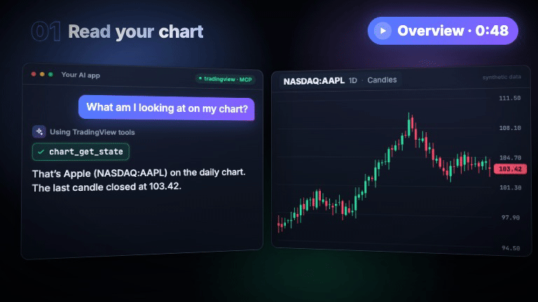
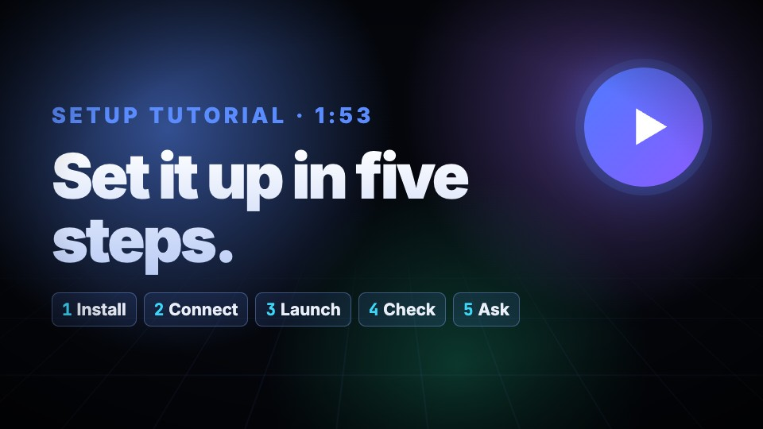
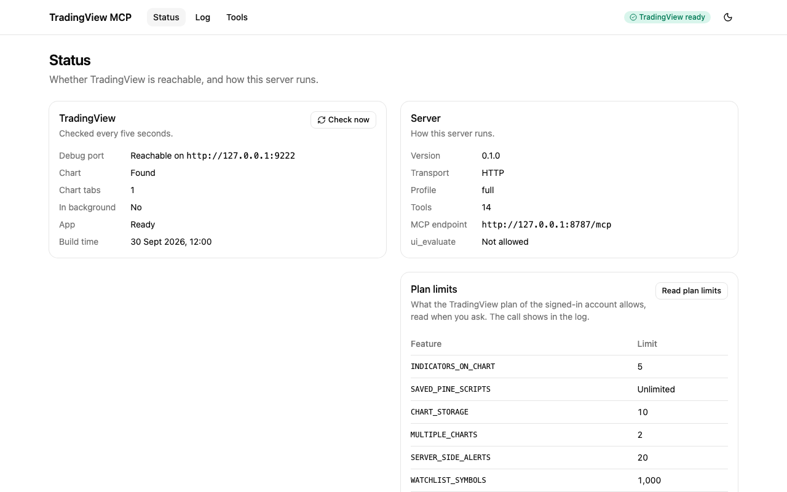
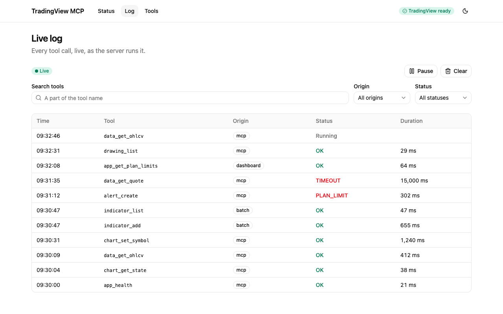
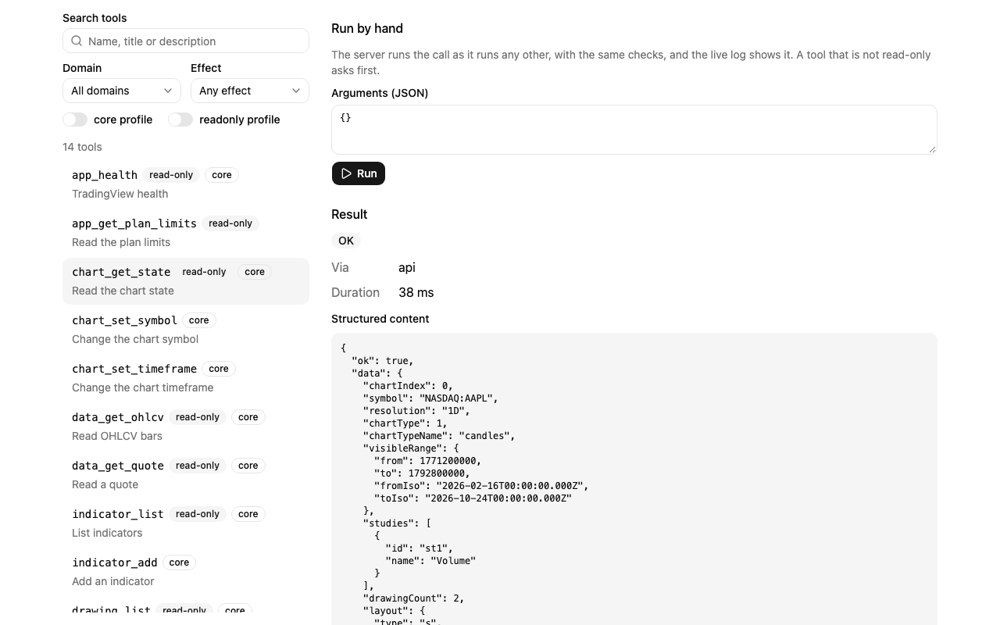

# tradingview-desktop-mcp

[English](../../README.md) · [简体中文](README.zh-CN.md) · [繁體中文](README.zh-TW.md) · [日本語](README.ja.md) · **한국어** · [Türkçe](README.tr.md) · [Русский](README.ru.md) · [Tiếng Việt](README.vi.md) · [ไทย](README.th.md) · [Deutsch](README.de.md) · [Español](README.es.md) · [Français](README.fr.md) · [Українська](README.uk.md) · [Polski](README.pl.md) · [Português (Brasil)](README.pt-BR.md) · [العربية](README.ar.md) · [فارسی](README.fa.md) · [Bahasa Indonesia](README.id.md) · [Italiano](README.it.md) · [Ελληνικά](README.el.md) · [മലയാളം](README.ml.md) · [Roman Urdu](README.ur-Latn.md) · [Română](README.ro.md)

[](https://www.npmjs.com/package/tradingview-desktop-mcp)
[](https://github.com/Mochamad-Rizky/tradingview-desktop-mcp/actions/workflows/ci.yml)
[](https://codecov.io/gh/Mochamad-Rizky/tradingview-desktop-mcp)
[](../../LICENSE)

> 이 문서는 [영문 README](../../README.md)의 번역본입니다. 두 문서의 내용이 다를 경우 영문판을 기준으로 합니다.

<p align="center">
  <a href="../media/promo.mp4"></a>
  <a href="../media/tutorial.mp4"></a>
</p>

<p align="center">
  <a href="../media/promo.mp4"><b>▶ 개요 영상 보기</b></a> (0:48) &nbsp;·&nbsp;
  <a href="../media/tutorial.mp4"><b>▶ 설정 튜토리얼 보기</b></a> (1:53)<br>
  <sub>두 영상 모두 실제 시장 데이터가 아닌 가상의 차트를 사용합니다.</sub>
</p>

AI 어시스턴트가 내 컴퓨터에 있는 TradingView Desktop 앱을 읽고 제어할 수 있게 해 주는
[MCP](https://modelcontextprotocol.io) 서버입니다. 이미 로그인되어 있는 앱을 Chrome DevTools
Protocol로 조작하며, 앱을 `--remote-debugging-port`와 함께 시작했을 때 열리는 디버그 포트를
사용합니다. 로컬 앱만 자동화할 뿐, 대신 로그인하거나 플랜 제한을 우회하거나 TradingView 서버를
호출하지는 않습니다.

> **상태: 1.0 이전.** 1.0 전까지 도구 이름과 옵션이 바뀔 수 있습니다. 아래와 같이 npm에서 패키지를
> 설치하거나, 서버를 [소스에서](#quick-start-from-source) 실행하세요. macOS에서 테스트했으며,
> Windows와 Linux는 최선의 노력 수준으로 지원합니다.

이 서버는 앱 도구(실행, 상태 점검, 탐색, 인터페이스 상태, 플랜 제한, 재연결), 차트 도구(상태,
심볼, 타임프레임, 차트 유형, 표시 범위, 스크롤), 시장 데이터 도구(봉, 시세, 심볼 정보와 검색),
지표 도구(목록, 검색, 추가, 제거, 입력값, 표시 여부, 값), Pine Script 도구(에디터와 저장된 스크립트,
컴파일, 규칙 기반 수정을 적용하는 스마트 컴파일, 오프라인 분석, 콘솔, 그리고 스크립트가 그리는 선,
라벨, 박스, 테이블), Strategy Tester 도구(결과, 거래, 자산 곡선), 드로잉·알림·관심 목록 도구,
레이아웃·멀티 차트·탭 도구, 바 리플레이, 스크린샷, 저수준 인터페이스 도구(클릭, 호버, 입력, 키,
스크롤, 찾기, 패널, 전체 화면, 그리고 허용한 경우 차트 페이지에서의 JavaScript 실행), 그리고 여러
도구를 한 번의 호출로 실행하는 `batch_run`을 제공합니다. 또한 리소스(앱 상태, 차트 상태와 봉, Pine
소스와 마지막 컴파일 결과, 전략 보고서, 활성 관심 목록)를 각각 데이터를 공유하는 도구와 함께
제공하며, 자주 하는 작업을 위한 프롬프트 다섯 개도 제공합니다. 웹 대시보드에서 호출을 실시간으로
확인하고 도구를 직접 실행할 수 있습니다(참고: [대시보드](#dashboard)).

목차: [AI 앱에 요청해서 설치하기](#install-by-asking-your-ai-app), [설치](#install),
[AI 앱 연결하기](#connect-your-ai-app), [원격 클라이언트와 터널](#remote-clients-and-tunnels),
[소스에서 빠르게 시작하기](#quick-start-from-source), [사용하기](#use-it),
[문제 해결](#troubleshooting), [대시보드](#dashboard), [기여하기](#contributing).

## <a id="install-by-asking-your-ai-app"></a>AI 앱에 요청해서 설치하기

명령어를 직접 입력할 필요가 없습니다. Claude Code, Cursor, VS Code, Windsurf, Gemini CLI, Codex
CLI처럼 AI 앱이 컴퓨터에서 명령을 실행할 수 있다면, 설정을 대신 해 줄 수 있습니다. 먼저 다음을
준비하세요.

1. [TradingView Desktop](https://www.tradingview.com/desktop/)을 설치하고 로그인합니다.
2. 아직 없다면 [Node.js](https://nodejs.org) (LTS 버전)를 설치합니다.

그런 다음 아래 프롬프트를 복사해 AI 앱에 붙여 넣고 보내세요.

```text
TradingView MCP 서버를 설치해 주세요. npm 패키지 tradingview-desktop-mcp
(https://github.com/Mochamad-Rizky/tradingview-desktop-mcp)입니다. 아래 단계를 따라 진행하고,
각 단계를 쉬운 말로 설명해 주세요.

1. Node.js 20.19 이상이 설치되어 있는지 확인해 주세요. 설치되어 있지 않으면 멈추고 설치 방법을 알려 주세요.
2. "npx -y tradingview-desktop-mcp config <client>"를 실행해 주세요. <client>는 지금 실행 중인 앱입니다
   (claude-code, cursor, vscode, windsurf, gemini-cli 또는 codex-cli). 출력된 안내대로 서버를 제
   설정에 추가하고, 이미 있는 다른 서버는 그대로 두세요.
3. "npx -y tradingview-desktop-mcp launch"로 TradingView를 시작해 주세요. TradingView가 디버그 포트
   없이 이미 실행 중이라고 나오면 먼저 저에게 물어보고, 제가 동의할 때만 --restart를 붙여 다시
   실행해 주세요. 그러면 TradingView가 닫혀서 저장하지 않은 변경 사항을 잃을 수 있기 때문입니다.
4. "npx -y tradingview-desktop-mcp doctor"를 실행하고 모든 검사를 통과했는지 알려 주세요. 차트
   검사가 실패하면 TradingView에서 차트 탭을 앞으로 가져오라고 알려 주세요.
5. TradingView 도구가 나타나기 전에 당신을 다시 시작하거나 새 채팅을 열어야 하는지 알려 주세요.
```

작업이 끝나면, 그렇게 하라는 안내를 받았다면 앱을 다시 시작하거나 새 채팅을 열고 "TradingView가
연결되어 있는지 확인해 주세요."라고 요청하세요. 그런 다음 [아래 프롬프트](#try-these-prompts)를
사용해 보세요.

Claude Desktop을 사용하나요? Claude Desktop은 명령을 실행할 수 없지만, Claude Code, Cursor 및 위의
다른 앱이 대신 설정해 줄 수 있습니다. 프롬프트 끝에 "이 앱이 아니라 Claude Desktop용으로 설정해
주세요(config claude-desktop)."를 추가하세요. ChatGPT와 OpenAI API에는 터널이 필요하며, 터널은
직접 설정해야 합니다(참고:
[원격 클라이언트와 터널](#remote-clients-and-tunnels)). 어시스턴트가 막히면 아래 단계를 직접 따라
하세요.

## <a id="install"></a>설치

필요한 것:

- 설치되어 있고 로그인된 TradingView Desktop.
- `npx`를 제공하는 Node.js 20.19 이상.

그 밖에는 아무것도 설치하지 않습니다. 아래 클라이언트들은 `npx -y tradingview-desktop-mcp`로 서버를
시작하며, 이 명령은 처음 사용할 때 패키지를 내려받습니다. TradingView를 디버그 포트와 함께
시작하세요. `launch` 명령이 앱을 찾아 그렇게 시작해 줍니다.

```sh
npx -y tradingview-desktop-mcp launch
```

TradingView는 인스턴스를 하나만 허용합니다. 이미 디버그 포트 없이 실행 중이라면 `launch`는 멈추고
그 사실을 알려 줍니다. `launch --restart`는 앱을 정상적으로 종료한 뒤 포트와 함께 다시 시작하며,
이때 TradingView가 먼저 변경 사항을 저장할지 물어볼 수 있습니다. 서버가 앱에 연결할 수 있는지
확인하세요.

```sh
npx -y tradingview-desktop-mcp doctor
```

차트 탭이 New tab 페이지나 차트가 없는 다른 탭 뒤에 가려져 백그라운드에 있으면 `doctor`의 차트
검사가 실패하므로, 차트 탭을 앞으로 가져오세요.
`npx -y tradingview-desktop-mcp --help`는 옵션 목록을, [.env.example](../../.env.example)은 환경 변수
목록을 보여 줍니다.

## <a id="connect-your-ai-app"></a>AI 앱 연결하기

`config <client>`는 클라이언트의 설정 스니펫을 출력하고 어디에 넣어야 하는지 알려 줍니다. 아래의 각
튜토리얼에는 같은 스니펫과 해당 앱의 설정 단계, 그리고 동작하지 않을 때 해야 할 일이 담겨 있습니다.

| 클라이언트                                     | 스니펫 출력                                            |
| ---------------------------------------------- | ------------------------------------------------------ |
| [Claude Desktop](../clients/claude-desktop.md) | `npx -y tradingview-desktop-mcp config claude-desktop` |
| [Claude Code](../clients/claude-code.md)       | `npx -y tradingview-desktop-mcp config claude-code`    |
| [Cursor](../clients/cursor.md)                 | `npx -y tradingview-desktop-mcp config cursor`         |
| [VS Code](../clients/vscode.md)                | `npx -y tradingview-desktop-mcp config vscode`         |
| [Windsurf](../clients/windsurf.md)             | `npx -y tradingview-desktop-mcp config windsurf`       |
| [Gemini CLI](../clients/gemini-cli.md)         | `npx -y tradingview-desktop-mcp config gemini-cli`     |
| [Codex CLI](../clients/codex-cli.md)           | `npx -y tradingview-desktop-mcp config codex-cli`      |
| [ChatGPT](../clients/chatgpt.md)               | `npx -y tradingview-desktop-mcp config chatgpt`        |
| [OpenAI API](../clients/openai-api.md)         | `npx -y tradingview-desktop-mcp config openai-api`     |

기본 전송 방식은 stdio이며, stdout에는 MCP 메시지만 오가고 로그는 stderr로 출력됩니다. 처음 일곱
개 클라이언트는 서버를 직접 시작합니다. Windows에서 `npx`를 바로 시작할 수 없는 클라이언트에는
`cmd /c npx` 형식이 필요하며, `config`를 Windows에서 실행하면(또는 `--platform win32`와 함께
실행하면) 이 형식을 출력합니다. `--profile`은 [도구 프로필](#tool-profiles)을 서버에 전달합니다.

### <a id="remote-clients-and-tunnels"></a>원격 클라이언트와 터널

ChatGPT와 OpenAI API는 내 컴퓨터에서 프로그램을 시작할 수 없습니다. 이들은 공개 HTTPS 주소로
서버에 접속하므로, 서버를 HTTP로 실행하고 그 앞에 터널을 두어야 합니다. 그러면 로그인된
TradingView를 제어할 수 있는 서버가 인터넷에 노출됩니다. 따라서 `--profile readonly`, 강력한
토큰(`TV_MCP_AUTH_TOKEN`), `--allowed-hosts`(`TV_MCP_ALLOWED_HOSTS`)에 지정한 터널의 공개 호스트,
그리고 대시보드 파일이 터널을 통해 제공되지 않도록 `--no-dashboard`를 사용하세요.
[ChatGPT](../clients/chatgpt.md)와 [OpenAI API](../clients/openai-api.md) 튜토리얼에서 이
과정을 차례로 안내하며, [SECURITY.md](../../SECURITY.md#tunnels-and-remote-clients)에는 읽기 전용
토큰으로도 여전히 접근할 수 있는 것들이 정리되어 있습니다.

## <a id="quick-start-from-source"></a>소스에서 빠르게 시작하기

게시된 패키지 대신 체크아웃한 소스를 실행하려면, 서버를 빌드할 Node.js 24(`nvm use`가 `.nvmrc`를
읽습니다)와 [pnpm](https://pnpm.io)이 필요합니다. pnpm 버전은 `package.json`에 고정되어 있습니다.
빌드된 서버는 Node.js 20.19 이상에서 실행됩니다.

```sh
git clone https://github.com/Mochamad-Rizky/tradingview-desktop-mcp.git
cd tradingview-desktop-mcp
pnpm install && pnpm build
node packages/server/dist/cli.js launch
node packages/server/dist/cli.js doctor
```

`node packages/server/dist/cli.js config <client> --local`은 이 체크아웃용 클라이언트 스니펫을
출력하며, `npx` 대신 `node`와 `cli.js`의 절대 경로를 사용합니다. JSON 설정을 쓰는 클라이언트의
경우 항목은 다음과 같습니다.

```json
{
  "mcpServers": {
    "tradingview": {
      "command": "node",
      "args": ["/absolute/path/to/tradingview-desktop-mcp/packages/server/dist/cli.js"]
    }
  }
}
```

HTTP 전송 방식(`--transport http`)도 있습니다. 사용하기 전에 [SECURITY.md](../../SECURITY.md)를 읽어
보세요.

## <a id="use-it"></a>사용하기

위에서 설명한 대로 MCP 클라이언트를 연결하고 TradingView를 디버그 포트와 함께 실행한 상태에서,
원하는 것을 평소 말투로 요청하세요. 어시스턴트가 도구를 골라 호출하므로 도구 이름을 알 필요는
없습니다. [도구 레퍼런스](../tools.md)에는 모든 도구의 입력값과 각 도구가 속한 프로필이 정리되어
있습니다.

### <a id="try-these-prompts"></a>이런 프롬프트를 사용해 보세요

아래의 각 프롬프트는 [docs/examples.md](../examples.md)에 있는 예시 중 하나입니다. 이 문서는
어시스턴트가 하는 도구 호출과 그 결과를 보여 주는데, 세 항목보다 긴 목록은 잘라 냈고, 각 호출의
소요 시간(`durationMs`)은 생략했으며, 스크린샷은 보여 주는 대신 메모에서 이름만 언급했습니다.
발췌한 부분은 그 결과의 일부 줄이며, `…`는 결과의 다른 부분에 해당하는 줄을 생략한 자리를
나타냅니다. 값은 합성 데이터입니다. 가상의 NASDAQ:AAPL 차트를 띄운 가짜 TradingView 앱에서 나온
값이므로 시장 데이터도 아니고 어떤 계정에서 나온 것도 아닙니다. 결과는 서버가 실제로 반환하는 형태를
따르지만, 백테스트 예시의 바탕이 된 Strategy Tester 보고서는 아직 실제 앱에서 읽어 보지
않았습니다.

**"지금 내 차트에 무엇이 표시되어 있나요? 심볼, 타임프레임, 그리고 어떤 지표가 올라가 있는지 알려
주세요."** 어시스턴트가 `chart_get_state`로 차트를 읽습니다
([자세히](../examples.md#1-read-the-chart)):

```json
"symbol": "NASDAQ:AAPL",
"resolution": "1D",
"chartTypeName": "candles",
```

**"최근 일봉 3개를 보여 주세요."** `data_get_ohlcv`로 봉을 읽습니다
([자세히](../examples.md#3-read-the-last-candles)):

```json
"timeIso": "2024-10-27T00:00:00Z",
"open": 103.58,
"close": 103.42,
```

**"내 차트에 MACD를 추가해 주세요."** 플랜이 허용하는 만큼 지표가 이미 올라가 있는 차트에서는
`indicator_add`가 아무것도 추가하지 않고 제한을 알려 주며, 자리를 만들기 위해 기존 지표 중 하나를
제거하려면 사용자의 확인이 필요합니다 ([자세히](../examples.md#5-add-an-indicator-to-a-full-chart)):

```json
"code": "PLAN_LIMIT",
"message": "The chart holds as many indicators as the plan allows (2)",
```

**"종가의 9봉 이동평균과 21봉 이동평균을 그리는 Pine Script 지표를 작성하고, 컴파일되는지 확인해
주세요."** `pine_new`로 스크립트를 Pine Editor에 넣고 `pine_compile`로 컴파일합니다
([자세히](../examples.md#6-write-and-compile-a-pine-script)):

```json
"success": true,
"errors": [],
"warnings": [],
```

**"Pine Editor에 있는 스크립트가 컴파일되지 않아요. 고쳐 줄 수 있나요?"** `pine_smart_compile`은
스크립트를 컴파일하고, v6 스크립트 안의 Pine v4 이름처럼 알고 있는 오류에 대해 규칙 기반 수정을
적용한 뒤 다시 컴파일하며, 에디터 내용은 바꾸지 않습니다
([자세히](../examples.md#7-fix-a-pine-script-with-smart-compile)):

```json
"message": "Could not find function or function reference 'study'",
…
"applied": ["Replace study( with indicator(", "Replace rsi( with ta.rsi("]
…
"writtenBack": false
```

**"내 차트에 있는 전략의 백테스트 성과는 어땠나요?"** `strategy_get_results`와
`strategy_get_trades`로 Strategy Tester를 읽습니다
([자세히](../examples.md#8-read-backtest-results)):

```json
"netProfit": 155,
"totalTrades": 3,
"percentProfitable": 66.67,
"profitFactor": 4.1,
```

**"내 차트의 102.80에 지지선을 그려 주세요."** `drawing_create`로 수평선을 그리며,
`drawing_list`는 이 선을 사용자가 직접 그린 드로잉과 함께 보여 주되 이 세션이 그린 것으로
표시합니다 ([자세히](../examples.md#9-draw-a-support-line)):

```json
"id": "DRW001",
"shape": "horizontal_line",
"text": "Support",
"createdByServer": true
```

**"Apple이 110을 돌파하면 알려 주세요."** `alert_create`가 TradingView 계정에 가격 알림을
설정합니다 ([자세히](../examples.md#10-create-a-price-alert)). 플랜이 허용하는 만큼 알림이 이미
있으면 아무것도 만들지 않고 제한을 알려 주며, `alert_list`가 그 자리를 채우고 있는 알림을 보여
줍니다 ([자세히](../examples.md#11-create-an-alert-when-the-plan-is-full)):

```json
"symbol": "NASDAQ:AAPL",
"condition": "crossing",
"price": 110,
"expirationIso": "2024-11-26T00:00:00Z"
```

**"NYSE:IBM, FX:EURUSD, NASDAQ:MSFT, NASDAQ:MSTF 심볼을 내 관심 목록에 추가해 주세요."**
`watchlist_add_bulk`는 TradingView의 심볼 검색으로 각 심볼을 확인하고, 새 심볼은 추가하며, 나머지를
건너뛴 이유를 알려 줍니다 ([자세히](../examples.md#12-add-symbols-to-a-watchlist)):

```json
"added": ["NYSE:IBM", "FX:EURUSD"],
…
{ "symbol": "NASDAQ:MSFT", "reason": "already_listed" },
{ "symbol": "NASDAQ:MSTF", "reason": "unknown" }
```

**"2024-06-03부터 내 차트로 바 리플레이 연습을 하고 싶어요. 다섯 봉 앞으로 진행하고, 지금 어디인지
알려 준 다음, 리플레이를 끝내 주세요."** `replay_start`로 바 리플레이를 시작하고, `replay_step`으로
진행하며, `replay_status`로 리플레이가 어디에 있는지 읽고, `replay_stop`으로 리플레이를
종료합니다. 거래는 일어나지 않습니다. 주문을 넣는 도구는 없습니다
([자세히](../examples.md#13-practice-with-bar-replay)):

```json
"dateIso": "2024-06-07T00:00:00Z",
"stepped": 5,
…
"position": null,
"realizedPL": null
```

**"내 차트의 스크린샷을 찍어 주세요."** `screenshot_capture`는 이미지를 크기 정보와 함께
어시스턴트에게 이미지로 전달하며, 디스크에는 아무것도 쓰지 않습니다
([자세히](../examples.md#14-take-a-screenshot)):

```json
"data": { "target": "chart", "format": "jpeg", "width": 1180, "height": 640, "bytes": 3100 },
"meta": { "via": "cdp", "warnings": [] }
```

서버는 자체 프롬프트 다섯 개도 제공하며, MCP 프롬프트를 지원하는 클라이언트는 이를 목록으로 보여
주어 선택할 수 있게 합니다. `analyze_current_chart`, `multi_timeframe_review`,
`write_and_backtest_strategy`, `debug_pine_script`, `replay_practice_session`입니다. 각 프롬프트는
어시스턴트에게 어떤 도구를 어떤 순서로 호출하고 무엇을 보고해야 하는지 알려 줍니다.
`replay_practice_session`은 바 리플레이로 연습 세션을 진행합니다. 어시스턴트는 과거를 한 봉씩
진행하면서 단계마다 롱, 숏, 관망 중 무엇을 할지 묻고, 차트에서 읽은 가격으로 이 가상 거래의 일지를
기록하며, 그 손익을 계산합니다. 먼저 사용자의 리플레이가 실행 중인지 확인하고, 실행 중이면 무언가를
바꾸기 전에 어떻게 할지 묻습니다. 끝날 때는 자신이 시작한 리플레이만 중지하며, 사용자의 리플레이는
절대 중지하지 않습니다.

### <a id="safety"></a>안전

차트, 스크립트, 계정을 변경하는 도구는 이미 사용자가 가지고 있는 것을 신중하게 다룹니다. Pine
Editor의 저장되지 않은 텍스트를 교체하는 것(이 서버 세션이 직접 만든 저장되지 않은 수정은 제외),
이 세션이 만들지 않은 스크립트의 새 버전을 저장하는 것, 차트에 이미 있던 지표를 제거하는 것에는
모두 `confirm: true`가 필요하며, 어시스턴트는 사용자가 동의한 뒤에만 이를 전달해야 합니다. 이
세션이 만들거나 추가하거나 열지 않은 드로잉, 알림, 관심 목록 심볼, 탭을 제거하는 것, 차트의 모든
드로잉을 제거하는 것, 저장되지 않은 변경 사항이 있는 레이아웃에서 다른 레이아웃으로 전환하는 것,
그리고 탭에 표시된 것보다 차트 수가 적은 멀티 차트 레이아웃으로 바꾸는 것(다음에 저장하면 나머지
차트가 사라집니다)도 마찬가지입니다. 차트의 지표 수, 저장된 스크립트 수, 알림 수, 레이아웃의 차트 수
같은 플랜 제한은 무언가를 추가하기 전에 확인되며, 제한값과 함께 `PLAN_LIMIT` 오류로 보고됩니다.
사용 중인 TradingView 빌드에서 제한값을 읽을 수 없으면 도구는 아무것도 하지 않고 그 사실을 알려
줍니다. 서버는 제한을 우회하지 않습니다. 도구들은 TradingView가 업그레이드 대화 상자나 다른 자체
대화 상자를 열게 만들 상황을 먼저 확인하고 대신 거부하지만, 이 확인으로 예측할 수 없는 프롬프트가
몇 가지 남아 있습니다. `layout_switch`는 차트 수가 더 적은 플랜에서 저장된 멀티 차트 레이아웃을
열 때, TradingView 서버가 제한 초과로 거부하는 레이아웃을 열 때, 그리고 TradingView가 자체적으로
관리하는 목록에서는 제한 초과로 표시되지만 `layout_list`에서는 그렇지 않은 레이아웃을 열 때
업그레이드 프롬프트를 만날 수 있습니다. `layout_new`는 확인을 통과한 뒤 TradingView가 새 레이아웃을
거부하면 TradingView의 메시지를 만날 수 있습니다. `tab_close`는 레이아웃에 저장되지 않은 변경
사항이 있는지 알려 주기까지 TradingView가 기다리는 시간보다 오래 걸리는 페이지나, 녹화가 진행
중이라고 알리는 페이지에서 "Close tab?" 대화 상자를 만날 수 있습니다. 저수준 `ui_*` 도구는 요청한
대로 클릭하고 입력하므로, 설계상 TradingView의 대화 상자를 열 수 있습니다. 서버는 스크립트를
삭제하거나 이름을 바꾸지 않습니다.

주문을 넣는 도구는 없습니다. 바 리플레이는 연습용이며, 어시스턴트는 연습 거래를 대화 안에만
기록합니다. 스크린샷은 이미지로 클라이언트에 전달되며, 서버는 디스크에 아무것도 쓰지 않습니다.
차트 페이지에서 JavaScript를 실행하는 `ui_evaluate`는 서버를 `--allow-eval`
(`TV_MCP_ALLOW_EVAL=true`)로 시작하지 않는 한 꺼져 있습니다.

### <a id="tool-profiles"></a>도구 프로필

기본적으로 서버는 83개 도구를 모두 제공합니다(`--profile full`). 일부 클라이언트는 제한된 수의
도구만 받아들입니다(Cursor는 40개를 넘으면 경고합니다). 이런 클라이언트를 위해 `--profile core`는
필수 도구 40개로 줄인 세트를, `--profile readonly`는 읽기만 하는 도구 37개만 제공합니다.
`--tools`는 `chart_*,data_*` 같은 이름 패턴을 받아 프로필을 더 좁힙니다. 도구는 프로필에 포함되면서
패턴과도 일치해야 하므로, `--profile core --tools 'pine_*'`에서도 core 도구가 아닌 `pine_open`과
`pine_save`는 빠집니다. 기본 프로필에서는 `--tools`만으로 도구가 정해집니다. 일부 설명과 힌트에는
`pine_open`, `pine_save`처럼 `core`에서 빠지는 도구 이름이 나오는데, `core`에서는 어시스턴트가 이
도구들을 호출할 수 없습니다. 리소스는 도구를 따라갑니다. 각 리소스는 데이터를 공유하는 도구가 있을
때만 제공되므로(예: `tradingview://pine/source`는 `pine_get_source`와 함께), `--tools 'chart_*'`는
차트 상태만 제공하고 Pine Editor 관련 리소스는 제공하지 않습니다.

[도구 레퍼런스](../tools.md)에는 모든 도구의 입력값과 각 도구가 속한 프로필이 정리되어 있습니다.

## <a id="troubleshooting"></a>문제 해결

[docs/troubleshooting.md](../troubleshooting.md)는 각 오류 코드와 함께, TradingView를 찾을 수
없을 때, 디버그 포트가 사용 중일 때, 클라이언트에 도구가 표시되지 않을 때, 터널이 요청을 거부할 때
해야 할 일을 설명합니다. 가장 먼저 `npx -y tradingview-desktop-mcp doctor`를 실행해 보세요.

## <a id="dashboard"></a>대시보드

서버에는 어시스턴트가 하는 일을 지켜보고 도구를 직접 실행해 볼 수 있는 웹 대시보드가 포함되어
있습니다. 별도로 설치할 필요는 없습니다. 게시된 패키지에 포함되어 있으며, 체크아웃에서는
`pnpm build`가 대시보드를 서버에 함께 빌드합니다.



### <a id="open-it"></a>대시보드 열기

- **HTTP 전송 방식:** 토큰과 함께 서버를 시작하고 `http://127.0.0.1:8787/`을 여세요. 이 모드에서는
  대시보드가 기본으로 켜져 있으며, `--no-dashboard`(`TV_MCP_DASHBOARD=false`)로 끌 수 있습니다.

  ```sh
  TV_MCP_AUTH_TOKEN="$(openssl rand -hex 32)" npx -y tradingview-desktop-mcp --transport http
  ```

  체크아웃에서는 대신 `node packages/server/dist/cli.js --transport http`를 실행하세요.

- **stdio와 함께:** stdio로 서버를 시작하는 MCP 클라이언트도 대시보드를 사용할 수 있습니다. 해당
  클라이언트 설정에 `--dashboard`(`TV_MCP_DASHBOARD=true`)와 `TV_MCP_AUTH_TOKEN`을 추가하세요.
  대시보드는 자체 주소에서 요청을 받으며, `--host`와 `--port`를 지정하지 않으면 `127.0.0.1:8787`을
  사용하고, `/mcp`는 제공하지 않습니다. 토큰이 없거나 포트가 이미 사용 중이면 대시보드는 꺼진 채로
  있고 서버가 경고를 기록하지만, MCP 서버는 계속 실행됩니다. 클라이언트가 하는 호출은 실시간 로그에
  표시됩니다.

서버는 시작할 때 stderr에 대시보드 주소를 출력합니다. 토큰은 절대 출력하지 않습니다.

### <a id="the-token"></a>토큰

페이지는 무엇이든 보여 주기 전에 토큰(`TV_MCP_AUTH_TOKEN`)을 요구합니다. 토큰을 붙여 넣거나,
`http://127.0.0.1:8787/#token=<token>`을 한 번 여세요. 페이지가 프래그먼트에서 토큰을 읽고 주소에서
지우며, 프래그먼트는 서버로 전송되지 않습니다. 페이지는 토큰을 `sessionStorage`에 보관하므로 탭을
닫으면 사라지고, 토큰은 URL에 넣지 않고 오직 `Authorization: Bearer <token>`으로만 보냅니다. 서버가
다른 토큰으로 다시 시작되면 페이지가 다시 토큰을 묻습니다. [SECURITY.md](../../SECURITY.md#the-dashboard)를
참고하세요.

### <a id="what-it-shows"></a>표시 내용



- **Status**는 TradingView에 연결할 수 있는지(연결할 수 없다면 시작하는 방법), 서버가 어떻게
  실행 중인지, 플랜 제한, 최근 호출을 보여 줍니다.
- **Log**는 MCP 클라이언트가 했든 대시보드가 했든 서버가 실행하는 모든 도구 호출을 스트리밍하며,
  도구 이름 필터, 일시 정지, 지우기, 각 호출의 세부 정보를 제공합니다. 연결이 끊기면
  "Reconnecting…"이라고 표시하고 멈춘 지점부터 이어서 받습니다. 대시보드의 열린 탭마다 서버와의
  이벤트 스트림을 하나씩 유지하는데, 브라우저는 한 호스트에 약 여섯 개의 연결만 허용하므로 대시보드
  탭을 많이 열어 두면 새 탭이 빈 연결을 기다려야 할 수 있습니다. 사용하지 않는 탭은 닫으세요.
- **Tools**는 서버가 제공하는 도구와 그 입력값을 보여 주고, 도구를 직접 실행합니다. 결과는 반환된
  그대로 표시되며, 긴 JSON은 "Show all" 뒤에 접혀 있고 이미지는 이미지로 표시됩니다.



대시보드에서 실행하는 것은 실제 도구 호출입니다. MCP 호출과 같은 레지스트리를 거치므로 같은 스키마,
프로필, `confirm` 규칙, 플랜 제한 검사가 적용되며, 로그에도 표시됩니다. 대시보드는 읽기 전용이 아닌
도구를 실행하기 전에 확인을 요청합니다.

### <a id="the-api"></a>API

페이지는 작은 API를 통해 서버와 통신하며, 이 API는 `curl`과 토큰으로 직접 호출할 수도 있습니다.
모든 경로에는 `Authorization: Bearer <token>`이 필요하며, 서버는 `/mcp`와 마찬가지로 `Host`와
`Origin`을 검사합니다.

| 경로                     | 기능                                                                  |
| ------------------------ | --------------------------------------------------------------------- |
| `GET /api/info`          | 버전, 전송 방식, 프로필, 도구 수, 시작 시각                           |
| `GET /api/health`        | 상태 보고서: TradingView에 연결할 수 있는지 여부                      |
| `GET /api/tools`         | 제공되는 도구와 그 스키마 및 어노테이션                               |
| `POST /api/tools/<name>` | `{"arguments": {...}}`로 도구를 실행하며, 출처는 `dashboard`로 기록됨 |
| `GET /api/events`        | 도구 호출의 Server-sent events. `?limit=`으로 다시 재생할 개수를 지정 |

페이지 자체의 파일(`/` 경로)은 토큰이 필요 없으며 데이터를 담고 있지 않습니다.

## <a id="contributing"></a>기여하기

로컬 설정, 테스트 단계, 커밋 규칙, 릴리스 방법은 [CONTRIBUTING.md](../../CONTRIBUTING.md)를, 테스트
가이드는 [docs/testing.md](../testing.md)를 참고하세요. 취약점을 신고하려면
[SECURITY.md](../../SECURITY.md)의 안내를 따르세요.

## <a id="disclaimer"></a>면책 조항

이 프로젝트는 TradingView, Inc.와 제휴 관계가 없으며, TradingView, Inc.의 보증이나 후원을 받지
않습니다. TradingView는 해당 소유자의 상표입니다. 이 문서의 어떤 내용도 투자 조언이 아닙니다.
도구는 앱에 표시되는 내용을 바꾸고 앱의 컨트롤에 접근할 수 있으므로, 무엇을 자동화할지와
TradingView 이용 약관을 준수하는 것은 사용자의 책임입니다.

## <a id="license"></a>라이선스

[MIT 라이선스](../../LICENSE)로 배포됩니다.
