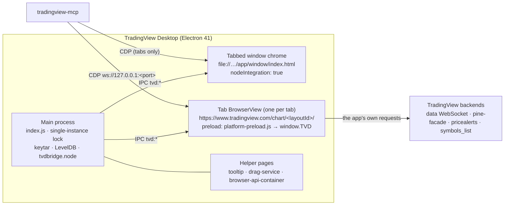

# Reverse Engineering Notes: TradingView Desktop

This document records how TradingView Desktop is built and how it can be controlled from outside the process.
It is the technical foundation for `tradingview-mcp`: every tool in the server maps to one of the mechanisms
described here, and every fallback chain follows the tier model in [§9](#9-fallback-strategy).

> **Scope and ethics.** The analysis only covers the locally installed app and its own logged-in session.
> Nothing here bypasses authentication, paywalls, or plan limits, and nothing calls TradingView servers directly:
> all network activity described below is performed _by the app itself_. TradingView internals are undocumented
> and can change without notice. This project is not affiliated with TradingView.

## Contents

1. [Method and evidence](#1-method-and-evidence)
2. [Application architecture](#2-application-architecture)
3. [Control channel: Chrome DevTools Protocol](#3-control-channel-chrome-devtools-protocol)
4. [Page-context entry points](#4-page-context-entry-points)
5. [DOM selectors](#5-dom-selectors)
6. [Feature-to-mechanism matrix](#6-feature-to-mechanism-matrix)
7. [Plan limits](#7-plan-limits)
8. [Stability risks](#8-stability-risks)
9. [Fallback strategy](#9-fallback-strategy)
10. [Platform support and install detection](#10-platform-support-and-install-detection)
11. [Security considerations](#11-security-considerations)
12. [Open questions](#12-open-questions)
13. [Prior art](#13-prior-art)
14. [Reproducing the analysis](#14-reproducing-the-analysis)

---

## 1. Method and evidence

### 1.1 Analyzed build

| Item               | Value                                                                             |
| ------------------ | --------------------------------------------------------------------------------- |
| Desktop app        | TradingView Desktop **3.4.1** (build `3.4.1.8194`)                                |
| Bundle identifier  | `com.tradingview.tradingviewapp.desktop` (URL scheme `tradingview://`)            |
| Runtime            | Electron **41.7.1**, Chromium 146.0.7680.216, V8 14.6, CDP 1.3                    |
| User agent suffix  | `TradingView/3.4.1 … Electron/41.7.1 … TVDesktop/3.4.1`                           |
| Web app            | `https://www.tradingview.com/chart/<layoutId>/`, `BUILD_TIME` 2026-10-16T17:55:37 |
| Host OS            | macOS (Darwin 25.5), universal binary (x86_64 + arm64)                            |
| `app.asar` SHA-256 | `d85cda843523e29e83ba5ecc5eb5a660761c813d66386a387719504c79c6ec50`                |

The desktop shell and the web app version independently: the shell is 3.4.1, but the chart UI is the live
tradingview.com bundle, which was rebuilt two days before this analysis.

### 1.2 Techniques

| Technique                              | Tool                                                                | What it established                                                                                                         |
| -------------------------------------- | ------------------------------------------------------------------- | --------------------------------------------------------------------------------------------------------------------------- |
| Electron fuse inspection               | REA `inspect_electron_fuses`                                        | Which debugging switches the binary honors                                                                                  |
| Static application graph of `app.asar` | REA `analyze_javascript_application`                                | Main process, preloads, IPC channels, BrowserView usage                                                                     |
| CDP target discovery                   | REA `list_browser_targets`, `list_electron_targets`                 | Which renderers are reachable and how they are typed                                                                        |
| Passive page inspection                | REA `inspect_electron_page`                                         | Window-chrome DOM structure and scripts                                                                                     |
| Viewport capture                       | REA `capture_web_screenshot`                                        | That `Page.captureScreenshot` works on a tab's BrowserView                                                                  |
| Read-only runtime introspection        | CDP `Runtime.evaluate` probes                                       | Global objects, method names and arity, method bodies via `Function.prototype.toString`, values of side-effect-free getters |
| Bundle source search                   | CDP `Debugger.getScriptSource` (already-loaded scripts, no refetch) | Internal services, signatures, and data shapes                                                                              |
| Probe script and end-to-end suites     | `pnpm re:probe`, `TV_E2E=1 pnpm test:e2e`                           | Return shapes, timings and DOM facts the server relies on (sections marked "seen on the app")                               |

REA runtime tools are deliberately passive and never evaluate page JavaScript, so deeper introspection used small
read-only probes (see [§14](#14-reproducing-the-analysis)). The probes never invoked mutating methods. The only
side effects were: registering one inert webpack chunk ID to obtain the module registry ([§4.7](#47-webpack-module-registry)),
one symbol search for `AAPL` (identical to typing in the search box), and resolving the already-initialized replay API.

### 1.3 Evidence ledger

REA Evidence IDs are scoped to the analysis session; they are listed so findings can be traced back to the raw records.

| Finding                               | Evidence               | Type                                                 |
| ------------------------------------- | ---------------------- | ---------------------------------------------------- |
| Fuse states                           | `ev_dc6c0330…a59ccf`   | observed, shipped artifact                           |
| `app.asar` application graph (parent) | `ev_bb48e6e1…64fd07`   | derived, static (coverage partial; see limits below) |
| CDP page targets (https)              | `ev_f775eaf2…d939531f` | observed, runtime                                    |
| CDP page targets (file://)            | `ev_601333ca…1cb02665` | observed, runtime                                    |
| Window-chrome DOM                     | `ev_0249a2a3…c95a53`   | observed, runtime                                    |
| Chart viewport screenshot             | `ev_de72f97e…8cf563f`  | observed, runtime                                    |

Static coverage limits: the ASAR graph parsed 60 JavaScript files (1,908 modules) but relationship expansion for the
large bundles (`index.js`, the shell bundles, and the preloads) exceeded REA's result budget, so complete static facts
were retained on file nodes without expanded edges. Four unpacked native modules (`classic_level.node`,
`notificationstate.node`, `keytar.node`, `tvdbridge.node`) do not match the ASAR header hashes; this is expected for
binaries re-signed after packaging, and their bytes were treated as untrusted. Negative findings (for example "no
`remote-debugging` check") are bounded text searches of the named file, not proofs of absence.

---

## 2. Application architecture



### 2.1 Main process (`index.js`, 2.2 MB webpack bundle)

- Enforces a **single instance** with `app.requestSingleInstanceLock()`. A second launch hands its arguments to the
  running instance and exits, so a debug switch on a second launch is lost ([§3.3](#33-launching-with-the-debug-port)).
- Appends `disable-features=CalculateNativeWinOcclusion` to the Chromium command line.
- Honors `--options=clean`, which appears to wipe the default session's data at startup. **The launcher must never
  pass this switch.**
- Uses `BrowserView` heavily (26 references), plus `BrowserWindow` (20) and one `WebContentsView`.
- Ships native modules for credential storage (`keytar.node`), LevelDB persistence (`classic_level.node`),
  notification state, and a native bridge (`tvdbridge.node`).
- Reads `configs/config.json` (default host `https://www.tradingview.com/`, chart path `chart/`, window load timeout
  10 s, persistence autosave interval 5 min) and `configs/nav-rules.json` (navigation policy that routes URLs to
  in-place navigation, a new tab, a popup, or the external browser).
- The chart host can be overridden with the `TARGET_TVD_HOST` environment variable (preloads fall back to
  `https://www.tradingview.com/`). Not useful for us, but it explains the `TARGET_TVD_HOST` key in `localStorage`.

### 2.2 Renderers and preloads

| Renderer                                          | Isolation                                              | Preload                                             | Exposes                                            |
| ------------------------------------------------- | ------------------------------------------------------ | --------------------------------------------------- | -------------------------------------------------- |
| Chart tab (`https://www.tradingview.com/chart/…`) | `contextIsolation` on                                  | `platform-preload.js`, `target-tvd-host-preload.js` | `window.TVD` (35 members), `window.__SENTRY_IPC__` |
| Window chrome (`app/window/index.html`)           | **`nodeIntegration: true`, `contextIsolation: false`** | —                                                   | full Node.js (`require` is defined)                |
| Menu (`app/menu`)                                 | Node integration                                       | `menu-handler-preload.js`                           | `window.hideMenu()` → `tvd:hide-menu`              |
| Two-factor window                                 | —                                                      | `two-fa-preload.js`                                 | CSS only                                           |

`platform-preload.js` also injects CSS that hides web-only chrome (`.tv-header`, `.tv-footer`,
`.i-hidden-on-tvdesktop`), proxies `sessionStorage` through IPC, and applies the scrollbar theme.

### 2.3 IPC surface

The static graph recorded 125 IPC operations (32 literal channels, 64 dynamic). Literal channels all use the `tvd:`
prefix and follow a remote-service pattern (`tvd:tabbed-window`, `tvd:tabs-container`, `tvd:new-tab-service`,
`tvd:window-service`, `tvd:main-menu-service`, `tvd:settings-provider-service`, `tvd:auth-handler`,
`tvd:password-manager-service`, …) plus page-facing channels (`tvd:get-watchlist`, `tvd:layout-change`,
`tvd:reload-tab`, `tvd:focus-pine-editor`, `tvd:get-credentials`, …). `tradingview-mcp` does **not** use IPC: it is
privileged, mostly dynamic, and reachable only through the Node-enabled window chrome. Tab operations go through the
window chrome's DOM instead ([§5.6](#56-window-chrome-tabs)).

### 2.4 `window.TVD` (desktop bridge inside the chart page)

| Category            | Members                                                                                                          | Use in `tradingview-mcp`                         |
| ------------------- | ---------------------------------------------------------------------------------------------------------------- | ------------------------------------------------ |
| Read-only state     | `getTheme`, `getThemeSetting`, `getActiveWatchlistId`, `crosshairSyncEnabled`                                    | Allowed                                          |
| Shell actions       | `reloadTab`, `openNewWindow`, `openSettings`, `setTitle`, `layoutChange`, `layoutRestored`, `setFocusPineEditor` | `reloadTab` only, as a last-resort recovery step |
| **Credentials**     | `getCredentials`, `setCredentials`, `insertCredentialsText`, `signIn`                                            | **Never.** Also denylisted inside `ui_evaluate`  |
| Telemetry and debug | `log`, `sendToSentry`, `*AutosaveDialogDebug`, screen-capture hooks                                              | Never                                            |

---

## 3. Control channel: Chrome DevTools Protocol

### 3.1 Fuses

| Fuse                                    | State    | Implication                                                                        |
| --------------------------------------- | -------- | ---------------------------------------------------------------------------------- |
| `RunAsNode`                             | enabled  | `ELECTRON_RUN_AS_NODE` works (security note in [§11](#11-security-considerations)) |
| `EnableCookieEncryption`                | disabled | —                                                                                  |
| `EnableNodeOptionsEnvironmentVariable`  | enabled  | —                                                                                  |
| `EnableNodeCliInspectArguments`         | enabled  | `--inspect` would be honored for the main process (not used)                       |
| `EnableEmbeddedAsarIntegrityValidation` | disabled | —                                                                                  |
| `OnlyLoadAppFromAsar`                   | disabled | —                                                                                  |
| `GrantFileProtocolExtraPrivileges`      | enabled  | —                                                                                  |

`--remote-debugging-port` is a Chromium switch that no fuse governs, and a bounded search of `index.js` found no
code that inspects or strips it. The analyzed instance was running with `--remote-debugging-port=9222`, and every
renderer was reachable. **Renderer CDP is the primary control channel.** The main-process Node inspector is
intentionally unused: it would grant more privilege than needed.

### 3.2 Targets exposed on the debug port

| Target                                                                                      | Type     | Notes                                                                                   |
| ------------------------------------------------------------------------------------------- | -------- | --------------------------------------------------------------------------------------- |
| `https://www.tradingview.com/chart/<layoutId>/`                                             | `page`   | One per tab (BrowserView). **The primary target.**                                      |
| `file://…/app.asar/app/window/index.html?rendererInitialData=…`                             | `page`   | Window chrome with the tab strip; `remoteServiceInstanceId` ends in `tvd:tabbed-window` |
| `file://…/app/tooltip/…`, `…/renderer-services/drag-service/…`, `…/browser-api-container/…` | `page`   | Helpers; ignore                                                                         |
| Two pages with an empty URL and title                                                       | `page`   | **`Runtime.evaluate` never returns** (no execution context). Must be skipped.           |
| doubleclick, reCAPTCHA, googlesyndication                                                   | `iframe` | Ads and anti-abuse frames inside the chart page; ignore                                 |
| Service worker                                                                              | `worker` | Ignore                                                                                  |

A later run listed the same kinds: one chart tab, the window chrome, three helpers, two blank pages, the ad and
anti-abuse iframes, and one or two workers. Every `webSocketDebuggerUrl` was `ws://127.0.0.1:9222/devtools/page/<id>`.
The window chrome's `rendererInitialData` holds a random `remoteServiceInstanceId` (`<hex>-tvd:tabbed-window`) and
title bar flags, nothing about the user; the chart tab's title is the generic "Live stock, index, futures, Forex and
Bitcoin charts on TradingView".

**Target selection rule:** `type === "page"` and the URL matches `^https://([a-z0-9-]+\.)?tradingview\.com/chart/`.
When several tabs exist, prefer the one whose `document.visibilityState === "visible"` (the only tab observed reported
`visible`; behavior with several tabs is still to be verified, see [§12](#12-open-questions)). **Every CDP call needs a
timeout**, because unresponsive targets otherwise hang the client.

### 3.3 Launching with the debug port

- macOS: spawn `/Applications/TradingView.app/Contents/MacOS/TradingView --remote-debugging-port=<port>` detached.
  `open -a TradingView --args …` drops the arguments when the app is already running.
- Because of the single-instance lock, launching while TradingView already runs **without** the flag does nothing
  useful. The launcher must detect that state (process list plus a port probe), and restart the app only with explicit
  consent (`restart: true`), using a graceful quit first.
- Readiness is a two-step check: `GET /json/version` answers, then a chart target exists where
  `window.TradingViewApi` is defined and `TradingViewApi.isConnected()` returns `true`.
- The `User-Agent` of `/json/version` names the app (`TradingView/` and `TVDesktop/`). Another browser that holds the
  port, such as a Chrome started with a debug port of its own, names neither, even with a chart of tradingview.com in
  one of its tabs, so the server takes the port for the app only when one of them is there.
- The debug port binds to loopback by default (observed: `127.0.0.1:9222` only, via `lsof`). The launcher must never
  pass `--remote-debugging-address`.

---

## 4. Page-context entry points

All paths below are evaluated inside the chart page through `Runtime.evaluate`.

### 4.1 Globals of interest

| Global                           | Kind                    | Purpose                                                                                                                                                                                                                  |
| -------------------------------- | ----------------------- | ------------------------------------------------------------------------------------------------------------------------------------------------------------------------------------------------------------------------ |
| `TradingViewApi`                 | object (64 own members) | Superset of the Charting Library / Trading Platform widget API. **Main entry point.**                                                                                                                                    |
| `_exposed_chartWidgetCollection` | object                  | All chart widgets of the layout, layout type, locks, fullscreen, snapshots                                                                                                                                               |
| `TVD`                            | object                  | Desktop bridge ([§2.4](#24-windowtvd-desktop-bridge-inside-the-chart-page))                                                                                                                                              |
| `TradingView`                    | object                  | `headerToolbar`, `bottomWidgetBar` (no registered widgets at observation time), `isFeatureEnabled`, `defaultProperties`                                                                                                  |
| `widgetbar`                      | object                  | Right-hand widget bar: `watchlist`, `alerts`, `object_tree`, `datawindow`, `pine_logs`, `hotlist`, `news`, `detail`                                                                                                      |
| `getQuoteSessionInstance()`      | function                | Quote session multiplexer of a type (`full` by default). **Creates** it, with a data session, when it does not exist; existing ones are read with the export `getQuoteSessionNoEnsure` ([§4.8](#48-chartapi-and-quotes)) |
| `studyMarket`                    | object                  | The "Indicators, metrics, and strategies" dialog (`show`, `hide`, `visible`)                                                                                                                                             |
| `TVSettings`, `TVLocalStorage`   | objects                 | App settings and namespaced storage (`getValue`, `getJSON`, `getItem`, …)                                                                                                                                                |
| `webpackChunktradingview`        | array                   | Webpack JSONP chunk list; gateway to the module registry ([§4.7](#47-webpack-module-registry))                                                                                                                           |
| `TVScript`                       | object                  | Pine version helpers (`TranslatorLastVersion`, `extractVersion`, `canUpgradeVersion`)                                                                                                                                    |
| `is_authenticated`, `user`       | boolean, object         | Session identity. **Never returned by any tool.**                                                                                                                                                                        |

### 4.2 `TradingViewApi`

Signatures below come from method bodies; parameters marked `?` are optional.

| Domain        | Members                                                                                                                                                                                                                                                                                                                                             |
| ------------- | --------------------------------------------------------------------------------------------------------------------------------------------------------------------------------------------------------------------------------------------------------------------------------------------------------------------------------------------------- |
| Charts        | `activeChart()`, `chart(index = 0)`, `charts()`, `chartsCount()`, `activeChartIndex()`, `setActiveChart(index)`, `changeSymbol(symbol, interval, onLoaded?)`, `getSymbolInterval(cb?) → {symbol, interval}`, `getIntervals()`, `supportedChartTypes()`                                                                                              |
| Layout        | `layout()` (for example `"s"`), `setLayout(type, {withUndo}?)`, `layoutName()`, `layoutId()`, `getSavedCharts(cb?) → Promise<records>`, `loadChartFromServer(record)`, `loadLayoutFromServerByLayoutId(id, …)`, `createNewLayout(name) → layoutId \| null`, `saveChartToServer(onOk?, onFail?, opts?)`, `hasChartChanges()`, `unloadUnusedCharts()` |
| Sub-APIs      | `replayApi() → Promise<ReplayApi>`, `pineEditorApi()`, `alerts()`, `alertService()`                                                                                                                                                                                                                                                                 |
| Search        | `searchSymbols({text, exchange, type}) → {symbols_remaining, symbols[]}`                                                                                                                                                                                                                                                                            |
| Drawing state | `selectLineTool(name, …)`, `selectedLineTool()`, `hideAllDrawingTools()`, `lockAllDrawingTools()`, `hideAllIndicators()`, `drawOnAllCharts(bool)`                                                                                                                                                                                                   |
| History       | `undo()`, `redo()`, `undoRedoState()`, `clearUndoHistory()`                                                                                                                                                                                                                                                                                         |
| View          | `startFullscreen()`, `exitFullscreen()`, `takeClientScreenshot(opts?)` (local render), `takeScreenshot()` (server snapshot)                                                                                                                                                                                                                         |
| Connection    | `isConnected()`, `connect()`, `disconnect()`, `onConnectionStatusChanged(cb)`                                                                                                                                                                                                                                                                       |
| Events        | `subscribe(event, cb)`, `unsubscribe(event, cb)`                                                                                                                                                                                                                                                                                                    |

`getIntervals()` merges the default resolutions of the data connection with the user's custom ones. The
analysis account got 30: ticks (`1T`, `10T`, `100T`, `1000T`), seconds (`1S` to `45S`), minutes (`1` to `240`), `1D`,
`1W`, months (`1M` to `12M`) and ranges (`1R` to `1000R`). Whether the plan offers each one is a separate question.

`searchSymbols({text, serverHighlight: false})` sends one request to the symbol search service and answers
`{symbols, symbols_remaining}`. Seen on the app for `AAPL`: 50 items and a numeric `symbols_remaining`. An item has
`symbol`, `description`, `exchange`, `type`, `typespecs`, `currency_code`, `country`, `provider_id`, `source_id`,
`source2`, `logo`, `logoid`, `source_logoid`, `currency-logoid`, `base-currency-logoid`, `is_primary_listing`, `isin`,
`cusip`, `cik_code`, `found_by_isin`, `found_by_cusip` and, on some items, `prefix`; it has no `full_name`. The NASDAQ
listing of AAPL has no `prefix` (its `exchange` is `NASDAQ`), so the symbol to set is `(prefix || exchange):symbol`, as
the search dialog builds it. With `serverHighlight: false` (`hl=0`) no symbol or description held markup.

**Disabled or stubbed in this build** (observed from method bodies):

| Member                                                               | Behavior                                                          | Replacement                                                           |
| -------------------------------------------------------------------- | ----------------------------------------------------------------- | --------------------------------------------------------------------- |
| `activeChart().exportData()`                                         | `Promise.reject("Data export is not supported")`                  | Read `mainSeries().bars()` ([§4.4](#44-chart-model-internals))        |
| `activeChart().setVisibleRange()`                                    | throws `Error("Not implemented")`                                 | Core time scale `zoomToBarsRange` ([§4.4](#44-chart-model-internals)) |
| `watchlist()`, `widgetbar()`, `getStudiesList()`, `getStudyInputs()` | delegate to an internal stub                                      | Webpack services or DOM                                               |
| `alertService()`                                                     | returns `null` (constructor-injected service absent on this page) | Alerts REST service ([§4.7](#47-webpack-module-registry))             |
| `takeScreenshot()`                                                   | uploads a snapshot to TradingView servers                         | Local capture only                                                    |

### 4.3 Chart widget API (`activeChart()`)

| Area          | Members                                                                                                                                                                                                                                                                                                          |
| ------------- | ---------------------------------------------------------------------------------------------------------------------------------------------------------------------------------------------------------------------------------------------------------------------------------------------------------------- |
| Read state    | `symbol()`, `symbolExt() → {symbol, full_name, exchange, description, type, pro_name, typespecs, delay}`, `resolution()`, `chartType()` (`1` = candles), `marketStatus()`, `getVisibleRange() → {from, to}` (Unix seconds), `getVisibleBarsRange()`, `getVisiblePriceRange()`, `getTimezone()`, `replayStatus()` |
| Change state  | `setSymbol(symbol, {dataReady?, doNotActivateChart?})`, `setResolution(res, {…})`, `setChartType(type)`, `setTimeFrame({val, res})`, `setTimezone(tz)`, `executeActionById(id)`                                                                                                                                  |
| Studies       | `getAllStudies() → [{id, name}]`, `getStudyById(id) → IStudyApi`, `createStudy(name, forceOverlay, lock, inputs, overrides, options)`, `removeEntity(id, {disableUndo}?)`, `removeAllStudies()`                                                                                                                  |
| Drawings      | `getAllShapes() → [{id, name}]`, `getShapeById(id) → ILineDataSourceApi`, `createShape(point, options)`, `createMultipointShape(points, options)`, `createAnchoredShape(position, options)`, `removeAllShapes()`, `getLineToolsState()`                                                                          |
| Structure     | `getPanes() → IPaneApi[]`, `getSeries()`, `getTimeScale()`, `chartModel()`, `chartWidget()`                                                                                                                                                                                                                      |
| Subscriptions | `onDataLoaded()`, `onSymbolChanged()`, `onIntervalChanged()`, `onVisibleRangeChanged()`, `onChartTypeChanged()`, `crossHairMoved()`, `dataReady(cb)`, `whenChartReady(cb)`                                                                                                                                       |

Seen on the app (probe script, chart-change experiments with an exact restore, and the end-to-end suites):

- `symbol()` is the `full_name` of the series' symbol info, which names the exchange of the **data feed**: on an
  account whose US stock data comes from Cboe, `setSymbol("NASDAQ:AAPL")` ends on `BATS:AAPL` while `pro_name` stays
  `NASDAQ:AAPL`. Right after `setSymbol`, `symbol()` returns the text as it was set, and changes to the feed's name
  once the symbol is resolved. (For illustration only: a delayed feed adds `_DLY` to the exchange, as in
  `BATS_DLY:AAPL`, which the symbol info of AAPL lists among its `alternatives`; AAPL itself was seen as `BATS:AAPL`.)
- `setSymbol(symbol, {dataReady})` returns a promise. When `symbol` equals `symbol()` or the series "resolved" it
  already (`symbolSameAsResolved`, which matched both `NASDAQ:AAPL` and `BATS:AAPL` while `BATS:AAPL` was shown), it
  calls `dataReady` at once and loads nothing. Otherwise it activates the chart unless `doNotActivateChart` is given,
  and calls `dataReady` once the series has loaded (about 350 ms for a new symbol). A bare ticker of the symbol shown
  (`AAPL`) is loaded again and also ends in `dataReady`. For a symbol that does not exist, `dataReady` never comes; the
  series flags it about 150 ms after the call, and the promise then resolves with `true` all the same.
- `getVisibleRange()` answers `{from, to}` in the chart's **public time**: for daily and longer bars the bar's day at
  00:00 UTC, while `bars().valueAt()` holds the start of the session (13:30 UTC for a US stock); intraday bars have
  the same time in both. `from` is the first visible bar, kept at or after the first time point. `to` is the last
  visible index, which lies in the future while the view keeps empty space after the last bar (the default view of
  the analyzed chart reached dozens of bars past it). While the chart has no range (a symbol loading, an unknown
  symbol) it answers `{from: 0, to: 0}`.
- `_convertIndexToPublicTime(index)` (internal) is the conversion `getVisibleRange` uses. It answers for the time
  points after the last bar too, and `null` while the series has no symbol info.
- `setResolution` activates the chart unless `doNotActivateChart` is given, changes `resolution()` at once and calls
  `dataReady` after the data (200 to 550 ms), or at once, changing nothing, when the resolution is unchanged or cannot
  be normalized. `setChartType` changes `chartType()` at once and returns a promise that settles once the style is
  drawn (4 ms for line, about 400 ms for Heikin Ashi).
- `getAllShapes()` answers `{id, name}` with the tool type as `name` (`rectangle`, `horizontal_line`, `text`), and
  `getAllStudies()` answers `{id, name}` with the study title as `name` and six-character ids. Neither carries the
  text of a drawing.

`createStudy(nameOrDescriptor, forceOverlay, lock, inputs, overrides, options)` takes two kinds of first argument
(method bodies):

- A **name** is matched, lower-cased, against the `description` of the built-in (Java) studies of the metadata
  repository ([§4.4](#44-chart-model-internals)), hidden ones included and the first match winning, never against
  standard Pine scripts. The indicators the indicator dialog inserts (RSI, MACD, moving averages, Bollinger Bands, …)
  are standard Pine scripts, so their names match only hidden legacy Java studies. `options.checkLimit` applies the
  plan's indicator limit: on a full chart the app shows a warning dialog and `createStudy` resolves `null`.
- A **descriptor**, `{type: "java", studyId}` or `{type: "pine", pineId, pineVersion}`, ignores every other argument,
  `checkLimit` included. It runs `canCreateStudy` itself and, on a full chart, opens the app's paywall dialog and
  rejects with `"Failed to create study"`. Some studies open an inputs dialog and wait for the user (`Overlay`,
  `Correlation Coeff`, `Spread`, `Ratio`, and any study with an input marked `confirm: true`).

`canCreateStudy({id})` of the undo-aware chart model (`activeChart()._chartWidget.model()`) is the app's own check and
changes nothing: `{success: true}`, or `{success: false, reason, limitValue?}` with `reason` `general` (the indicator
limit), `child`, `fundamental` or `forecast`. Seen on the app on a chart at its limit of 2:
`{success: false, reason: "general", limitValue: 2}` for an empty id and for an unknown one (both count like any study),
while `Volume@tv-basicstudies`, which does not count, passed. **`tradingview-mcp` checks the limit itself first**
(`canCreateStudy` and the plan limit) and fails with `PLAN_LIMIT` before the app can open a dialog: on that chart
`indicator_add` failed so, and no study and no dialog was added. It inserts a standard Pine script by its descriptor,
with the version from the list of standard scripts ([§4.6](#46-pine-script)), passes `checkLimit: true` when it adds a
built-in by name, and refuses studies that need the inputs dialog.

- `IStudyApi`: `getInputValues()`, `setInputValues([{id, value}])`, `getInputsInfo()`, `getStyleValues()`,
  `isVisible()`, `setVisible(bool)`, `applyOverrides()`, `title()`, `paneIndex()`, `hasError()`, `isLoading()`,
  `status()`, `mergeUp()`/`mergeDown()`, `onDataLoaded()`, `onStudyError()`.
- `ILineDataSourceApi`: `getPoints()`, `setPoints()`, `getProperties()`, `setProperties()`, `isHidden()`,
  `setVisible()`, `bringToFront()`, `sendToBack()`, `isUserEditEnabled()`, `isSavingEnabled()`, `symbol()`.
- `IPaneApi`: `getAllEntities()`, `getHeight()`, `setHeight()`, `collapse()`, `restore()`, `setMaximized()`,
  `moveTo()`, `paneIndex()`, `getMainSourcePriceScale()`, `hasMainSeries()`.

### 4.4 Chart model internals

The model is reachable at `activeChart()._chartWidget.model()` (verified). The public accessors `chartWidget()` and
`chartModel()` likely return the same objects (to be verified). Property names are not minified, which makes these paths
more stable than their underscore prefix suggests.

| Path                                 | Returns                                                                                                                                                                                                                                                                                                                                           |
| ------------------------------------ | ------------------------------------------------------------------------------------------------------------------------------------------------------------------------------------------------------------------------------------------------------------------------------------------------------------------------------------------------- |
| `….model().mainSeries().bars()`      | Bar container: `size()`, `firstIndex()`, `lastIndex()`, `valueAt(i) → [time, open, high, low, close, volume]`, `search(time)`, `range()`, `each()`                                                                                                                                                                                                |
| `….mainSeries().symbolInfo()`        | 51 fields: `name`, `full_name`, `pro_name`, `exchange`, `listed_exchange`, `description`, `type`, `typespecs`, `currency_code`, `pricescale`, `minmov`, `pointvalue`, `session`, `subsessions`, `timezone`, `has_intraday`, `has_extended_hours`, `is_replayable`, `variable_tick_size`, `isin`, …                                                |
| `….mainSeries().quotes()`            | Live quote, the shared object itself (copy fields out), `null` while the series has no data: `last_price`, `change`, `change_percent`, `volume`, `bid`, `ask`, `bid_size`, `ask_size`, `open_price`, `high_price`, `low_price`, `prev_close_price`, `lp_time` (Unix seconds), `currency_code`, about 1,400 keys in all, most of them fundamentals |
| `….model().model().getStudyById(id)` | Study core, also reached as `activeChart().getStudyById(id).study()`: `data()` (rows `[time, plot_0, …, plot_n]`, pre-history rows included, below), `metaInfo().plots` (`{id, type}`), `graphics()` (Pine drawings), `tables()` (Pine tables), `logs()` (Pine logs), `isPine()`, `hasCompileError()`, `performance()`                            |
| Strategy study core                  | `reportData() → {performance: {all: {netProfit, totalTrades, numberOfWiningTrades, largestWinTrade, …}}, currency, position, filledOrders, …}`, `ordersData()` (= `filledOrders`), `barsIndexes()`                                                                                                                                                |
| `….model().model().timeScale()`      | Core time scale: `zoomToBarsRange(from, to)`, `scrollToBar(index)`, `scrollToRealtime()`, `scrollToFirstBar()`, `setBarSpacing()`, `setRightOffset()`, `timePointToIndex(time)`, `indexToTimePoint(i)`, `logicalRange()`, `requestMoreHistoryPoints()`                                                                                            |

Observed: 300 bars were loaded for a daily chart. Older history loads on demand (`requestMoreData`, or scrolling).

Seen on the app (probe script and chart-change experiments with an exact restore):

- `bars()`: indices run from `firstIndex()` 0 to `lastIndex()` `size() - 1`; `valueAt(i)` answers six numbers, and
  `null` outside that range or for a fractional index. The time in a row is the start of the bar's session, not the
  public time `getVisibleRange` reports ([§4.3](#43-chart-widget-api-activechart)).
- `symbolInfo()` is `null` from the moment a symbol is set until it is resolved, and stays `null` for a symbol that
  does not exist; it has 51 keys otherwise (`corrections` is present but undefined).
- `isSymbolInvalid()` exists on the main series: `this._status.value().seriesStatus === Status.InvalidSymbol`, a
  boolean. `status()` read 2 while loading, 3 once a new symbol had loaded, 4 for an invalid symbol, and 9 on a chart
  loaded at startup. While the flag is up the series has no bars.
- The time scale keeps time points after the last bar for the empty space a chart shows there:
  `points().range().value()` answered `{firstIndex: 0, lastIndex}` with dozens of points past the last bar.
  `indexToTimePoint(i)` answers for them too.
- `logicalRange()` answers an object with `left()` and `right()` (own fields `_left`, `_right`), the first and the
  last bar index of the view, fractional; `right()` passes the last bar while the view keeps empty space. It has no
  `from` or `to`.
- `timePointToIndex(time, mode?)`, in the time base of the bar rows: the default mode answers the index of the first
  time point at or after `time` (a time between two bars gives the later one), the first index for an earlier time,
  and the last time point for a later one; a number, `null` only without points.
- `zoomToBarsRange(i, j)` ignores `j < i`. Otherwise it sets the right offset to `j - baseIndex()` and the bar spacing
  to fit bars `i` to `j`, so the logical range becomes exactly `[i, j]` and `getVisibleRange()` the public times of
  bars `i` and `j`, a future `j` included. `zoomToBarsRange(i, i)` shows bars `i - 1` and `i`.
- `barSpacing()`, `rightOffset()`, `setBarSpacing()` and `setRightOffset()` set a view exactly: the logical range
  spans `width() / barSpacing() - 1` bars and ends `rightOffset()` bars past the bar at `baseIndex()`.
  `preserveBarSpacing` was off, so `setBarSpacing` saved no default. The width of the time scale follows the price
  axis, which TradingView resized by itself after a change of symbol (20 px narrower in one run, likely a label of
  the axis that went away), so the same bar spacing can show other bars later; the same bars need
  `width() / (right - left + 1)`.
- `timeScale().state()`, what a layout stores of the view, holds `m_barSpacing`, `m_rightOffset`,
  `rightOffsetPercentage` and `usePercentageRightOffset`, not a range. When the window gets narrower or wider (a move
  to a display of another width), TradingView keeps the bar spacing and the right offset, so the right edge stays
  and the left edge shows more or fewer bars.
- Older history: `mainSeries().requestMoreData(count)` asks for `count` older bars and returns nothing; no promise
  says when they arrive. Right after the call, in the same task, `isLoading()` is true and
  `requestMoreDataAvailable()` false. The 20 bars asked for arrived, after which `requestMoreDataAvailable()` was true
  again, `endOfData()` false and `endOfDataType()` `null`; `data_get_ohlcv`, asked for 20 bars more than were
  loaded, answered in 0.2 to 0.4 s. A call is a silent no-op unless the series is ready, laid out and takes a request.
  Once, while the Mac was in maintenance sleep, a request brought neither a bar nor an end flag, and the series took
  no further request. The loaded bars stay until the chart loads again. What `endOfDataType()` says at the plan's
  `HISTORICAL_BARS` cap is not known: only `"end"` (the first bar of the symbol) appears in the client, and the cap
  was not reached.
- Study rows (`data()` of a study core) use the indices of `bars()`, slot 0 holding the bar time, and also hold
  pre-history rows at indices `<= -1e6` (`UNPLOTTABLE_TIME_POINT_INDEX`): 100 rows from -1000100 to -1000001 on a
  chart with 300 bars, so `data().firstIndex()` is about -1e6 and `size()` exceeds the bar count. Iterate
  `rangeIterator(firstPlottableIndex(), lastIndex())`.
- `graphics()` exists on the Pine studies of the analysis chart. Every collection of it (`dwglines()`, `dwglabels()`,
  `dwgboxes()`, `dwgpolylines()`, `dwgtables()`, `dwgtablecells()`, `dwglinefills()`) was an empty `Map`, and
  `metaInfo().graphics` was `{}`. The X of a drawing is a time-point index: `indexToTimePoint(x)` equaled
  `bars().valueAt(x)[0]` on loaded indices, and answers for the points after the last bar too. The items themselves
  and the ids of tables and cells were not seen: no study on the chart draws, and none could be added.
- The study metadata repository (export `studyMetaInfoRepository()`) was ready (`isReady()`), and
  `getInternalMetaInfoArray()` holds what `findAllJavaStudies()` answers without a request once it is: 246 built-in
  studies, 159 of them hidden. An item has `id` (`<Name>@<package>`), `description`, `shortDescription`,
  `description_localized`, `is_price_study`, `shortId`, `packageId`, `productId`, `fullId`, `version`, `format`,
  `inputs`, `plots`, `graphics`, `defaults` and `palettes`, sometimes `is_hidden_study`, `styles`, `bands`,
  `linkedToSeries` and `extra`, and never `pine` or `scriptIdPart`.

### 4.5 Replay API (`await TradingViewApi.replayApi()`)

| Group         | Members                                                                                                                                                                                                                                      |
| ------------- | -------------------------------------------------------------------------------------------------------------------------------------------------------------------------------------------------------------------------------------------- |
| Availability  | `isReplayAvailable()` (watched value, `true` on a daily chart), `isReadyToPlay()`, `replayResolutions()`, `currentReplayResolution()`                                                                                                        |
| Lifecycle     | `selectDate(unixMs)` (enables replay mode, then selects the date), `selectFirstAvailableDate()`, `selectRandomDate()`, `stopReplay()`, `goToRealtime()`, `leaveReplay({skipConfirm, onLeave})`, `showReplayToolbar()`, `hideReplayToolbar()` |
| Playback      | `doStep()`, `toggleAutoplay()`, `isAutoplayStarted()`, `changeAutoplayDelay(ms)`, `autoplayDelayList()` (100 ms to 10 s, labeled 10x to 0.1x), `currentDate()`, `isReplayStarted()`                                                          |
| Paper trading | `buy(qty)`, `sell(qty)` (market orders in the replay trading model), `closePosition()`, `position()`, `realizedPL()`, `currency()`                                                                                                           |

Many getters return watched values; read them with `.value()`.

### 4.6 Pine Script

**`TradingViewApi.pineEditorApi()`**: `listSavedScripts()`, `getSource(scriptId, version)`, `getVersionList(id)`,
`compileScript(scriptId, version)` (compiles a _saved_ script), `open(opts?)` (lazy-loads the editor chunk and opens
it), `getBottomFacade()` / `getDialogFacade()` (facade of an open editor, or `null`), `saveNewScript({source, name})`,
`saveExistingScript({scriptIdPart, source, name})`, `renameScript()`, `deleteScript()`, `openedScripts()`.
Both save methods check the plan's paywall before writing.

**Editor facade** (registered per placement through `registerOpenPineEditor(placement, {getFacade})`):

| Member                                                      | Behavior                                                                                   |
| ----------------------------------------------------------- | ------------------------------------------------------------------------------------------ |
| `awaitEditorReady()`                                        | Resolves when the Monaco editor is mounted                                                 |
| `openNewScript(type = "indicator")`                         | Opens a template (`indicator`, `strategy`, `library`) and clears the console               |
| `setScript(source)`, `setNewScript(source)`                 | Replace the editor content                                                                 |
| `getSource()`                                               | Current editor text                                                                        |
| `addToChart()`                                              | Compile and add; picks the new-draft, unsaved-version, or saved-version path automatically |
| `updateOnChart()`                                           | Recompile an existing script on the chart                                                  |
| `saveScript(name?)`                                         | Save (requires sign-in; plan limits apply)                                                 |
| `openScript({scriptIdPart, …}, line?)`, `openLastOrDraft()` | Open saved scripts                                                                         |
| `isModified()`, `isDraft()`, `getScriptIdVersion()`         | Editor state                                                                               |

The editor state is a Redux Toolkit store. Compile and save thunks return `{compileErrors, metaInfo, success}`, and
console messages persist in `TVLocalStorage` under `console_messages_key` (next to `editor_console_open` and
`detached_window`). The Pine Editor button is `[data-name="pine-dialog-button"]`.

**Compile-only path:** the module exporting `translateScriptAsync` compiles raw source through the app's own
`pineFacadeFetch` (POST `translate_source/…`) without touching the chart. It is reachable only through the module
registry (Tier 2).

Seen on the app (probe scripts and the end-to-end suites; ids, flags and shapes only):

- **Placement.** The Pine button opens the editor as the right-hand side panel `pine`, whose facade registers as
  `"dialog"` (`getOpenPineEditor("dialog")`); the export `pineDialogOpenState` says whether it is on screen
  (`isVisibleWV()`). The bottom placement (`"bottom"`, the `scripteditor` widget) is still in the code.
- **Closing.** `service(PAGE_LAYOUT_SERVICE).closeSidePanel("pine")` closes the panel, and the editor leaves the
  registry: `getOpenPineEditor("dialog")` answers `null` again.
- **What an open shows.** The first open of a session shows the script the editor last held (`openLastOrDraft`, from
  `last_edited_script`). An open after the editor was closed shows a new script from the template instead, unless
  unsaved changes were kept, which always come back.
- **Unsaved changes kept.** Kept unsaved text comes back as the text of the script: `isModified()` is false although
  the text differs from the saved script, and only the flag `has_unsaved_modifications` says it is unsaved. The flag
  is written when the editor unmounts or closes, under its bare key and the account name, and the app reads it with
  `getPersistedValue(hasScriptModificationsKey, true)`. While the editor is open it lags: after `pine_open` replaced
  unsaved text, it stays set until the editor closes. The tools count the editor as modified when `isModified()` or
  the flag says so.
- **Persisted keys.** `last_edited_script` (the id, version, name, title and text of the script),
  `has_unsaved_modifications`, `last_edited_script_position`, `last_edited_script_view_state` and
  `console_messages_key`, each a JSON object keyed by the account name, under bare keys for the side panel (the bottom
  placement prefixes `bottom_`). The copy of `last_edited_script` the app wrote again on a close had other line breaks
  than before, its text otherwise the same.
- **Ready.** `getSource()` of the facade throws until Monaco is mounted, and answers the text after that.
- **Console.** An entry of the store's `console.messages` is `{level, text, time}`, `time` a local clock time without a
  date (`toLocaleTimeString()`, such as `9:41:07 PM`). `openNewScript()` (`pine_new`) clears the console and its
  persisted copy. Compile-only writes nothing to the console: two compilations of the editor's text left it at its
  one entry.
- **Templates name the account:** the template of a new script holds `// © <username>` (`getScriptTemplate`), which
  tests and logs must never print.

**Script lists** (seen on the app, key names and types only):

- `requestUserScripts()` (`GET list?filter=saved`, kept by the app until a save, delete, rename or login change):
  `scriptIdPart`, `scriptName`, `scriptTitle`, `version` (`"major.minor"`), `modified` (a number of seconds, Unix
  time), `scriptSource`, `isTVScriptBuiltIn` and `extra` (`kind`, `is_price_study`, `isCompiled`,
  `sourceInputsCount`, `stats`). The kind is `extra.kind` (`study`, `strategy` or `library`); there is no top-level
  `kind`.
- `requestBuiltinScripts()` (`GET list?filter=standard`, a request on every call): 145 standard scripts with
  `scriptIdPart` (`STD;…`), `scriptName`, `scriptSource`, `version`, `lastVersionMaj`, `scriptAccess`, `userId` and
  `extra` (`kind`, `shortDescription`, `isBuiltIn`, `isAuto`, `isBeta`, `isNew`, `isUpdated`, `isChartPattern`,
  `isCompiled`, `isMTFResolution`, `isPineEditorNewTemplate`, `is_price_study`, `sourceInputsCount`, `stats`,
  `tags`), and no `scriptTitle`: the short name is `extra.shortDescription` (`RSI` for `Relative strength index`, as
  TradingView spells it). Two modules export the name; the first, which a lookup by name finds, is the legacy one,
  and both send the same request.

**Compile results** (seen on the app, compile-only of synthetic scripts): `translateScriptAsync` answers
`{success, metaInfo, compileErrors: {errors, warnings}}`. A diagnostic has a `message` whose `{name}` placeholders
are filled from its `ctx`, a `code`, and `start` and `end` (`{line, column}`):

- Lines and columns are 1-based, columns count UTF-16 code units, and `end.column` is inclusive: `plot(clse)` on line
  3 gives 3:6 to 3:9. A name after `"é" + ` starts at the column it has after `"\t" + ` (11), and after `"😀" + ` one
  column later (12).
- A tab that indents a line at the top level makes the compiler report the first word of the line (columns 2 to 5
  for `plot`).
- `Undeclared identifier "{identifier}"` (code `CE10272`) is reported for every undeclared name.
- A call of a Pine v4 name that version 6 removed (`study(`, `rsi(`) gives `Could not find {kind} '{fullName}'` (code
  `CE10271`, kind `function or function reference`), after which the compiler reports nothing more.
- A script without `//@version` compiles as Pine v1, where `study` and `rsi` exist, with one warning at 1:1 (without
  an end) saying so.

### 4.7 Webpack module registry

Several capabilities (alerts, watchlists, compile-only Pine, plan limits) live in webpack modules with no global
handle. The registry can be reached read-only:

```js
let req;
window.webpackChunktradingview.push([
  [`tvmcp_${Date.now()}`],
  {},
  (r) => {
    req = r;
  },
]);
// req.m: module factories (8,947 observed), req.c: instantiated module cache (6,903 observed)
```

Rules for `tradingview-mcp`:

1. Locate modules by **export name** in `req.c` (export names are preserved in production bundles). Never hardcode
   module IDs; they change with every web build.
2. Only read exports from `req.c`. Never call `req(id)` for a module that is not cached, because that executes its
   factory.
3. Cache resolved handles per page load, and re-resolve after navigation.

| Export name                                                                                                                                               | Provides                                                                                                                                                                                                                                         |
| --------------------------------------------------------------------------------------------------------------------------------------------------------- | ------------------------------------------------------------------------------------------------------------------------------------------------------------------------------------------------------------------------------------------------ |
| `getAlertsRestApi()`                                                                                                                                      | Alerts REST client: `listAlerts`, `getAlerts`, `createAlert`, `modifyRestartAlert(s)`, `deleteAlerts`, `stopAlerts`, `restartAlerts`, `cloneAlerts`, `listFires`, `deleteFires` (endpoints `/list_alerts`, `/create_alert`, `/delete_alerts`, …) |
| `ChartAlertsFacade`                                                                                                                                       | Chart-level alert helpers (`getAlerts`, `deleteAlert(s)`, `restartAlert`, `getAlertSync`)                                                                                                                                                        |
| `translateScriptAsync`, `translateScriptAsync2`, `requestUserScripts`, `getPineSourceCode`, `saveNew`, `saveNext`, `getVersions`, `requestBuiltinScripts` | Pine facade client                                                                                                                                                                                                                               |
| `getOpenPineEditor(placement)`                                                                                                                            | Registry of open editors (`"bottom"`, `"dialog"`)                                                                                                                                                                                                |
| `pineDialogOpenState`                                                                                                                                     | Whether the Pine Editor side panel is on screen (`isVisibleWV()`)                                                                                                                                                                                |
| `getPersistedValue`, `hasScriptModificationsKey`                                                                                                          | The persisted flag of unsaved Pine Editor changes ([§4.6](#46-pine-script))                                                                                                                                                                      |
| `PAGE_LAYOUT_SERVICE` (with the service locator's `service`)                                                                                              | The page layout, whose `closeSidePanel("pine")` closes the Pine Editor                                                                                                                                                                           |
| `studyMetaInfoRepository()`                                                                                                                               | Metadata of the built-in studies ([§4.4](#44-chart-model-internals))                                                                                                                                                                             |
| `getActiveStrategyReportData`, `getBacktestingStrategyFacade`                                                                                             | Strategy Tester report selector and facade (lazy)                                                                                                                                                                                                |
| `getCustomLists`, `getCustomListById`, `getGlobalActiveSymbolList`, `initSymbolListService`, `getWatchlistSymbolsLimit`, `MAX_WATCHLIST_LENGTH`           | Watchlist selectors, service, and limits (the backing store is created lazily by the watchlist widget)                                                                                                                                           |
| `ProductFeatures`, `getConfig(feature)`, `UNLIMITED_FEATURE_LIMIT`                                                                                        | Plan limits ([§7](#7-plan-limits))                                                                                                                                                                                                               |
| `QuoteSession`, `getQuotePrice`                                                                                                                           | Quote sessions for symbols other than the chart's                                                                                                                                                                                                |
| `QUOTE_FIELDS_CACHE`, `getQuoteSessionNoEnsure`, `quoteSessionAdapters`                                                                                   | Quotes the app already holds, read without creating a session ([§4.8](#48-chartapi-and-quotes))                                                                                                                                                  |

A few names are exported by more than one module: `requestBuiltinScripts`, `StudyMetaInfo`, `QuoteSessionSnapshoter`,
`StudyStatusType` and `StudyPlotType` by two, `Status` by three. A lookup by name takes the first match.

The in-app watchlist client calls `/api/v1/symbols_list/custom/{id}/append/`, `…/remove/`, `…/replace/`,
`/api/v1/symbols_list/active/`, and `/api/v1/symbols_list/all/`. The alerts client surfaces server-enforced errors
such as `total_alerts_count_exceeded`, `max_primitive_alerts_count_exceeded`, and `no_permissions`.
`tradingview-mcp` relays these verbatim as plan-limit errors.

### 4.8 ChartApi and quotes

`TradingViewApi._chartApiInstance` manages the data WebSocket: `resolveSymbol`, `quoteCreateSession`,
`quoteAddSymbols`, `quoteSetFields`, `depthCreateSession`, `depthSetSymbol`, `serverTime()`, `connected()`.
`allStudiesMetadata()` is there too, but always throws `Error("This method is not implemented")` (seen in its body).
Creating extra sessions can count against connection limits (`SIMULTANEOUS_CONNECTIONS`, `BACKEND_CONNECTIONS`), so
the tools read only quotes the app already holds:

- the chart symbol: `mainSeries().quotes()` ([§4.4](#44-chart-model-internals)), for which `data_get_quote` reported
  every one of its fields on the app;
- another symbol: the shared quote cache `QUOTE_FIELDS_CACHE` (`get(symbol)` answers `{symbolname, status, values}`,
  keyed by the string the app subscribed with, plain `EXCHANGE:TICKER` or the encoded `={…}` form), the live entries
  of the `full` multiplexer through `getQuoteSessionNoEnsure("full")?.internals().data()`, and the watchlist widget's
  `quoteSessionAdapters._lastSymbolData`. `getQuoteSessionInstance()` creates the multiplexer and its data session
  when it is missing, unlike `getQuoteSessionNoEnsure`, so no tool calls it.

The info of another symbol has no read-only source: `resolveSymbol` sends a request over the chart session and leaves
the symbol in it. `data_get_symbol_info` takes the symbol search instead ([§4.2](#42-tradingviewapi)), which gives
part of the fields.

Market depth would need a depth session (`depthCreateSession`) and a depth entitlement or a broker connection, so
none is opened: `data_get_market_depth` gives the top of the book from the quote, the best bid and ask with their
sizes (seen on the app with both and their sizes), and says so when more levels are asked for.

---

## 5. DOM selectors

Preference order: `id` → `data-qa-id` → `data-name` → `data-test-id-*` → `aria-label`. Hashed class names (for
example `iconButton-3Lt7-uhL`) change on every build and are never used.

### 5.1 Header toolbar (ids)

`#header-toolbar-symbol-search`, `#header-toolbar-compare`, `#header-toolbar-intervals`,
`#header-toolbar-chart-styles`, `#header-toolbar-indicators`, `#header-toolbar-study-templates`,
`#header-toolbar-alerts`, `#header-toolbar-replay`, `#header-toolbar-undo-redo`, `#header-toolbar-layouts`,
`#header-toolbar-save-load`, `#header-toolbar-quick-search`, `#header-toolbar-properties`,
`#header-toolbar-fullscreen`, `#header-toolbar-screenshot`.

Seen on the app: every id exists. `#header-toolbar-symbol-search` is a `button` with no `data-name` or `aria-label`.
`#header-toolbar-intervals` held a single button for the current interval (`aria-label` and `data-tooltip` such as
"1 day", `aria-haspopup`, no `data-value`) on a layout without favorite intervals, so a selector by `data-value`
finds nothing there. `#header-toolbar-layouts` carries `data-qa-id="layouts-menu-button"`, and the quick search,
properties and fullscreen buttons carry their id as `data-name` too.

### 5.2 Page regions

`#drawing-toolbar`, `#bottom-area`, `#footer-chart-panel`, `#overlap-manager-root` (portal for dialogs and menus),
`#tooltip-root-element`, `#snackbar-container`, `[data-qa-id="chart-container"]`, `[data-qa-id="pane"]`,
`canvas[data-name="pane-canvas"]`.

Seen on the app: `#bottom-area` is `display: none` while the bottom panel is closed, so it is not always shown.
`#overlap-manager-root` holds one empty layer of no size when nothing is open. `[data-name="widgetbar-wrap"]` holds the
45 px wide right toolbar (`[data-name="right-toolbar"]`) and the pages of the right panel
(`[data-name="widgetbar-pages-with-tabs"]`), which are a border of 1 px while the panel is collapsed: the wrapper is
shown either way, and only the pages tell whether the panel is open. The widgets inside have no size while it is
closed.

### 5.3 Buttons (`data-name`)

| Purpose                      | Selector                                                                                                                                                                                                                                                                                                     |
| ---------------------------- | ------------------------------------------------------------------------------------------------------------------------------------------------------------------------------------------------------------------------------------------------------------------------------------------------------------ |
| Indicators dialog            | `[data-name="open-indicators-dialog"]`                                                                                                                                                                                                                                                                       |
| Pine Editor                  | `[data-name="pine-dialog-button"]`                                                                                                                                                                                                                                                                           |
| Alerts panel / object tree   | `[data-name="alerts"]`, `[data-name="object_tree"]`                                                                                                                                                                                                                                                          |
| Go to date                   | `[data-name="go-to-date"]`                                                                                                                                                                                                                                                                                   |
| Date range presets           | `[data-name="date-range-tab-1D"]` … `5D`, `1M`, `3M`, `6M`, `YTD`, `12M`, `60M`, `ALL`                                                                                                                                                                                                                       |
| Drawing toolbar              | `[data-name="linetool-group-trend-line"]`, `…-gann-and-fibonacci`, `…-geometric-shapes`, `…-annotation`, `…-patterns`, `…-prediction-and-measurement`, `…-cursors`, `…-font-icons`, `[data-name="removeAllDrawingTools"]`, `[data-name="hide-all"]`, `[data-name="lock-all"]`, `[data-name="magnet-button"]` |
| Right toolbar and widget bar | `[data-name="right-toolbar"]`, `[data-name="widgetbar-wrap"]`, `[data-name="widgetbar-pages-with-tabs"]`                                                                                                                                                                                                     |
| Panels                       | `[data-name="toggle-maximize-button"]`, `[data-name="toggle-visibility-button"]`                                                                                                                                                                                                                             |

Seen on the app: the replay button (`#header-toolbar-replay`), the Pine Editor button and the alerts and object tree
buttons of the right toolbar carry `aria-pressed`; the fullscreen button carries neither `aria-pressed` nor
`aria-selected`. The right toolbar also holds `base`, `copilot-dialog-button`, `screener-dialog-button`,
`calendar-dialog-button`, `community-hub-button`, `notifications-button`, `chats-button` and `help-button`.
`startFullscreen()` calls `requestFullscreen()` of the chart's resizer bridge; whether that is the browser's
Fullscreen API was not seen (`document.fullscreenElement` was `null`, and fullscreen was not turned on).

### 5.4 Legend, panes, and control bar (`data-qa-id`)

- Legend: `legend`, `legend-series-item`, `legend-source-item` (carries `data-entity-id` = study ID),
  `legend-source-title`, `legend-show-hide-action`, `legend-delete-action`, `legend-settings-action`,
  `legend-more-action`. A later run found every one of them except `legend-source-title`.
- Values: `[data-test-id-value-title]` (`O`, `H`, `L`, `C`, `Vol`, and plot titles).
- Panes: `pane-button-close`, `pane-button-collapse`, `pane-button-up`, `pane-button-down`,
  `pane-button-maximize`, `pane-button-restore`.
- Control bar: `control-bar-zoom-in-button`, `control-bar-zoom-out-button`, `control-bar-scroll-left-button`,
  `control-bar-scroll-right-button`, `control-bar-reset-scale-button`, `control-bar-back-to-realtime-button`.
- Right-panel widgets: `[data-test-id-widget-type="watchlist" | "detail" | "alerts" | "object_tree" | "pine_logs"]`.

### 5.5 Never click

`[data-name="buy-order-button"]`, `[data-name="sell-order-button"]`, `[data-name="buy-sell-buttons"]`,
`[data-qa-id="trade-button"]`, `#header-toolbar-trade-desktop`, and anything inside a broker order ticket.
All five matched elements of the analyzed chart, the trade button four times.
The low-level UI tools refuse a click on a target that matches one of these selectors, contains one, sits inside one,
or has one over the point where the click would land. They also refuse a click when a dialog, a menu or a popup of the
overlap root, or a frame, lies over that point, because the click would go to it and what it is cannot be told, and
when the page cannot say what lies there. A layer of another kind stacked over the target, such as one of the canvases
of the chart, does not stop a click. The target is looked at once more after the pointer has moved onto it, because a
hover can open a menu there, and the button goes down only if the second look is as clean as the first. They refuse
key presses and text while the focused element matches one or sits inside one, while the page cannot say what has the
focus, and while the focus is inside a frame or a shadow root, where document.activeElement names only the frame or
the host and what really has the focus cannot be seen (a closed shadow root cannot be told from none). A focused
element that only holds one, such as the chart pane, is not refused: key events go to the focused element and not to
its descendants. Text is typed only into a focused text field (an input that takes text, a textarea or a
content-editable element). Input.insertText types at the caret, and a field keeps the caret when the focus moves to a
button or a container (observed in Chrome 155), so the focused element says nothing about where the text would go
unless it is a text field itself. The calls of one page run one at a time, so that no event is sent on a look that an
earlier call has made stale: a Tab that moves the focus to a trade button, and an Enter that was cleared before it. An
order ticket has no stable selector yet, so it is covered only through the buttons inside it that match, and through
the rule about what covers a click. Whether TradingView binds trading hotkeys is not known, so a key chord can still
reach one.

### 5.6 Window chrome (tabs)

Target: `file://…/app/window/index.html`.

| Element    | Selector                                                                                                |
| ---------- | ------------------------------------------------------------------------------------------------------- |
| Tab        | `div.tab[draggable="true"][id]` (the id is a UUID; text is `<symbol> <price> <change> / <layout name>`) |
| Active tab | `div.tab.active`                                                                                        |
| New tab    | `button.create-new-tab-button` (`aria-label="New tab"`)                                                 |
| New window | `#new-window-button`                                                                                    |
| Main menu  | `#main-menu-button`                                                                                     |

This renderer has Node integration. `tradingview-mcp` only reads its DOM and dispatches input events; it never calls
`require` there.

---

## 6. Feature-to-mechanism matrix

Status legend: ✅ verified at runtime (read-only) · 🔎 verified statically (method body or bundle) · ❓ to verify during implementation.
Tiers: **T1** public JS API · **T2** internal model or webpack service · **T3** DOM · **T4** keyboard ([§9](#9-fallback-strategy)).

| Domain            | Capability                                                           | Primary                                                                                                                                               | Fallbacks                                                             | Status                                                                   |
| ----------------- | -------------------------------------------------------------------- | ----------------------------------------------------------------------------------------------------------------------------------------------------- | --------------------------------------------------------------------- | ------------------------------------------------------------------------ |
| Connection        | launch                                                               | Spawn binary with `--remote-debugging-port`, honoring the single-instance lock                                                                        | —                                                                     | ✅ flag works · ❓ launcher                                              |
|                   | health / discover                                                    | `/json/version`, `/json/list`, `TradingViewApi.isConnected()`                                                                                         | —                                                                     | ✅                                                                       |
|                   | UI state                                                             | Widget bar, bottom area, open dialogs in `#overlap-manager-root`                                                                                      | T3                                                                    | ✅ read (probe)                                                          |
|                   | reconnect                                                            | Re-resolve target, reattach; `TradingViewApi.connect()`                                                                                               | `TVD.reloadTab()`                                                     | 🔎                                                                       |
| Chart             | get state                                                            | `symbol()`, `resolution()`, `chartType()`, `getVisibleRange()`, studies, shapes, layout                                                               | —                                                                     | ✅                                                                       |
|                   | set symbol / timeframe / type                                        | `setSymbol`, `setResolution`, `setChartType` (T1)                                                                                                     | Header toolbar (T3), typing a symbol or interval on the chart (T4)    | ✅ T1 · ❓ T3/T4 on the app                                              |
|                   | set visible range                                                    | Core time scale `zoomToBarsRange` after mapping times to bar indices (T2)                                                                             | Date range presets (T3)                                               | ✅ T1 disabled · ✅ T2                                                   |
|                   | scroll to date                                                       | Core time scale `zoomToBarsRange` around the bar, keeping the width (T2)                                                                              | Go-to-date dialog (T3)                                                | 🔎 (`zoomToBarsRange` ✅)                                                |
|                   | OHLCV                                                                | `mainSeries().bars().valueAt(i)` (T2); older history through `requestMoreData`                                                                        | —                                                                     | ✅ (`exportData` disabled; history loading ✅)                           |
|                   | quote                                                                | `mainSeries().quotes()` (T2)                                                                                                                          | Quote caches that create no session ([§4.8](#48-chartapi-and-quotes)) | ✅ chart symbol · 🔎 other symbols                                       |
|                   | symbol info                                                          | `mainSeries().symbolInfo()` (T2)                                                                                                                      | Symbol search for another symbol (part of the fields)                 | ✅                                                                       |
|                   | symbol search                                                        | `searchSymbols({text, exchange, type})`                                                                                                               | Symbol search dialog (T3)                                             | ✅ (items seen)                                                          |
|                   | market depth                                                         | Top of the book from the quote (T2)                                                                                                                   | — (no depth session)                                                  | ✅ top of the book · full depth not offered                              |
| Indicators        | search                                                               | Standard Pine scripts (`requestBuiltinScripts`) and the study metadata repository (T2)                                                                | Indicators dialog search (T3)                                         | ✅                                                                       |
|                   | add / remove                                                         | `canCreateStudy` and the plan limit, then `createStudy` (a Pine descriptor, or a built-in by description with `checkLimit: true`); `removeEntity(id)` | Indicators dialog (T3)                                                | ✅ `PLAN_LIMIT` on a full chart · ❓ adding and removing (no free slot)  |
|                   | set inputs / visibility                                              | `getStudyById(id).setInputValues()`, `setVisible()`                                                                                                   | Legend actions (T3)                                                   | 🔎 (`getInputValues` ✅; not run on the app: no study of the tests' own) |
|                   | read values                                                          | Study core `data().valueAt(i)` + `metaInfo().plots` (T2)                                                                                              | Data window values (T3)                                               | ✅                                                                       |
| Pine              | new / open / get / set source                                        | Editor facade `openNewScript`, `openScript`, `getSource`, `setScript`                                                                                 | Monaco through the DOM (T3)                                           | ✅                                                                       |
|                   | compile                                                              | Compile-only `translateScriptAsync` (T2); facade `addToChart()` to add to the chart                                                                   | —                                                                     | ✅ compile-only · ❓ adding (no free slot)                               |
|                   | errors / console                                                     | Compile result, the console of the editor store, study `logs()`                                                                                       | `pine_logs` widget (T3)                                               | ✅ errors and console · ❓ `log.*` output (no script with logs)          |
|                   | save / list                                                          | Facade `saveScript`, `pineEditorApi().listSavedScripts()`                                                                                             | —                                                                     | 🔎 save (paywall-checked; never run on the app) · ✅ list                |
|                   | smart compile / static analysis                                      | Server-side logic on top of compile results                                                                                                           | —                                                                     | ✅ with the real compiler                                                |
| Pine outputs      | lines, labels, boxes, tables                                         | Study core `graphics()`, `tables()` (T2)                                                                                                              | —                                                                     | ✅ empty collections · ❓ item shapes (no script that draws)             |
| Strategy Tester   | results / trades / equity                                            | `reportData()` of the strategy study; `getActiveStrategyReportData` (T2)                                                                              | Strategy Tester panel (T3)                                            | 🔎 · ❓ (no strategy could be added)                                     |
| Drawings          | create                                                               | `createShape` / `createMultipointShape`                                                                                                               | Drawing toolbar (T3)                                                  | 🔎                                                                       |
|                   | list / get / remove / clear                                          | `getAllShapes()` ✅, `getShapeById()`, `removeEntity()`, `removeAllShapes()`                                                                          | Object tree (T3)                                                      | ✅ / 🔎                                                                  |
| Alerts            | list / create / delete                                               | `getAlertsRestApi()` (T2)                                                                                                                             | Alert dialog and alerts panel (T3)                                    | 🔎 · ❓ create payload                                                   |
| Watchlist         | get / add / bulk / remove                                            | Symbol-list service and selectors (T2); `TVD.getActiveWatchlistId()`                                                                                  | Watchlist widget rows (T3)                                            | 🔎 · ❓ store wiring                                                     |
| Layouts and panes | list / new / switch                                                  | `getSavedCharts()`, `createNewLayout()`, `loadChartFromServer()`                                                                                      | Layouts menu (T3)                                                     | 🔎 (plan-limited)                                                        |
|                   | panes / multi-chart / focus / pane symbol                            | `getPanes()`, `setLayout(type)`, `setActiveChart(i)`, `chart(i).setSymbol()`                                                                          | Layout setup menu (T3)                                                | 🔎 (plan-limited)                                                        |
| Tabs              | list / new / switch / close                                          | Window-chrome DOM + chart targets                                                                                                                     | Shortcuts (T4)                                                        | ✅ selectors · ❓ switching and closing                                  |
| Replay            | start / step / autoplay / status / stop / trade                      | Replay API ([§4.5](#45-replay-api-await-tradingviewapireplayapi))                                                                                     | Replay toolbar (T3)                                                   | ✅ availability · 🔎 actions                                             |
| Screenshot        | chart / window                                                       | CDP `Page.captureScreenshot` on the chart target                                                                                                      | `takeClientScreenshot()` canvas                                       | ✅ (REA capture)                                                         |
| Low-level UI      | click, hover, type, keys, scroll, find, panels, fullscreen, evaluate | CDP `Input.*`, `Runtime.evaluate`, `startFullscreen()`                                                                                                | —                                                                     | standard CDP                                                             |

---

## 7. Plan limits

Limits come from `getConfig(ProductFeatures.<NAME>).limit`. Values observed on the analysis account (Basic plan):

| Feature                                            | Limit | Impact                                                                                       |
| -------------------------------------------------- | ----- | -------------------------------------------------------------------------------------------- |
| `INDICATORS_ON_CHART`                              | 2     | `indicator_add` and adding a strategy fail once the chart holds 2 studies                    |
| `CHART_STORAGE`                                    | 1     | `layout_new` is blocked when one layout is already saved                                     |
| `MULTIPLE_CHARTS`                                  | 1     | Multi-chart layouts (`pane_set_layout`) are unavailable                                      |
| `SERVER_SIDE_ALERTS`                               | 3     | `alert_create` fails beyond 3 active alerts                                                  |
| `SAVED_PINE_SCRIPTS`                               | 1     | `pine_save` of a new script can be refused                                                   |
| `STUDY_TEMPLATES`                                  | 1     | —                                                                                            |
| `WATCHLIST_SYMBOLS`                                | 30    | Tiered watchlist limits were feature-flagged off; `getWatchlistSymbolsLimit()` returned 1000 |
| `HISTORICAL_BARS`                                  | 5     | Caps loadable history                                                                        |
| `SIMULTANEOUS_CONNECTIONS` / `BACKEND_CONNECTIONS` | 1 / 2 | Avoid opening extra data sessions                                                            |

The values come from the app's own configuration (seen on the app): the export `ProductFeatures` maps each feature
name to its value (an export `ProductFeaturesEnum` exists too), `getConfig(value)` of the module that also exports
`getProductFeaturesConfig` answers an object whose `limit` is a number, and `UNLIMITED_FEATURE_LIMIT` (99999) stands
for no limit. `app_get_plan_limits` reports them, `null` for a feature the app does not report. For
`INDICATORS_ON_CHART` the app's own check is `canCreateStudy` ([§4.3](#43-chart-widget-api-activechart)), which
answered the same limit on a full chart.

Tools check the relevant limit **before** acting and return a typed `PLAN_LIMIT` error naming the feature and limit,
rather than triggering the app's paywall dialog. Server-side limit errors are passed through unchanged. Nothing tries
to work around a limit.

---

## 8. Stability risks

| Risk                                                                                                                             | Likelihood            | Mitigation                                                                                                                   |
| -------------------------------------------------------------------------------------------------------------------------------- | --------------------- | ---------------------------------------------------------------------------------------------------------------------------- |
| The web app redeploys independently of the desktop version                                                                       | High                  | Capability probe at connect time; `app_health` reports degraded tools; record `BUILD_TIME` in results                        |
| Internal method renamed or removed                                                                                               | Medium                | Feature detection before every T2 call, with a fallback to T3 or T4                                                          |
| Public API members stubbed (`exportData`, `setVisibleRange`)                                                                     | Observed              | T2 replacements                                                                                                              |
| Lazy modules not loaded yet (Pine editor chunk, alerts service, backtesting, watchlist store)                                    | High                  | Trigger loading through the UI path (open the panel) or report `NOT_AVAILABLE` with a hint; never execute uncached factories |
| Unresponsive or blank targets                                                                                                    | Observed              | Strict target filter, per-call timeouts                                                                                      |
| Overlays (ads, upsell toasts, paywall dialogs) intercepting clicks                                                               | Observed              | Prefer T1/T2; T3 dismisses known overlays first                                                                              |
| Single-instance lock swallows the debug flag                                                                                     | Observed (static)     | Detect and require explicit restart consent                                                                                  |
| Layout autosave persists every chart change                                                                                      | High                  | Tools change only what they are asked to; E2E tests clean up exactly what they create                                        |
| The Pine Editor keeps unsaved text across a close and shows it as the text of the script, with a flag that lags while it is open | Observed              | The tools count the persisted flag as unsaved changes and need `confirm` to replace them                                     |
| Adding a study on a full chart opens a dialog of the app (a warning, or the paywall on the descriptor path)                      | Observed (static)     | Check `canCreateStudy` and the plan limit first and fail with `PLAN_LIMIT`                                                   |
| Hashed CSS classes                                                                                                               | Certain               | Never used as selectors                                                                                                      |
| Windows MSIX packaging blocks launching with flags                                                                               | Reported by prior art | Platform-specific launcher, `TV_APP_PATH` override, documented manual launch                                                 |

---

## 9. Fallback strategy

Each tool declares an ordered list of strategies. At runtime the first strategy whose capability probe succeeds is
used, and the result reports which tier served it (`meta.via`).

1. **T1, public JS API**: `TradingViewApi`, `activeChart()`, and sub-APIs. Highest-level and most likely to keep its
   semantics.
2. **T2, internal model and services**: chart model internals and webpack exports located by name. Powerful but tied
   to the web build.
3. **T3, DOM interaction**: stable selectors from [§5](#5-dom-selectors) plus CDP input events. Slower, and sensitive
   to overlays.
4. **T4, keyboard shortcuts**: CDP key events to the focused chart. Last resort with few guarantees.

All page-side code runs as self-contained functions serialized into `Runtime.evaluate`, returns JSON-safe values,
and never returns session or identity data.

---

## 10. Platform support and install detection

| OS      | Candidate locations                                                                                                                                                                                | Status                                 |
| ------- | -------------------------------------------------------------------------------------------------------------------------------------------------------------------------------------------------- | -------------------------------------- |
| macOS   | `/Applications/TradingView.app/Contents/MacOS/TradingView`, `~/Applications/TradingView.app/…`                                                                                                     | ✅ verified                            |
| Windows | MSIX: `(Get-AppxPackage -Name TradingView.Desktop).InstallLocation\TradingView.exe`; classic installer: `%LOCALAPPDATA%\TradingView\TradingView.exe`, `%ProgramFiles%\TradingView\TradingView.exe` | ❓ not verifiable on the analysis host |
| Linux   | `/opt/TradingView/tradingview`, `/usr/bin/tradingview`, `/snap/bin/tradingview`, Flatpak `com.tradingview.TradingView`                                                                             | ❓ not verifiable on the analysis host |

`TV_APP_PATH` always overrides detection. Prior art reports that launching an MSIX install directly from
`WindowsApps` fails with `EACCES` on some Windows builds, and that the debug port sometimes never binds under COM
activation. This needs confirmation on a real Windows machine before the Windows launcher is considered stable.

User data lives in `~/Library/Application Support/TradingView` on macOS (`%APPDATA%\TradingView` on Windows and
`~/.config/TradingView` on Linux are expected). `tradingview-mcp` never reads or modifies it.

---

## 11. Security considerations

- **The debug port is equivalent to full control of the logged-in session**, including trading if a broker is
  connected. Any local process can connect. Keep it on loopback, never forward it, and restart TradingView without the
  flag when automation is not needed.
- The `RunAsNode` fuse is enabled, so `ELECTRON_RUN_AS_NODE=1` turns the TradingView binary into a plain Node.js
  runtime. This is outside this project's control and is noted for completeness.
- `tradingview-mcp` exposes **no broker trading tools**. Replay trades are paper trades inside Bar Replay, and the
  tool refuses to run unless replay is active.
- `ui_evaluate` is disabled unless explicitly enabled, and denylists credential and identity surfaces (`TVD.getCredentials`,
  `TVD.setCredentials`, `TVD.insertCredentialsText`, `document.cookie`, `window.user`).
- The HTTP transport requires a bearer token, binds to `127.0.0.1` by default, and validates `Origin` to prevent DNS
  rebinding.

---

## 12. Open questions

These are resolved during implementation of the corresponding domain, each with an E2E check:

1. **Answered.** Pine editor facade at runtime: placement (`bottom` vs `dialog`), compile error structure (line,
   column, message), and Monaco marker access. The side panel registers as `dialog`, and a diagnostic has 1-based
   lines and columns in UTF-16 code units with an inclusive end, a message with placeholders filled from `ctx`, and a
   code ([§4.6](#46-pine-script)). Monaco markers are not read: the tools take the compile result and the console.
2. Strategy report keys for the trade list and equity curve (`trades`, `equity`, `equityHistory`, …). Not observable
   on the analysis account: the chart had no free indicator slot for a test strategy.
3. The watchlist store instance behind the `getCustomLists` selectors once the watchlist widget is open.
4. The `createAlert` payload schema (condition, series, expiration, notification options).
5. Shapes of Pine `graphics()` primitives (lines, labels, boxes, polylines) and `tables()`. Partly answered:
   `graphics()` exists on Pine studies, and its collections are `Map`s, empty on studies that draw nothing
   ([§4.4](#44-chart-model-internals)). The items and the ids of tables and cells wait for a study that draws, which
   could not be added on the analysis account.
6. Tab-to-target mapping with several tabs, and whether background tabs report `visibilityState: "hidden"`.
7. Whether `takeClientScreenshot()` resolves to a canvas.
8. **Not needed.** Market depth availability per symbol and plan. No depth session is opened:
   `data_get_market_depth` reads the top of the book from the quote ([§4.8](#48-chartapi-and-quotes)).
9. Windows and Linux launch behavior.
10. Which element has the focus after a click on the chart pane, and whether the symbol search input opens empty in
    the main document. Not observed: both need input to the user's chart.
11. Whether `Input.dispatchMouseEvent` coordinates match `getBoundingClientRect()` at a page zoom other than 100%. The
    analysis ran at 100% (`devicePixelRatio` 2 on a Retina screen, the page as wide as the screen).
12. Which attribute names the interval of a favorite interval button in `#header-toolbar-intervals`: only the button
    of the current interval was seen, without `data-value`.
13. Whether the fullscreen button shows its state, and whether `startFullscreen()` uses the browser's Fullscreen API.
14. Whether order tickets and context menus open inside `#overlap-manager-root` (none was open).
15. `setSymbol` and `setResolution` on `chart(i)` activate that chart unless `doNotActivateChart` is passed (seen in
    their bodies), so the server passes it when a call names a chart. How the app behaves with several charts was not
    exercised: the analysis plan allows one chart per layout. `setResolution` also calls `dataReady` at once, changing
    nothing, for a resolution it cannot normalize.
16. Whether the public `chartWidget()` and `chartModel()` lead to the same objects as `_chartWidget`.
17. What `endOfDataType()` says when history stops at the plan's `HISTORICAL_BARS` cap (only `"end"`, the first bar of
    the symbol, appears in the client; the cap was not reached).
18. Whether `"last"` works as the `pineVersion` of a Pine study descriptor. The tools pass the version from the list of
    standard scripts instead.
19. What a save answers (`SaveResult`): nothing was saved on the app.
20. The raw level values of Pine `log.*` messages, and what `enableLogs(true)` does for a study's logs: no script with
    logs was on the chart.

Answered while the foundation was built, with the probe script and the end-to-end suites: how an unknown symbol shows,
when `dataReady` comes, how the chart names a symbol through its data feed, the time base of `getVisibleRange` and the
empty space after the last bar ([§4.3](#43-chart-widget-api-activechart)); the shapes of `logicalRange()` and
`timePointToIndex()`, the bar container, what `zoomToBarsRange` shows, and the time points after the last bar
([§4.4](#44-chart-model-internals)); the interval list ([§4.2](#42-tradingviewapi)); the capability flags, all true on
a booted chart tab; and the header toolbar, panels and trading controls ([§5](#5-dom-selectors)).

Answered while the data and Pine tools were built, on the same build (web `BUILD_TIME` 2026-10-16T17:55:37), with
read-only probes, compile-only of synthetic scripts and the end-to-end suites: the symbol search items
([§4.2](#42-tradingviewapi)); what `createStudy` matches, its two paths and `canCreateStudy` on a full chart
([§4.3](#43-chart-widget-api-activechart)); how older history loads, the study rows before the first bar, `graphics()`
on studies that draw nothing, the time-point index of drawings, the study metadata repository and what a layout
stores of the view ([§4.4](#44-chart-model-internals)); the Pine Editor's placement, close path, what an open shows,
the kept unsaved changes and their flag, readiness and console, the lists of saved and standard scripts, and the
compile results with their positions and messages ([§4.6](#46-pine-script)); the quote fields and caches, and that
`allStudiesMetadata()` throws ([§4.8](#48-chartapi-and-quotes)); and where the plan limits come from
([§7](#7-plan-limits)).

---

## 13. Prior art

[tradesdontlie/tradingview-mcp](https://github.com/tradesdontlie/tradingview-mcp) (MIT) is an existing JavaScript MCP
server for TradingView Desktop over CDP. This project's analysis was performed independently with REA. The prior
art was consulted only to cross-check Windows and Linux install locations and the MSIX caveat in [§10](#10-platform-support-and-install-detection),
which could not be observed on the analysis host. No code was copied.

---

## 14. Reproducing the analysis

1. Start TradingView with `--remote-debugging-port=9222` ([§3.3](#33-launching-with-the-debug-port)).
2. REA, static: `inspect_electron_fuses` on the app bundle; `analyze_javascript_application` on
   `Contents/Resources/app.asar` with `detail: "summary"` and `integrity_policy: "record-and-continue"` (the unpacked
   native modules are re-signed after packaging).
3. REA, runtime: `list_browser_targets` and `list_electron_targets` on `http://127.0.0.1:9222`, then
   `inspect_electron_page` on the window-chrome target and `capture_web_screenshot` on the chart target.
4. Read-only probes: evaluate introspection snippets in the chart target (enumerate `Object.keys(window)`, walk
   prototypes for method names and arity, read method bodies with `Function.prototype.toString`). The scripts in
   `packages/server/scripts/re/` do this: `pnpm re:probe` prints a summary of what the app offers and whether every
   member the server relies on is still there (`--json` prints everything, `--bodies` the sources of those members),
   and `pnpm re:record` records scrubbed fixtures for the fake app ([testing.md](testing.md)).
5. Bundle search: collect sources of already-loaded scripts with `Debugger.getScriptSource`, then search them as inert
   text.
6. End-to-end suites: `TV_E2E=1 pnpm test:e2e` runs the tools against the app. They change only the symbol, the
   timeframe, the chart type and the visible range of the active chart, the history it has loaded, the Pine Editor
   (under a guard that puts back the script it showed) and studies they add themselves within the plan limits, and
   restore all of it ([testing.md](testing.md)). Their `observed` lines print what they saw of the app as key names,
   types, counts and booleans.

Re-run steps 3 to 6 after a TradingView update, and compare results with this document.
