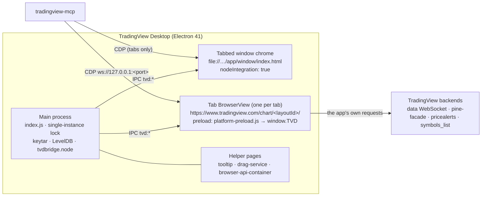

# Reverse Engineering Notes: TradingView Desktop

This document records how TradingView Desktop is built and how it can be controlled from outside the process.
It is the technical foundation for `tradingview-mcp`: every tool in the server maps to one of the mechanisms
described here, and every fallback chain follows the tier model in [§9](#9-fallback-strategy).

> **Scope and ethics.** The analysis only covers the locally installed app and its own logged-in session.
> Nothing here bypasses authentication, paywalls, or plan limits, and nothing calls TradingView servers directly:
> all network activity described below is performed _by the app itself_. TradingView internals are undocumented
> and can change without notice. This project is not affiliated with TradingView.

## Contents

1. [Method and evidence](#1-method-and-evidence)
2. [Application architecture](#2-application-architecture)
3. [Control channel: Chrome DevTools Protocol](#3-control-channel-chrome-devtools-protocol)
4. [Page-context entry points](#4-page-context-entry-points)
5. [DOM selectors](#5-dom-selectors)
6. [Feature-to-mechanism matrix](#6-feature-to-mechanism-matrix)
7. [Plan limits](#7-plan-limits)
8. [Stability risks](#8-stability-risks)
9. [Fallback strategy](#9-fallback-strategy)
10. [Platform support and install detection](#10-platform-support-and-install-detection)
11. [Security considerations](#11-security-considerations)
12. [Open questions](#12-open-questions)
13. [Prior art](#13-prior-art)
14. [Reproducing the analysis](#14-reproducing-the-analysis)

---

## 1. Method and evidence

### 1.1 Analyzed build

| Item                  | Value                                                         |
| --------------------- | ------------------------------------------------------------- |
| Desktop app           | TradingView Desktop **3.4.1** (build `3.4.1.8194`)            |
| Bundle identifier     | `com.tradingview.tradingviewapp.desktop` (URL scheme `tradingview://`) |
| Runtime               | Electron **41.7.1**, Chromium 146.0.7680.216, V8 14.6, CDP 1.3 |
| User agent suffix     | `TradingView/3.4.1 … Electron/41.7.1 … TVDesktop/3.4.1`       |
| Web app               | `https://www.tradingview.com/chart/<layoutId>/`, `BUILD_TIME` 2026-10-16T17:55:37 |
| Host OS               | macOS (Darwin 25.5), universal binary (x86_64 + arm64)        |
| `app.asar` SHA-256    | `d85cda843523e29e83ba5ecc5eb5a660761c813d66386a387719504c79c6ec50` |

The desktop shell and the web app version independently: the shell is 3.4.1, but the chart UI is the live
tradingview.com bundle, which was rebuilt two days before this analysis.

### 1.2 Techniques

| Technique | Tool | What it established |
| --- | --- | --- |
| Electron fuse inspection | REA `inspect_electron_fuses` | Which debugging switches the binary honors |
| Static application graph of `app.asar` | REA `analyze_javascript_application` | Main process, preloads, IPC channels, BrowserView usage |
| CDP target discovery | REA `list_browser_targets`, `list_electron_targets` | Which renderers are reachable and how they are typed |
| Passive page inspection | REA `inspect_electron_page` | Window-chrome DOM structure and scripts |
| Viewport capture | REA `capture_web_screenshot` | That `Page.captureScreenshot` works on a tab's BrowserView |
| Read-only runtime introspection | CDP `Runtime.evaluate` probes | Global objects, method names and arity, method bodies via `Function.prototype.toString`, values of side-effect-free getters |
| Bundle source search | CDP `Debugger.getScriptSource` (already-loaded scripts, no refetch) | Internal services, signatures, and data shapes |

REA runtime tools are deliberately passive and never evaluate page JavaScript, so deeper introspection used small
read-only probes (see [§14](#14-reproducing-the-analysis)). The probes never invoked mutating methods. The only
side effects were: registering one inert webpack chunk ID to obtain the module registry ([§4.7](#47-webpack-module-registry)),
one symbol search for `AAPL` (identical to typing in the search box), and resolving the already-initialized replay API.

### 1.3 Evidence ledger

REA Evidence IDs are scoped to the analysis session; they are listed so findings can be traced back to the raw records.

| Finding | Evidence | Type |
| --- | --- | --- |
| Fuse states | `ev_dc6c0330…a59ccf` | observed, shipped artifact |
| `app.asar` application graph (parent) | `ev_bb48e6e1…64fd07` | derived, static (coverage partial; see limits below) |
| CDP page targets (https) | `ev_f775eaf2…d939531f` | observed, runtime |
| CDP page targets (file://) | `ev_601333ca…1cb02665` | observed, runtime |
| Window-chrome DOM | `ev_0249a2a3…c95a53` | observed, runtime |
| Chart viewport screenshot | `ev_de72f97e…8cf563f` | observed, runtime |

Static coverage limits: the ASAR graph parsed 60 JavaScript files (1,908 modules) but relationship expansion for the
large bundles (`index.js`, the shell bundles, and the preloads) exceeded REA's result budget, so complete static facts
were retained on file nodes without expanded edges. Four unpacked native modules (`classic_level.node`,
`notificationstate.node`, `keytar.node`, `tvdbridge.node`) do not match the ASAR header hashes; this is expected for
binaries re-signed after packaging, and their bytes were treated as untrusted. Negative findings (for example "no
`remote-debugging` check") are bounded text searches of the named file, not proofs of absence.

---

## 2. Application architecture



### 2.1 Main process (`index.js`, 2.2 MB webpack bundle)

- Enforces a **single instance** with `app.requestSingleInstanceLock()`. A second launch hands its arguments to the
  running instance and exits, so a debug switch on a second launch is lost ([§3.3](#33-launching-with-the-debug-port)).
- Appends `disable-features=CalculateNativeWinOcclusion` to the Chromium command line.
- Honors `--options=clean`, which appears to wipe the default session's data at startup. **The launcher must never
  pass this switch.**
- Uses `BrowserView` heavily (26 references), plus `BrowserWindow` (20) and one `WebContentsView`.
- Ships native modules for credential storage (`keytar.node`), LevelDB persistence (`classic_level.node`),
  notification state, and a native bridge (`tvdbridge.node`).
- Reads `configs/config.json` (default host `https://www.tradingview.com/`, chart path `chart/`, window load timeout
  10 s, persistence autosave interval 5 min) and `configs/nav-rules.json` (navigation policy that routes URLs to
  in-place navigation, a new tab, a popup, or the external browser).
- The chart host can be overridden with the `TARGET_TVD_HOST` environment variable (preloads fall back to
  `https://www.tradingview.com/`). Not useful for us, but it explains the `TARGET_TVD_HOST` key in `localStorage`.

### 2.2 Renderers and preloads

| Renderer | Isolation | Preload | Exposes |
| --- | --- | --- | --- |
| Chart tab (`https://www.tradingview.com/chart/…`) | `contextIsolation` on | `platform-preload.js`, `target-tvd-host-preload.js` | `window.TVD` (35 members), `window.__SENTRY_IPC__` |
| Window chrome (`app/window/index.html`) | **`nodeIntegration: true`, `contextIsolation: false`** | — | full Node.js (`require` is defined) |
| Menu (`app/menu`) | Node integration | `menu-handler-preload.js` | `window.hideMenu()` → `tvd:hide-menu` |
| Two-factor window | — | `two-fa-preload.js` | CSS only |

`platform-preload.js` also injects CSS that hides web-only chrome (`.tv-header`, `.tv-footer`,
`.i-hidden-on-tvdesktop`), proxies `sessionStorage` through IPC, and applies the scrollbar theme.

### 2.3 IPC surface

The static graph recorded 125 IPC operations (32 literal channels, 64 dynamic). Literal channels all use the `tvd:`
prefix and follow a remote-service pattern (`tvd:tabbed-window`, `tvd:tabs-container`, `tvd:new-tab-service`,
`tvd:window-service`, `tvd:main-menu-service`, `tvd:settings-provider-service`, `tvd:auth-handler`,
`tvd:password-manager-service`, …) plus page-facing channels (`tvd:get-watchlist`, `tvd:layout-change`,
`tvd:reload-tab`, `tvd:focus-pine-editor`, `tvd:get-credentials`, …). `tradingview-mcp` does **not** use IPC: it is
privileged, mostly dynamic, and reachable only through the Node-enabled window chrome. Tab operations go through the
window chrome's DOM instead ([§5.6](#56-window-chrome-tabs)).

### 2.4 `window.TVD` (desktop bridge inside the chart page)

| Category | Members | Use in `tradingview-mcp` |
| --- | --- | --- |
| Read-only state | `getTheme`, `getThemeSetting`, `getActiveWatchlistId`, `crosshairSyncEnabled` | Allowed |
| Shell actions | `reloadTab`, `openNewWindow`, `openSettings`, `setTitle`, `layoutChange`, `layoutRestored`, `setFocusPineEditor` | `reloadTab` only, as a last-resort recovery step |
| **Credentials** | `getCredentials`, `setCredentials`, `insertCredentialsText`, `signIn` | **Never.** Also denylisted inside `ui_evaluate` |
| Telemetry and debug | `log`, `sendToSentry`, `*AutosaveDialogDebug`, screen-capture hooks | Never |

---

## 3. Control channel: Chrome DevTools Protocol

### 3.1 Fuses

| Fuse | State | Implication |
| --- | --- | --- |
| `RunAsNode` | enabled | `ELECTRON_RUN_AS_NODE` works (security note in [§11](#11-security-considerations)) |
| `EnableCookieEncryption` | disabled | — |
| `EnableNodeOptionsEnvironmentVariable` | enabled | — |
| `EnableNodeCliInspectArguments` | enabled | `--inspect` would be honored for the main process (not used) |
| `EnableEmbeddedAsarIntegrityValidation` | disabled | — |
| `OnlyLoadAppFromAsar` | disabled | — |
| `GrantFileProtocolExtraPrivileges` | enabled | — |

`--remote-debugging-port` is a Chromium switch that no fuse governs, and a bounded search of `index.js` found no
code that inspects or strips it. The analyzed instance was running with `--remote-debugging-port=9222`, and every
renderer was reachable. **Renderer CDP is the primary control channel.** The main-process Node inspector is
intentionally unused: it would grant more privilege than needed.

### 3.2 Targets exposed on the debug port

| Target | Type | Notes |
| --- | --- | --- |
| `https://www.tradingview.com/chart/<layoutId>/` | `page` | One per tab (BrowserView). **The primary target.** |
| `file://…/app.asar/app/window/index.html?rendererInitialData=…` | `page` | Window chrome with the tab strip; `remoteServiceInstanceId` ends in `tvd:tabbed-window` |
| `file://…/app/tooltip/…`, `…/renderer-services/drag-service/…`, `…/browser-api-container/…` | `page` | Helpers; ignore |
| Two pages with an empty URL and title | `page` | **`Runtime.evaluate` never returns** (no execution context). Must be skipped. |
| doubleclick, reCAPTCHA, googlesyndication | `iframe` | Ads and anti-abuse frames inside the chart page; ignore |
| Service worker | `worker` | Ignore |

**Target selection rule:** `type === "page"` and the URL matches `^https://([a-z0-9-]+\.)?tradingview\.com/chart/`.
When several tabs exist, prefer the one whose `document.visibilityState === "visible"` (the only tab observed reported
`visible`; behavior with several tabs is still to be verified, see [§12](#12-open-questions)). **Every CDP call needs a
timeout**, because unresponsive targets otherwise hang the client.

### 3.3 Launching with the debug port

- macOS: spawn `/Applications/TradingView.app/Contents/MacOS/TradingView --remote-debugging-port=<port>` detached.
  `open -a TradingView --args …` drops the arguments when the app is already running.
- Because of the single-instance lock, launching while TradingView already runs **without** the flag does nothing
  useful. The launcher must detect that state (process list plus a port probe), and restart the app only with explicit
  consent (`restart: true`), using a graceful quit first.
- Readiness is a two-step check: `GET /json/version` answers, then a chart target exists where
  `window.TradingViewApi` is defined and `TradingViewApi.isConnected()` returns `true`.
- The debug port binds to loopback by default (observed: `127.0.0.1:9222` only, via `lsof`). The launcher must never
  pass `--remote-debugging-address`.

---

## 4. Page-context entry points

All paths below are evaluated inside the chart page through `Runtime.evaluate`.

### 4.1 Globals of interest

| Global | Kind | Purpose |
| --- | --- | --- |
| `TradingViewApi` | object (64 own members) | Superset of the Charting Library / Trading Platform widget API. **Main entry point.** |
| `_exposed_chartWidgetCollection` | object | All chart widgets of the layout, layout type, locks, fullscreen, snapshots |
| `TVD` | object | Desktop bridge ([§2.4](#24-windowtvd-desktop-bridge-inside-the-chart-page)) |
| `TradingView` | object | `headerToolbar`, `bottomWidgetBar` (no registered widgets at observation time), `isFeatureEnabled`, `defaultProperties` |
| `widgetbar` | object | Right-hand widget bar: `watchlist`, `alerts`, `object_tree`, `datawindow`, `pine_logs`, `hotlist`, `news`, `detail` |
| `getQuoteSessionInstance()` | function | Shared quote session; `_symbol_data[proName].values` caches live quotes |
| `studyMarket` | object | The "Indicators, metrics, and strategies" dialog (`show`, `hide`, `visible`) |
| `TVSettings`, `TVLocalStorage` | objects | App settings and namespaced storage (`getValue`, `getJSON`, `getItem`, …) |
| `webpackChunktradingview` | array | Webpack JSONP chunk list; gateway to the module registry ([§4.7](#47-webpack-module-registry)) |
| `TVScript` | object | Pine version helpers (`TranslatorLastVersion`, `extractVersion`, `canUpgradeVersion`) |
| `is_authenticated`, `user` | boolean, object | Session identity. **Never returned by any tool.** |

### 4.2 `TradingViewApi`

Signatures below come from method bodies; parameters marked `?` are optional.

| Domain | Members |
| --- | --- |
| Charts | `activeChart()`, `chart(index = 0)`, `charts()`, `chartsCount()`, `activeChartIndex()`, `setActiveChart(index)`, `changeSymbol(symbol, interval, onLoaded?)`, `getSymbolInterval(cb?) → {symbol, interval}`, `getIntervals()`, `supportedChartTypes()` |
| Layout | `layout()` (for example `"s"`), `setLayout(type, {withUndo}?)`, `layoutName()`, `layoutId()`, `getSavedCharts(cb?) → Promise<records>`, `loadChartFromServer(record)`, `loadLayoutFromServerByLayoutId(id, …)`, `createNewLayout(name) → layoutId \| null`, `saveChartToServer(onOk?, onFail?, opts?)`, `hasChartChanges()`, `unloadUnusedCharts()` |
| Sub-APIs | `replayApi() → Promise<ReplayApi>`, `pineEditorApi()`, `alerts()`, `alertService()` |
| Search | `searchSymbols({text, exchange, type}) → {symbols_remaining, symbols[]}` |
| Drawing state | `selectLineTool(name, …)`, `selectedLineTool()`, `hideAllDrawingTools()`, `lockAllDrawingTools()`, `hideAllIndicators()`, `drawOnAllCharts(bool)` |
| History | `undo()`, `redo()`, `undoRedoState()`, `clearUndoHistory()` |
| View | `startFullscreen()`, `exitFullscreen()`, `takeClientScreenshot(opts?)` (local render), `takeScreenshot()` (server snapshot) |
| Connection | `isConnected()`, `connect()`, `disconnect()`, `onConnectionStatusChanged(cb)` |
| Events | `subscribe(event, cb)`, `unsubscribe(event, cb)` |

**Disabled or stubbed in this build** (observed from method bodies):

| Member | Behavior | Replacement |
| --- | --- | --- |
| `activeChart().exportData()` | `Promise.reject("Data export is not supported")` | Read `mainSeries().bars()` ([§4.4](#44-chart-model-internals)) |
| `activeChart().setVisibleRange()` | throws `Error("Not implemented")` | Core time scale `zoomToBarsRange` ([§4.4](#44-chart-model-internals)) |
| `watchlist()`, `widgetbar()`, `getStudiesList()`, `getStudyInputs()` | delegate to an internal stub | Webpack services or DOM |
| `alertService()` | returns `null` (constructor-injected service absent on this page) | Alerts REST service ([§4.7](#47-webpack-module-registry)) |
| `takeScreenshot()` | uploads a snapshot to TradingView servers | Local capture only |

### 4.3 Chart widget API (`activeChart()`)

| Area | Members |
| --- | --- |
| Read state | `symbol()`, `symbolExt() → {symbol, full_name, exchange, description, type, pro_name, typespecs, delay}`, `resolution()`, `chartType()` (`1` = candles), `marketStatus()`, `getVisibleRange() → {from, to}` (Unix seconds), `getVisibleBarsRange()`, `getVisiblePriceRange()`, `getTimezone()`, `replayStatus()` |
| Change state | `setSymbol(symbol, {dataReady?, doNotActivateChart?})`, `setResolution(res, {…})`, `setChartType(type)`, `setTimeFrame({val, res})`, `setTimezone(tz)`, `executeActionById(id)` |
| Studies | `getAllStudies() → [{id, name}]`, `getStudyById(id) → IStudyApi`, `createStudy(name, forceOverlay, lock, inputs, overrides, options)`, `removeEntity(id, {disableUndo}?)`, `removeAllStudies()` |
| Drawings | `getAllShapes() → [{id, name}]`, `getShapeById(id) → ILineDataSourceApi`, `createShape(point, options)`, `createMultipointShape(points, options)`, `createAnchoredShape(position, options)`, `removeAllShapes()`, `getLineToolsState()` |
| Structure | `getPanes() → IPaneApi[]`, `getSeries()`, `getTimeScale()`, `chartModel()`, `chartWidget()` |
| Subscriptions | `onDataLoaded()`, `onSymbolChanged()`, `onIntervalChanged()`, `onVisibleRangeChanged()`, `onChartTypeChanged()`, `crossHairMoved()`, `dataReady(cb)`, `whenChartReady(cb)` |

`createStudy` resolves `name` case-insensitively against study descriptions from the study metadata repository and
accepts `options.checkLimit`, which applies the plan's per-chart indicator limit. **`tradingview-mcp` always passes
`checkLimit: true`.**

- `IStudyApi`: `getInputValues()`, `setInputValues([{id, value}])`, `getInputsInfo()`, `getStyleValues()`,
  `isVisible()`, `setVisible(bool)`, `applyOverrides()`, `title()`, `paneIndex()`, `hasError()`, `isLoading()`,
  `status()`, `mergeUp()`/`mergeDown()`, `onDataLoaded()`, `onStudyError()`.
- `ILineDataSourceApi`: `getPoints()`, `setPoints()`, `getProperties()`, `setProperties()`, `isHidden()`,
  `setVisible()`, `bringToFront()`, `sendToBack()`, `isUserEditEnabled()`, `isSavingEnabled()`, `symbol()`.
- `IPaneApi`: `getAllEntities()`, `getHeight()`, `setHeight()`, `collapse()`, `restore()`, `setMaximized()`,
  `moveTo()`, `paneIndex()`, `getMainSourcePriceScale()`, `hasMainSeries()`.

### 4.4 Chart model internals

The model is reachable at `activeChart()._chartWidget.model()` (verified). The public accessors `chartWidget()` and
`chartModel()` likely return the same objects (to be verified). Property names are not minified, which makes these paths
more stable than their underscore prefix suggests.

| Path | Returns |
| --- | --- |
| `….model().mainSeries().bars()` | Bar container: `size()`, `firstIndex()`, `lastIndex()`, `valueAt(i) → [time, open, high, low, close, volume]`, `search(time)`, `range()`, `each()` |
| `….mainSeries().symbolInfo()` | 51 fields: `name`, `full_name`, `pro_name`, `exchange`, `listed_exchange`, `description`, `type`, `typespecs`, `currency_code`, `pricescale`, `minmov`, `pointvalue`, `session`, `subsessions`, `timezone`, `has_intraday`, `has_extended_hours`, `is_replayable`, `variable_tick_size`, `isin`, … |
| `….mainSeries().quotes()` | Live quote: `last_price`, `bid`, `ask`, `bid_size`, `ask_size`, `change`, `change_percent`, `low_price`, `lp_time`, `currency_code`, plus fundamentals |
| `….model().model().getStudyById(id)` | Study core: `data()` (rows `[time, plot_0, …, plot_n]`), `metaInfo().plots` (`{id, type}`), `graphics()` (Pine drawings), `tables()` (Pine tables), `logs()` (Pine logs), `isPine()`, `hasCompileError()`, `performance()` |
| Strategy study core | `reportData() → {performance: {all: {netProfit, totalTrades, numberOfWiningTrades, largestWinTrade, …}}, currency, position, filledOrders, …}`, `ordersData()` (= `filledOrders`), `barsIndexes()` |
| `….model().model().timeScale()` | Core time scale: `zoomToBarsRange(from, to)`, `scrollToBar(index)`, `scrollToRealtime()`, `scrollToFirstBar()`, `setBarSpacing()`, `setRightOffset()`, `timePointToIndex(time)`, `indexToTimePoint(i)`, `logicalRange()`, `requestMoreHistoryPoints()` |

Observed: 300 bars were loaded for a daily chart. Older history loads on demand (`requestMoreData`, or scrolling).

### 4.5 Replay API (`await TradingViewApi.replayApi()`)

| Group | Members |
| --- | --- |
| Availability | `isReplayAvailable()` (watched value, `true` on a daily chart), `isReadyToPlay()`, `replayResolutions()`, `currentReplayResolution()` |
| Lifecycle | `selectDate(unixMs)` (enables replay mode, then selects the date), `selectFirstAvailableDate()`, `selectRandomDate()`, `stopReplay()`, `goToRealtime()`, `leaveReplay({skipConfirm, onLeave})`, `showReplayToolbar()`, `hideReplayToolbar()` |
| Playback | `doStep()`, `toggleAutoplay()`, `isAutoplayStarted()`, `changeAutoplayDelay(ms)`, `autoplayDelayList()` (100 ms to 10 s, labeled 10x to 0.1x), `currentDate()`, `isReplayStarted()` |
| Paper trading | `buy(qty)`, `sell(qty)` (market orders in the replay trading model), `closePosition()`, `position()`, `realizedPL()`, `currency()` |

Many getters return watched values; read them with `.value()`.

### 4.6 Pine Script

**`TradingViewApi.pineEditorApi()`**: `listSavedScripts()`, `getSource(scriptId, version)`, `getVersionList(id)`,
`compileScript(scriptId, version)` (compiles a _saved_ script), `open(opts?)` (lazy-loads the editor chunk and opens
it), `getBottomFacade()` / `getDialogFacade()` (facade of an open editor, or `null`), `saveNewScript({source, name})`,
`saveExistingScript({scriptIdPart, source, name})`, `renameScript()`, `deleteScript()`, `openedScripts()`.
Both save methods check the plan's paywall before writing.

**Editor facade** (registered per placement through `registerOpenPineEditor(placement, {getFacade})`):

| Member | Behavior |
| --- | --- |
| `awaitEditorReady()` | Resolves when the Monaco editor is mounted |
| `openNewScript(type = "indicator")` | Opens a template (`indicator`, `strategy`, `library`) and clears the console |
| `setScript(source)`, `setNewScript(source)` | Replace the editor content |
| `getSource()` | Current editor text |
| `addToChart()` | Compile and add; picks the new-draft, unsaved-version, or saved-version path automatically |
| `updateOnChart()` | Recompile an existing script on the chart |
| `saveScript(name?)` | Save (requires sign-in; plan limits apply) |
| `openScript({scriptIdPart, …}, line?)`, `openLastOrDraft()` | Open saved scripts |
| `isModified()`, `isDraft()`, `getScriptIdVersion()` | Editor state |

The editor state is a Redux Toolkit store. Compile and save thunks return `{compileErrors, metaInfo, success}`, and
console messages persist in `TVLocalStorage` under `console_messages_key` (next to `editor_console_open` and
`detached_window`). The Pine Editor button is `[data-name="pine-dialog-button"]`. Depending on user settings, the
editor opens as a bottom panel or a dialog.

**Compile-only path:** the module exporting `translateScriptAsync` compiles raw source through the app's own
`pineFacadeFetch` (POST `translate_source/…`) without touching the chart. It is reachable only through the module
registry (Tier 2).

### 4.7 Webpack module registry

Several capabilities (alerts, watchlists, compile-only Pine, plan limits) live in webpack modules with no global
handle. The registry can be reached read-only:

```js
let req;
window.webpackChunktradingview.push([[`tvmcp_${Date.now()}`], {}, (r) => { req = r; }]);
// req.m: module factories (8,947 observed), req.c: instantiated module cache (6,903 observed)
```

Rules for `tradingview-mcp`:

1. Locate modules by **export name** in `req.c` (export names are preserved in production bundles). Never hardcode
   module IDs; they change with every web build.
2. Only read exports from `req.c`. Never call `req(id)` for a module that is not cached, because that executes its
   factory.
3. Cache resolved handles per page load, and re-resolve after navigation.

| Export name | Provides |
| --- | --- |
| `getAlertsRestApi()` | Alerts REST client: `listAlerts`, `getAlerts`, `createAlert`, `modifyRestartAlert(s)`, `deleteAlerts`, `stopAlerts`, `restartAlerts`, `cloneAlerts`, `listFires`, `deleteFires` (endpoints `/list_alerts`, `/create_alert`, `/delete_alerts`, …) |
| `ChartAlertsFacade` | Chart-level alert helpers (`getAlerts`, `deleteAlert(s)`, `restartAlert`, `getAlertSync`) |
| `translateScriptAsync`, `translateScriptAsync2`, `requestUserScripts`, `getPineSourceCode`, `saveNew`, `saveNext`, `getVersions`, `requestBuiltinScripts` | Pine facade client |
| `getOpenPineEditor(placement)` | Registry of open editors (`"bottom"`, `"dialog"`) |
| `getActiveStrategyReportData`, `getBacktestingStrategyFacade` | Strategy Tester report selector and facade (lazy) |
| `getCustomLists`, `getCustomListById`, `getGlobalActiveSymbolList`, `initSymbolListService`, `getWatchlistSymbolsLimit`, `MAX_WATCHLIST_LENGTH` | Watchlist selectors, service, and limits (the backing store is created lazily by the watchlist widget) |
| `ProductFeatures`, `getConfig(feature)` | Plan limits ([§7](#7-plan-limits)) |
| `QuoteSession`, `getQuotePrice` | Quote sessions for symbols other than the chart's |

The in-app watchlist client calls `/api/v1/symbols_list/custom/{id}/append/`, `…/remove/`, `…/replace/`,
`/api/v1/symbols_list/active/`, and `/api/v1/symbols_list/all/`. The alerts client surfaces server-enforced errors
such as `total_alerts_count_exceeded`, `max_primitive_alerts_count_exceeded`, and `no_permissions`.
`tradingview-mcp` relays these verbatim as plan-limit errors.

### 4.8 ChartApi and quotes

`TradingViewApi._chartApiInstance` manages the data WebSocket: `resolveSymbol`, `quoteCreateSession`,
`quoteAddSymbols`, `quoteSetFields`, `depthCreateSession`, `depthSetSymbol`, `serverTime()`, `connected()`,
`allStudiesMetadata()`. Creating extra sessions can count against connection limits (`SIMULTANEOUS_CONNECTIONS`,
`BACKEND_CONNECTIONS`), so tools prefer existing caches (`mainSeries().quotes()`, `getQuoteSessionInstance()`). Market
depth depends on data entitlements; when it is unavailable, the tool reports `NOT_AVAILABLE`.

---

## 5. DOM selectors

Preference order: `id` → `data-qa-id` → `data-name` → `data-test-id-*` → `aria-label`. Hashed class names (for
example `iconButton-3Lt7-uhL`) change on every build and are never used.

### 5.1 Header toolbar (ids)

`#header-toolbar-symbol-search`, `#header-toolbar-compare`, `#header-toolbar-intervals`,
`#header-toolbar-chart-styles`, `#header-toolbar-indicators`, `#header-toolbar-study-templates`,
`#header-toolbar-alerts`, `#header-toolbar-replay`, `#header-toolbar-undo-redo`, `#header-toolbar-layouts`,
`#header-toolbar-save-load`, `#header-toolbar-quick-search`, `#header-toolbar-properties`,
`#header-toolbar-fullscreen`, `#header-toolbar-screenshot`.

### 5.2 Page regions

`#drawing-toolbar`, `#bottom-area`, `#footer-chart-panel`, `#overlap-manager-root` (portal for dialogs and menus),
`#tooltip-root-element`, `#snackbar-container`, `[data-qa-id="chart-container"]`, `[data-qa-id="pane"]`,
`canvas[data-name="pane-canvas"]`.

### 5.3 Buttons (`data-name`)

| Purpose | Selector |
| --- | --- |
| Indicators dialog | `[data-name="open-indicators-dialog"]` |
| Pine Editor | `[data-name="pine-dialog-button"]` |
| Alerts panel / object tree | `[data-name="alerts"]`, `[data-name="object_tree"]` |
| Go to date | `[data-name="go-to-date"]` |
| Date range presets | `[data-name="date-range-tab-1D"]` … `5D`, `1M`, `3M`, `6M`, `YTD`, `12M`, `60M`, `ALL` |
| Drawing toolbar | `[data-name="linetool-group-trend-line"]`, `…-gann-and-fibonacci`, `…-geometric-shapes`, `…-annotation`, `…-patterns`, `…-prediction-and-measurement`, `…-cursors`, `…-font-icons`, `[data-name="removeAllDrawingTools"]`, `[data-name="hide-all"]`, `[data-name="lock-all"]`, `[data-name="magnet-button"]` |
| Right toolbar and widget bar | `[data-name="right-toolbar"]`, `[data-name="widgetbar-wrap"]`, `[data-name="widgetbar-pages-with-tabs"]` |
| Panels | `[data-name="toggle-maximize-button"]`, `[data-name="toggle-visibility-button"]` |

### 5.4 Legend, panes, and control bar (`data-qa-id`)

- Legend: `legend`, `legend-series-item`, `legend-source-item` (carries `data-entity-id` = study ID),
  `legend-source-title`, `legend-show-hide-action`, `legend-delete-action`, `legend-settings-action`,
  `legend-more-action`.
- Values: `[data-test-id-value-title]` (`O`, `H`, `L`, `C`, `Vol`, and plot titles).
- Panes: `pane-button-close`, `pane-button-collapse`, `pane-button-up`, `pane-button-down`,
  `pane-button-maximize`, `pane-button-restore`.
- Control bar: `control-bar-zoom-in-button`, `control-bar-zoom-out-button`, `control-bar-scroll-left-button`,
  `control-bar-scroll-right-button`, `control-bar-reset-scale-button`, `control-bar-back-to-realtime-button`.
- Right-panel widgets: `[data-test-id-widget-type="watchlist" | "detail" | "alerts" | "object_tree" | "pine_logs"]`.

### 5.5 Never click

`[data-name="buy-order-button"]`, `[data-name="sell-order-button"]`, `[data-name="buy-sell-buttons"]`,
`[data-qa-id="trade-button"]`, `#header-toolbar-trade-desktop`, and anything inside a broker order ticket.
The low-level UI tools refuse targets that match these selectors or contain them.

### 5.6 Window chrome (tabs)

Target: `file://…/app/window/index.html`.

| Element | Selector |
| --- | --- |
| Tab | `div.tab[draggable="true"][id]` (the id is a UUID; text is `<symbol> <price> <change> / <layout name>`) |
| Active tab | `div.tab.active` |
| New tab | `button.create-new-tab-button` (`aria-label="New tab"`) |
| New window | `#new-window-button` |
| Main menu | `#main-menu-button` |

This renderer has Node integration. `tradingview-mcp` only reads its DOM and dispatches input events; it never calls
`require` there.

---

## 6. Feature-to-mechanism matrix

Status legend: ✅ verified at runtime (read-only) · 🔎 verified statically (method body or bundle) · ❓ to verify during implementation.
Tiers: **T1** public JS API · **T2** internal model or webpack service · **T3** DOM · **T4** keyboard ([§9](#9-fallback-strategy)).

| Domain | Capability | Primary | Fallbacks | Status |
| --- | --- | --- | --- | --- |
| Connection | launch | Spawn binary with `--remote-debugging-port`, honoring the single-instance lock | — | ✅ flag works · ❓ launcher |
| | health / discover | `/json/version`, `/json/list`, `TradingViewApi.isConnected()` | — | ✅ |
| | UI state | Widget bar, bottom area, open dialogs in `#overlap-manager-root` | T3 | 🔎 |
| | reconnect | Re-resolve target, reattach; `TradingViewApi.connect()` | `TVD.reloadTab()` | 🔎 |
| Chart | get state | `symbol()`, `resolution()`, `chartType()`, `getVisibleRange()`, studies, shapes, layout | — | ✅ |
| | set symbol / timeframe / type | `setSymbol`, `setResolution`, `setChartType` (T1) | Header toolbar (T3), typing a symbol or interval on the chart (T4) | 🔎 |
| | set visible range | Core time scale `zoomToBarsRange` after mapping times to bar indices (T2) | Date range presets (T3) | ✅ T1 disabled · ❓ T2 |
| | scroll to date | `timeScale().scrollToBar(index)` (T2) | Go-to-date dialog (T3) | ❓ |
| Market data | OHLCV | `mainSeries().bars().valueAt(i)` (T2) | — | ✅ (`exportData` disabled) |
| | quote | `mainSeries().quotes()` (T2) | Quote session cache | ✅ |
| | symbol info | `mainSeries().symbolInfo()`, `symbolExt()` | — | ✅ |
| | symbol search | `searchSymbols({text, exchange, type})` | Symbol search dialog (T3) | ✅ |
| | market depth | `depthCreateSession` (T2) | `NOT_AVAILABLE` | ❓ entitlement-dependent |
| Indicators | search | Study metadata repository / `allStudiesMetadata()` (T2) | Indicators dialog search (T3) | 🔎 (`getStudiesList` stubbed) |
| | add / remove | `createStudy(…, {checkLimit: true})`, `removeEntity(id)` | Indicators dialog (T3) | 🔎 |
| | set inputs / visibility | `getStudyById(id).setInputValues()`, `setVisible()` | Legend actions (T3) | 🔎 (`getInputValues` ✅) |
| | read values | Study core `data().valueAt(i)` + `metaInfo().plots` (T2) | Data window values (T3) | ✅ |
| Pine | new / open / get / set source | Editor facade `openNewScript`, `openScript`, `getSource`, `setScript` | Monaco through the DOM (T3) | 🔎 |
| | compile | Facade `addToChart()` / `updateOnChart()` | Compile-only `translateScriptAsync` (T2) | 🔎 |
| | errors / console | Thunk `compileErrors`, `console_messages_key`, study `logs()` | `pine_logs` widget (T3) | 🔎 · ❓ marker details |
| | save / list | Facade `saveScript`, `pineEditorApi().listSavedScripts()` | — | 🔎 (paywall-checked) |
| | smart compile / static analysis | Server-side logic on top of compile results | — | design |
| Pine outputs | lines, labels, boxes, tables | Study core `graphics()`, `tables()` (T2) | — | 🔎 · ❓ primitive shapes |
| Strategy Tester | results / trades / equity | `reportData()` of the strategy study; `getActiveStrategyReportData` (T2) | Strategy Tester panel (T3) | 🔎 · ❓ trade and equity keys |
| Drawings | create | `createShape` / `createMultipointShape` | Drawing toolbar (T3) | 🔎 |
| | list / get / remove / clear | `getAllShapes()` ✅, `getShapeById()`, `removeEntity()`, `removeAllShapes()` | Object tree (T3) | ✅ / 🔎 |
| Alerts | list / create / delete | `getAlertsRestApi()` (T2) | Alert dialog and alerts panel (T3) | 🔎 · ❓ create payload |
| Watchlist | get / add / bulk / remove | Symbol-list service and selectors (T2); `TVD.getActiveWatchlistId()` | Watchlist widget rows (T3) | 🔎 · ❓ store wiring |
| Layouts and panes | list / new / switch | `getSavedCharts()`, `createNewLayout()`, `loadChartFromServer()` | Layouts menu (T3) | 🔎 (plan-limited) |
| | panes / multi-chart / focus / pane symbol | `getPanes()`, `setLayout(type)`, `setActiveChart(i)`, `chart(i).setSymbol()` | Layout setup menu (T3) | 🔎 (plan-limited) |
| Tabs | list / new / switch / close | Window-chrome DOM + chart targets | Shortcuts (T4) | ✅ selectors · ❓ switching and closing |
| Replay | start / step / autoplay / status / stop / trade | Replay API ([§4.5](#45-replay-api-await-tradingviewapireplayapi)) | Replay toolbar (T3) | ✅ availability · 🔎 actions |
| Screenshot | chart / window | CDP `Page.captureScreenshot` on the chart target | `takeClientScreenshot()` canvas | ✅ (REA capture) |
| Low-level UI | click, hover, type, keys, scroll, find, panels, fullscreen, evaluate | CDP `Input.*`, `Runtime.evaluate`, `startFullscreen()` | — | standard CDP |

---

## 7. Plan limits

Limits come from `getConfig(ProductFeatures.<NAME>).limit`. Values observed on the analysis account (Basic plan):

| Feature | Limit | Impact |
| --- | --- | --- |
| `INDICATORS_ON_CHART` | 2 | `indicator_add` and adding a strategy fail once the chart holds 2 studies |
| `CHART_STORAGE` | 1 | `layout_new` is blocked when one layout is already saved |
| `MULTIPLE_CHARTS` | 1 | Multi-chart layouts (`pane_set_layout`) are unavailable |
| `SERVER_SIDE_ALERTS` | 3 | `alert_create` fails beyond 3 active alerts |
| `SAVED_PINE_SCRIPTS` | 1 | `pine_save` of a new script can be refused |
| `STUDY_TEMPLATES` | 1 | — |
| `WATCHLIST_SYMBOLS` | 30 | Tiered watchlist limits were feature-flagged off; `getWatchlistSymbolsLimit()` returned 1000 |
| `HISTORICAL_BARS` | 5 | Caps loadable history |
| `SIMULTANEOUS_CONNECTIONS` / `BACKEND_CONNECTIONS` | 1 / 2 | Avoid opening extra data sessions |

Tools check the relevant limit **before** acting and return a typed `PLAN_LIMIT` error naming the feature and limit,
rather than triggering the app's paywall dialog. Server-side limit errors are passed through unchanged. Nothing tries
to work around a limit.

---

## 8. Stability risks

| Risk | Likelihood | Mitigation |
| --- | --- | --- |
| The web app redeploys independently of the desktop version | High | Capability probe at connect time; `app_health` reports degraded tools; record `BUILD_TIME` in results |
| Internal method renamed or removed | Medium | Feature detection before every T2 call, with a fallback to T3 or T4 |
| Public API members stubbed (`exportData`, `setVisibleRange`) | Observed | T2 replacements |
| Lazy modules not loaded yet (Pine editor chunk, alerts service, backtesting, watchlist store) | High | Trigger loading through the UI path (open the panel) or report `NOT_AVAILABLE` with a hint; never execute uncached factories |
| Unresponsive or blank targets | Observed | Strict target filter, per-call timeouts |
| Overlays (ads, upsell toasts, paywall dialogs) intercepting clicks | Observed | Prefer T1/T2; T3 dismisses known overlays first |
| Single-instance lock swallows the debug flag | Observed (static) | Detect and require explicit restart consent |
| Layout autosave persists every chart change | High | Tools change only what they are asked to; E2E tests clean up exactly what they create |
| Hashed CSS classes | Certain | Never used as selectors |
| Windows MSIX packaging blocks launching with flags | Reported by prior art | Platform-specific launcher, `TV_APP_PATH` override, documented manual launch |

---

## 9. Fallback strategy

Each tool declares an ordered list of strategies. At runtime the first strategy whose capability probe succeeds is
used, and the result reports which tier served it (`meta.via`).

1. **T1, public JS API**: `TradingViewApi`, `activeChart()`, and sub-APIs. Highest-level and most likely to keep its
   semantics.
2. **T2, internal model and services**: chart model internals and webpack exports located by name. Powerful but tied
   to the web build.
3. **T3, DOM interaction**: stable selectors from [§5](#5-dom-selectors) plus CDP input events. Slower, and sensitive
   to overlays.
4. **T4, keyboard shortcuts**: CDP key events to the focused chart. Last resort with few guarantees.

All page-side code runs as self-contained functions serialized into `Runtime.evaluate`, returns JSON-safe values,
and never returns session or identity data.

---

## 10. Platform support and install detection

| OS | Candidate locations | Status |
| --- | --- | --- |
| macOS | `/Applications/TradingView.app/Contents/MacOS/TradingView`, `~/Applications/TradingView.app/…` | ✅ verified |
| Windows | MSIX: `(Get-AppxPackage -Name TradingView.Desktop).InstallLocation\TradingView.exe`; classic installer: `%LOCALAPPDATA%\TradingView\TradingView.exe`, `%ProgramFiles%\TradingView\TradingView.exe` | ❓ not verifiable on the analysis host |
| Linux | `/opt/TradingView/tradingview`, `/usr/bin/tradingview`, `/snap/bin/tradingview`, Flatpak `com.tradingview.TradingView` | ❓ not verifiable on the analysis host |

`TV_APP_PATH` always overrides detection. Prior art reports that launching an MSIX install directly from
`WindowsApps` fails with `EACCES` on some Windows builds, and that the debug port sometimes never binds under COM
activation. This needs confirmation on a real Windows machine before the Windows launcher is considered stable.

User data lives in `~/Library/Application Support/TradingView` on macOS (`%APPDATA%\TradingView` on Windows and
`~/.config/TradingView` on Linux are expected). `tradingview-mcp` never reads or modifies it.

---

## 11. Security considerations

- **The debug port is equivalent to full control of the logged-in session**, including trading if a broker is
  connected. Any local process can connect. Keep it on loopback, never forward it, and restart TradingView without the
  flag when automation is not needed.
- The `RunAsNode` fuse is enabled, so `ELECTRON_RUN_AS_NODE=1` turns the TradingView binary into a plain Node.js
  runtime. This is outside this project's control and is noted for completeness.
- `tradingview-mcp` exposes **no broker trading tools**. Replay trades are paper trades inside Bar Replay, and the
  tool refuses to run unless replay is active.
- `ui_evaluate` is disabled unless explicitly enabled, and denylists credential and identity surfaces (`TVD.getCredentials`,
  `TVD.setCredentials`, `TVD.insertCredentialsText`, `document.cookie`, `window.user`).
- The HTTP transport requires a bearer token, binds to `127.0.0.1` by default, and validates `Origin` to prevent DNS
  rebinding.

---

## 12. Open questions

These are resolved during implementation of the corresponding domain, each with an E2E check:

1. Pine editor facade at runtime: placement (`bottom` vs `dialog`), compile error structure (line, column, message),
   and Monaco marker access.
2. Strategy report keys for the trade list and equity curve (`trades`, `equity`, `equityHistory`, …).
3. The watchlist store instance behind the `getCustomLists` selectors once the watchlist widget is open.
4. The `createAlert` payload schema (condition, series, expiration, notification options).
5. Shapes of Pine `graphics()` primitives (lines, labels, boxes, polylines) and `tables()`.
6. Tab-to-target mapping with several tabs, and whether background tabs report `visibilityState: "hidden"`.
7. Whether `takeClientScreenshot()` resolves to a canvas.
8. Market depth availability per symbol and plan.
9. Windows and Linux launch behavior.

---

## 13. Prior art

[tradesdontlie/tradingview-mcp](https://github.com/tradesdontlie/tradingview-mcp) (MIT) is an existing JavaScript MCP
server for TradingView Desktop over CDP. This project's analysis was performed independently with REA. The prior
art was consulted only to cross-check Windows and Linux install locations and the MSIX caveat in [§10](#10-platform-support-and-install-detection),
which could not be observed on the analysis host. No code was copied.

---

## 14. Reproducing the analysis

1. Start TradingView with `--remote-debugging-port=9222` ([§3.3](#33-launching-with-the-debug-port)).
2. REA, static: `inspect_electron_fuses` on the app bundle; `analyze_javascript_application` on
   `Contents/Resources/app.asar` with `detail: "summary"` and `integrity_policy: "record-and-continue"` (the unpacked
   native modules are re-signed after packaging).
3. REA, runtime: `list_browser_targets` and `list_electron_targets` on `http://127.0.0.1:9222`, then
   `inspect_electron_page` on the window-chrome target and `capture_web_screenshot` on the chart target.
4. Read-only probes: evaluate introspection snippets in the chart target (enumerate `Object.keys(window)`, walk
   prototypes for method names and arity, read method bodies with `Function.prototype.toString`). The repository's
   `scripts/re/` folder will hold these probes so they can be re-run after TradingView updates.
5. Bundle search: collect sources of already-loaded scripts with `Debugger.getScriptSource`, then search them as inert
   text.

Re-run steps 3 to 5 after a TradingView update, and compare results with this document.
