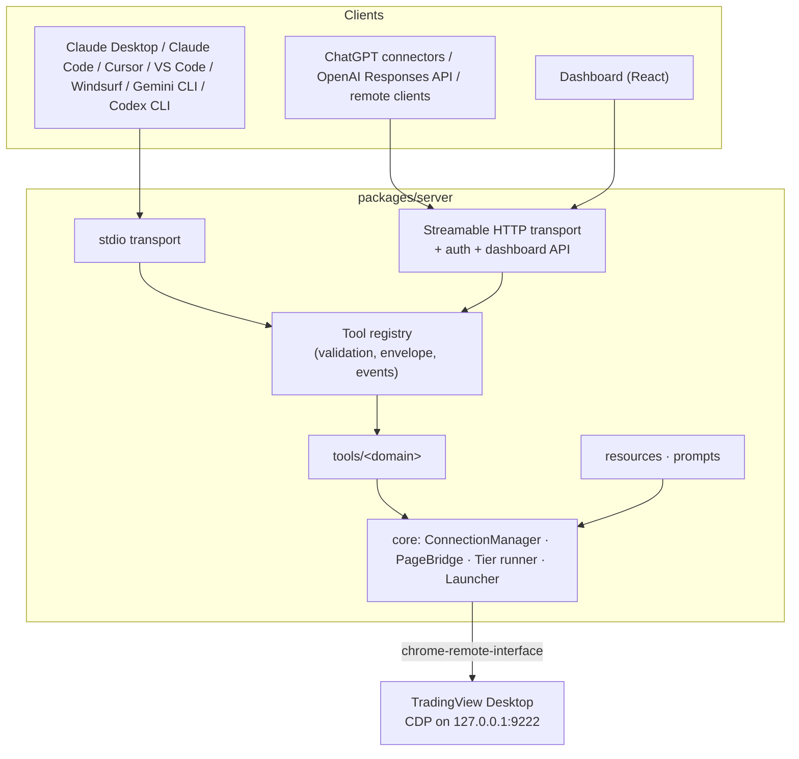

# tradingview-mcp: Design

**Status:** proposed, awaiting approval · **Date:** 2026-10-18
**Inputs:** the project brief (Phase 1 to 6 workflow) and [docs/reverse-engineering.md](../../reverse-engineering.md).

## 1. Goal

An MCP server that lets AI assistants read from and control the user's locally running, logged-in TradingView
Desktop app, exposing as many TradingView features as practical. It ships with automated tests at three levels, a web
dashboard, and complete documentation.

Hard boundaries: automate only the local app; never bypass authentication, paywalls, or plan limits; never call
TradingView servers directly (the app makes its own requests); no broker trading.

## 2. Architecture



- **Core** owns everything that touches TradingView: target discovery and selection, CDP sessions with per-call
  timeouts, serialized page functions, tiered fallbacks, and the launcher.
- **Tools** are thin: a Zod schema, an LLM-facing description, and a handler that composes core primitives and
  domain page functions.
- **Transports** adapt the same registry to stdio and Streamable HTTP. The dashboard is a client of the HTTP API.

## 3. Technology choices

| Concern      | Choice                                                                                                       | Reason                                                                                                                                                                                                                                                                                                                                                                              |
| ------------ | ------------------------------------------------------------------------------------------------------------ | ----------------------------------------------------------------------------------------------------------------------------------------------------------------------------------------------------------------------------------------------------------------------------------------------------------------------------------------------------------------------------------- |
| Language     | TypeScript 6.0.x, `strict`, no `any`, ESM                                                                    | typescript-eslint 8 supports `<6.1`; 7.x (native compiler) is not supported by the lint toolchain yet                                                                                                                                                                                                                                                                               |
| MCP          | `@modelcontextprotocol/sdk` 1.32.x with `zod` 4                                                              | Latest SDK; accepts zod `^3.25 \|\| ^4`                                                                                                                                                                                                                                                                                                                                             |
| CDP client   | **`chrome-remote-interface`** 0.34 with `devtools-protocol` types, wrapped behind our `CdpSession` interface | Thin raw-protocol client; connects to any target by ID, including the `file://` window chrome. Puppeteer auto-attaches to every target, and TradingView exposes page targets that never answer `Runtime.evaluate`, which risks hangs. Puppeteer's browser-management layer adds weight we do not use. The wrapper keeps the library swappable and makes the client trivial to fake. |
| HTTP         | `node:http` plus a small router                                                                              | Full control over auth, Origin and Host checks, and SSE, without a framework                                                                                                                                                                                                                                                                                                        |
| Logging      | `pino` to file descriptor 2                                                                                  | Structured logs that never touch stdout (stdio protocol channel)                                                                                                                                                                                                                                                                                                                    |
| CLI          | `node:util.parseArgs`, `picocolors`                                                                          | No heavy CLI framework; colorful banner on stderr                                                                                                                                                                                                                                                                                                                                   |
| Build        | `tsup` (server), Vite (dashboard)                                                                            | As specified                                                                                                                                                                                                                                                                                                                                                                        |
| Tests        | Vitest 5 + `@vitest/coverage-v8`, React Testing Library, MSW, Playwright                                     | As specified                                                                                                                                                                                                                                                                                                                                                                        |
| Node         | Runtime `engines: >=20.19`; development Node ≥22.22 (`.nvmrc` = 24)                                          | Current tsup, Vitest, lint-staged, commitlint, and MSW require Node 22+. Runtime dependencies support Node 20, and CI smoke-tests the built package on Node 20.                                                                                                                                                                                                                     |
| Package name | `tradingview-desktop-mcp` (pending approval)                                                                 | `tradingview-mcp` is taken on npm; this name is free and runs as `npx -y tradingview-desktop-mcp`                                                                                                                                                                                                                                                                                   |

## 4. Repository layout

```
.
├── packages/
│   ├── server/                  # published npm package (bin: tradingview-desktop-mcp)
│   │   ├── src/
│   │   │   ├── cli.ts           # bin entry: flags, banner, subcommands, transport start
│   │   │   ├── index.ts         # programmatic API (createMcpServer, loadConfig)
│   │   │   ├── server.ts        # builds McpServer + registry + resources + prompts
│   │   │   ├── config/          # env + CLI schema (zod), profiles, tool filters
│   │   │   ├── core/
│   │   │   │   ├── errors.ts  result.ts  logger.ts  events.ts
│   │   │   │   ├── cdp/         # types, discovery, targets, chrome-remote-interface adapter
│   │   │   │   ├── tv/          # page bridge, TvWindow types, tiers, capabilities, input, webpack, selectors, plan limits
│   │   │   │   ├── launcher/    # install discovery, process control, launch
│   │   │   │   └── connection.ts
│   │   │   ├── tools/
│   │   │   │   ├── types.ts  registry.ts
│   │   │   │   └── <domain>/    # index.ts (tool definitions), page.ts (page functions), mappers.ts, schemas.ts
│   │   │   ├── resources/  prompts/  transports/  utils/
│   │   └── test/
│   │       ├── unit/  integration/  e2e/
│   │       ├── helpers/         # fake CDP server, fake TradingView window, MCP client helpers
│   │       └── fixtures/        # recorded CDP target lists, synthetic TradingView state snapshots
│   └── dashboard/               # React + Vite + Tailwind + shadcn/ui (built into server/dist/dashboard)
├── scripts/re/                  # read-only REA follow-up probes and fixture recorder
├── docs/                        # reverse-engineering.md, testing.md, tools.md (generated), clients/
└── .github/workflows/ci.yml
```

## 5. Tool contract

### 5.1 Naming and schemas

- `snake_case` with a domain prefix: `app_`, `chart_`, `data_`, `indicator_`, `pine_`, `strategy_`, `drawing_`,
  `alert_`, `watchlist_`, `layout_`, `pane_`, `tab_`, `replay_`, `screenshot_`, `ui_`, `batch_`.
- Every input field has a Zod type, bounds, and a `.describe()` text. Descriptions tell the model when to use the
  tool, what it returns, and its limits (plan limits, side effects).
- MCP tool annotations are set on every tool (`readOnlyHint`, `destructiveHint`, `idempotentHint`,
  `openWorldHint: false`).
- Times are accepted as ISO 8601 strings or Unix timestamps. Numbers above `1e11` are treated as milliseconds.
  Outputs use Unix seconds plus an ISO string.

### 5.2 Result envelope

Success: `structuredContent` and a JSON text block carry the same payload:

```json
{ "ok": true, "data": { "...": "..." }, "meta": { "via": "api", "durationMs": 42, "warnings": [] } }
```

`meta.via` is one of `api` (T1), `internal` (T2), `dom` (T3), `keyboard` (T4), `cdp`, or `local`. Screenshots add an
MCP `image` content block in front of the JSON block.

Failure: `isError: true` with

```json
{
  "ok": false,
  "error": {
    "code": "PLAN_LIMIT",
    "message": "…",
    "hint": "…",
    "details": { "feature": "INDICATORS_ON_CHART", "limit": 2 }
  },
  "meta": { "durationMs": 8 }
}
```

Error codes: `TV_NOT_INSTALLED`, `TV_NOT_RUNNING`, `RESTART_REQUIRED`, `LAUNCH_FAILED`, `CDP_UNREACHABLE`,
`TARGET_NOT_FOUND`, `TIMEOUT`, `PAGE_EVALUATION_FAILED`, `CAPABILITY_UNAVAILABLE`, `NOT_AVAILABLE`, `PLAN_LIMIT`,
`INVALID_INPUT`, `CONFIRMATION_REQUIRED`, `UNSAFE_ACTION_BLOCKED`, `AUTH_REQUIRED`, `INTERNAL`. Stack traces never
leave the server.

### 5.3 Safety rules

1. No broker trading tools. Low-level UI tools refuse the selectors in reverse-engineering §5.5.
2. Destructive operations on pre-existing user data need `confirm: true` (`drawing_clear_all` with `scope: "all"`,
   `drawing_remove`, `alert_delete`, `watchlist_remove` and `tab_close` of what this session did not create, add or
   open, `layout_switch` and `layout_new` while the current layout has unsaved changes, `pane_set_layout` to fewer
   charts, `app_launch` with `restart: true`, and `app_reconnect` with `reloadTab: true`, which can lose unsaved Pine
   Editor text). Operations on objects the server created in this session do not.
3. Plan limits are checked before acting (`PLAN_LIMIT`), and server-side limit errors are relayed unchanged.
4. `ui_evaluate` is off unless `TV_MCP_ALLOW_EVAL=true`, and denylists credential, identity and trading surfaces
   (the trading service, brokers, orders and positions, the order buttons of reverse-engineering §5.5, and the buy and
   sell calls of the replay API), since a click the page itself makes never meets the guard of the input.
5. No tool returns cookies, `window.user`, session identifiers, or `TVD` credential data.

### 5.4 Tool profiles

Some clients cap the number of tools (Cursor warns above 40). `--profile core|full|readonly` (default `full`) and
`--tools <glob,…>` select what is registered, and each resource follows its tool (§7). `readonly` registers only tools with `readOnlyHint: true`, which is the
recommended profile when the HTTP endpoint is exposed through a tunnel.

## 6. Fallback tiers and page functions

Strategies are tried in order (T1 public API → T2 internal or webpack → T3 DOM → T4 keyboard). **Only
`CAPABILITY_UNAVAILABLE` falls through**, and a strategy raises it only _before_ acting. Every other error stops the
chain, so an operation is never executed twice.

Page functions are self-contained TypeScript functions `(win: TvWindow, ...args) => JsonValue | PageErrorSentinel`,
serialized into `Runtime.evaluate`. They import nothing, close over nothing, and return JSON-safe values. A unit test
guards serializability. `TvWindow` encodes the reverse-engineered surface as TypeScript interfaces, so page code and
test fakes share one contract.

## 7. Tool catalog

Inputs are summarized; `?` marks optional fields. "Limit" names the plan feature checked first.

| Domain            | Tool                                                                                                                                    | Inputs                                                                  | Notes                                                                                                                                                      |
| ----------------- | --------------------------------------------------------------------------------------------------------------------------------------- | ----------------------------------------------------------------------- | ---------------------------------------------------------------------------------------------------------------------------------------------------------- |
| App               | `app_launch`                                                                                                                            | `restart?`, `port?`, `confirm?` (`restart` needs `confirm`)             | Spawns with `--remote-debugging-port`; `RESTART_REQUIRED` when running without it                                                                          |
|                   | `app_health`                                                                                                                            | —                                                                       | CDP, chart target, `TradingViewApi` readiness, build info, capabilities                                                                                    |
|                   | `app_discover`                                                                                                                          | —                                                                       | Install path, process state, classified CDP targets                                                                                                        |
|                   | `app_get_ui_state`                                                                                                                      | —                                                                       | Open panels and dialogs, fullscreen, replay toolbar, Pine editor                                                                                           |
|                   | `app_get_plan_limits`                                                                                                                   | —                                                                       | Limits of the signed-in plan as the app reports them, `null` for one it does not report                                                                    |
|                   | `app_reconnect`                                                                                                                         | `reloadTab?`, `confirm?` (`reloadTab` needs `confirm`)                  | Drops and re-resolves sessions; `reloadTab` uses `TVD.reloadTab()`                                                                                         |
| Chart             | `chart_get_state`                                                                                                                       | `chartIndex?`                                                           | Symbol, timeframe, type, visible range, studies, drawing count, layout                                                                                     |
|                   | `chart_set_symbol`                                                                                                                      | `symbol`, `chartIndex?`                                                 | Detects unknown symbols                                                                                                                                    |
|                   | `chart_set_timeframe`                                                                                                                   | `timeframe`, `chartIndex?`                                              | Aliases normalized (`1h` → `60`, `1d` → `1D`; lowercase `m` = minutes, uppercase `M` = months)                                                             |
|                   | `chart_set_type`                                                                                                                        | `type`, `chartIndex?`                                                   | Named enum mapped to chart style IDs                                                                                                                       |
|                   | `chart_get_visible_range`                                                                                                               | `chartIndex?`                                                           |                                                                                                                                                            |
|                   | `chart_set_visible_range`                                                                                                               | `from`+`to` or `preset`, `chartIndex?`                                  | T2 `zoomToBarsRange`; presets via T3                                                                                                                       |
|                   | `chart_scroll_to_date`                                                                                                                  | `date`, `align?`, `chartIndex?`                                         | T2 `scrollToBar`, T3 go-to-date                                                                                                                            |
| Market data       | `data_get_ohlcv`                                                                                                                        | `count?` (≤5000), `from?`, `to?`, `chartIndex?`                         | From loaded bars; loads older history like a scroll to the left, within the plan's limit and the call timeout; `complete: false` with a warning when short |
|                   | `data_get_quote`                                                                                                                        | `symbol?`                                                               | Chart symbol via `quotes()`; others from the quotes the app already holds (no new session), else `NOT_AVAILABLE`                                           |
|                   | `data_get_symbol_info`                                                                                                                  | `symbol?`                                                               | Chart symbol from the chart; others from the symbol search, which gives part of the fields (the rest `null`)                                               |
|                   | `data_search_symbols`                                                                                                                   | `query`, `exchange?`, `type?`, `limit?` (≤50)                           | One request, as the search dialog sends it, without highlight markup                                                                                       |
|                   | `data_get_market_depth`                                                                                                                 | `symbol?`, `levels?` (≤50)                                              | Top of the book from the quote: `levels` 1 and `fullDepth: false`, with a warning when more levels are asked for; `NOT_AVAILABLE` without a bid or an ask  |
| Indicators        | `indicator_list`                                                                                                                        | `chartIndex?`                                                           | Studies with visibility and inputs; the internal inputs of Pine scripts left out                                                                           |
|                   | `indicator_search`                                                                                                                      | `query`, `limit?` (≤50)                                                 | Standard Pine scripts (the app's list) first, then built-in studies                                                                                        |
|                   | `indicator_add`                                                                                                                         | `name`, `inputs?`, `overlay?`, `chartIndex?`                            | Limit `INDICATORS_ON_CHART`                                                                                                                                |
|                   | `indicator_remove`                                                                                                                      | `id`, `confirm?`, `chartIndex?`                                         | `confirm` for a study this session did not add                                                                                                             |
|                   | `indicator_set_inputs`                                                                                                                  | `id`, `inputs`, `chartIndex?`                                           | Validated against `getInputsInfo()`                                                                                                                        |
|                   | `indicator_set_visibility`                                                                                                              | `id`, `visible`, `chartIndex?`                                          |                                                                                                                                                            |
|                   | `indicator_get_values`                                                                                                                  | `id`, `count?` (≤500), `at?`, `chartIndex?`                             | Plot titles mapped to values                                                                                                                               |
| Pine              | `pine_new`                                                                                                                              | `type?`, `source?`, `confirm?`                                          | `confirm` to replace unsaved changes in the editor (also for `pine_open` and `pine_set_source`)                                                            |
|                   | `pine_open`                                                                                                                             | `scriptId?` or `name?`, `confirm?`                                      |                                                                                                                                                            |
|                   | `pine_get_source` / `pine_set_source`                                                                                                   | — / `source`, `confirm?`                                                |                                                                                                                                                            |
|                   | `pine_compile`                                                                                                                          | `source?`, `addToChart?`                                                | Compile-only with `source` (the editor is not used); limit `INDICATORS_ON_CHART` when adding                                                               |
|                   | `pine_smart_compile`                                                                                                                    | `source?`, `maxAttempts?` (≤5), `applyFixes?`, `writeBack?`, `confirm?` | Compile, apply deterministic fixes, retry; returns attempts and diff; `writeBack` puts the result in the editor, with `confirm` over unsaved changes       |
|                   | `pine_get_errors`                                                                                                                       | —                                                                       | Line, column (UTF-16 code units, 1-based), message, severity                                                                                               |
|                   | `pine_get_console`                                                                                                                      | `limit?` (≤500)                                                         | Compiler console and script `log.*` output                                                                                                                 |
|                   | `pine_save`                                                                                                                             | `name?`, `confirm?`                                                     | Limit `SAVED_PINE_SCRIPTS`; `confirm` for a new version of a script this session did not create                                                            |
|                   | `pine_list_scripts`                                                                                                                     | —                                                                       | Id, name, version, type, `modified` (Unix seconds) with `modifiedIso`                                                                                      |
|                   | `pine_analyze`                                                                                                                          | `source?`                                                               | Local static analysis; works offline                                                                                                                       |
| Pine outputs      | `pine_get_lines`, `pine_get_labels`, `pine_get_boxes`, `pine_get_tables`                                                                | `studyId?`, `limit?` (≤500), `chartIndex?`                              | From study `graphics()` and `tables()`                                                                                                                     |
| Strategy          | `strategy_get_results`                                                                                                                  | `studyId?`, `chartIndex?`                                               | Performance summary (all, long, short)                                                                                                                     |
|                   | `strategy_get_trades`                                                                                                                   | `studyId?`, `limit?`, `offset?`, `chartIndex?`                          |                                                                                                                                                            |
|                   | `strategy_get_equity`                                                                                                                   | `studyId?`, `maxPoints?`, `chartIndex?`                                 | Realized equity from the closed trades, downsampled to `maxPoints`                                                                                         |
| Drawings          | `drawing_create`                                                                                                                        | `shape`, `points`, `text?`, `style?`, `chartIndex?`                     | Curated shape enum with point-count validation                                                                                                             |
|                   | `drawing_list` / `drawing_get`                                                                                                          | `limit?`, `offset?`, `chartIndex?` / `id`, `chartIndex?`                |                                                                                                                                                            |
|                   | `drawing_remove`                                                                                                                        | `id`, `confirm?`, `chartIndex?`                                         | `confirm` for a drawing this session did not create                                                                                                        |
|                   | `drawing_clear_all`                                                                                                                     | `scope` (`created_by_mcp` \| `all`), `confirm?`, `chartIndex?`          | `all` requires `confirm: true`                                                                                                                             |
| Alerts            | `alert_create`                                                                                                                          | `symbol?`, `condition`, `price`, `message?`, `expiration?`              | Limit `SERVER_SIDE_ALERTS`                                                                                                                                 |
|                   | `alert_list`                                                                                                                            | `status?`                                                               |                                                                                                                                                            |
|                   | `alert_delete`                                                                                                                          | `alertIds`, `confirm?`                                                  | Explicit IDs only; no "delete all"; `confirm` for an alert this session did not create                                                                     |
| Watchlist         | `watchlist_list`                                                                                                                        | —                                                                       | All lists                                                                                                                                                  |
|                   | `watchlist_get`                                                                                                                         | `listId?`                                                               | Default: active list                                                                                                                                       |
|                   | `watchlist_add` / `watchlist_add_bulk` / `watchlist_remove`                                                                             | `symbol` / `symbols` / `symbols`, `listId?`; `confirm?` on remove       | Watchlist symbol limit; `confirm` to remove a symbol this session did not add                                                                              |
| Layouts and panes | `layout_list`, `layout_new`, `layout_switch`                                                                                            | — / `name` (1–64 once trimmed), `confirm?` / `layoutId`, `confirm?`     | Limit `CHART_STORAGE` for new layouts; `confirm` while the current layout has unsaved changes, which loading another layout discards                       |
|                   | `pane_list`                                                                                                                             | —                                                                       | Charts in the layout, and panes per chart                                                                                                                  |
|                   | `pane_set_layout`                                                                                                                       | `layout`, `confirm?`                                                    | Limit `MULTIPLE_CHARTS`; `confirm` for a layout of fewer charts, whose next save drops the charts it hides                                                 |
|                   | `pane_focus`, `pane_set_symbol`                                                                                                         | `chartIndex` / `chartIndex`, `symbol`                                   |                                                                                                                                                            |
| Tabs              | `tab_list`, `tab_new`, `tab_switch`, `tab_close`                                                                                        | — / — / `tabId` or `index` / `tabId` or `index`, `confirm?`             | `tab_new` opens TradingView's local New tab page (no chart, no saved layout); refuses to close the last tab; `confirm` for a tab this session did not open |
| Replay            | `replay_start`                                                                                                                          | `date?` (ISO, Unix, `first`, `random`)                                  |                                                                                                                                                            |
|                   | `replay_step`                                                                                                                           | `bars?` (≤500)                                                          |                                                                                                                                                            |
|                   | `replay_autoplay`                                                                                                                       | `enabled`, `speed?`                                                     | Speeds from `autoplayDelayList()`                                                                                                                          |
|                   | `replay_status`, `replay_stop`                                                                                                          | —                                                                       | No trading tool: on Desktop the paper trading of replay runs through the app's trading service                                                             |
| Screenshot        | `screenshot_capture`                                                                                                                    | `target?`, `format?`, `maxWidth?`, `chartIndex?`                        | `target` `chart` (default), `page` or `window` (the tab strip); `chartIndex` with `chart` only; returns MCP image content                                  |
| Low-level UI      | `ui_click`, `ui_hover`, `ui_type_text`, `ui_press_key`, `ui_scroll`, `ui_find_element`, `ui_open_panel`, `ui_fullscreen`, `ui_evaluate` | selector, text, or coordinates; `target?` (`chart`, `window`)           | Unsafe-target guard; `ui_evaluate` opt-in                                                                                                                  |
| Batch             | `batch_run`                                                                                                                             | `steps[]` (≤20), `stopOnError?`                                         | No nesting                                                                                                                                                 |

Resources: `tradingview://app/health`, `tradingview://chart/state`, `tradingview://chart/ohlcv`,
`tradingview://pine/source`, `tradingview://pine/errors`, `tradingview://strategy/report`,
`tradingview://watchlist/active`. Each is registered only with the tool it shares its data with (`app_health`,
`chart_get_state`, `data_get_ohlcv`, `pine_get_source`, `pine_get_errors`, `strategy_get_results`), so the profile
and `--tools` narrow the resources as they narrow the tools.

Prompts: `analyze_current_chart`, `write_and_backtest_strategy`, `debug_pine_script`, `replay_practice_session`,
`multi_timeframe_review`.

## 8. Transports and security

- **stdio** (default): stdout carries only JSON-RPC. ESLint `no-console` is an error in `src`, and an integration
  test asserts that every stdout line parses as JSON-RPC.
- **Streamable HTTP** (`--transport http`): binds `127.0.0.1:8787` by default with stateful sessions. A token is
  required (`TV_MCP_AUTH_TOKEN`) and is accepted as `Authorization: Bearer <token>`, or as a path segment
  (`/mcp/<token>`) for connector UIs that cannot send headers. `Host` and `Origin` are validated against an allowlist
  to block DNS rebinding. Unauthenticated routes: `/healthz` and the static dashboard files; `/api/*` takes the Bearer
  token only.
- **Dashboard**: served by the HTTP transport at `/`. `--dashboard` also starts it next to a stdio server, so tool
  calls made by a desktop client show up in the live log. A port conflict disables the dashboard with a warning
  instead of failing the MCP server. The dashboard next to stdio needs `TV_MCP_AUTH_TOKEN` and serves no `/mcp`.
- Remote clients (ChatGPT connectors, OpenAI Responses API) need a public HTTPS URL, which means a tunnel. The docs
  will recommend `--profile readonly` for that setup and warn that the endpoint can control the logged-in session.

## 9. Configuration

| Env var                                 | CLI flag                         | Default                             |
| --------------------------------------- | -------------------------------- | ----------------------------------- |
| `TV_CDP_HOST`                           | `--cdp-host`                     | `127.0.0.1` (loopback only)         |
| `TV_CDP_PORT`                           | `--cdp-port`                     | `9222`                              |
| `TV_APP_PATH`                           | `--app-path`                     | auto-detect                         |
| `TV_LAUNCH_TIMEOUT_MS`                  | —                                | `60000`                             |
| `TV_CALL_TIMEOUT_MS`                    | —                                | `15000`                             |
| `TV_MCP_LOG_LEVEL`                      | `--log-level`                    | `info`                              |
| `TV_MCP_TRANSPORT`                      | `--transport`                    | `stdio`                             |
| `TV_MCP_HTTP_HOST` / `TV_MCP_HTTP_PORT` | `--host` / `--port`              | `127.0.0.1` / `8787`                |
| `TV_MCP_AUTH_TOKEN`                     | —                                | required for HTTP and the dashboard |
| `TV_MCP_PROFILE` / `TV_MCP_TOOLS`       | `--profile` / `--tools`          | `full` / all                        |
| `TV_MCP_ALLOW_EVAL`                     | `--allow-eval`                   | `false`                             |
| `TV_MCP_DASHBOARD`                      | `--dashboard` / `--no-dashboard` | on in HTTP mode, off in stdio mode  |

The dashboard next to stdio needs `TV_MCP_AUTH_TOKEN`; without it the dashboard is disabled with a warning.

Precedence: CLI flag over environment variable over default. Subcommands: `launch` (start TradingView with the debug
port), `doctor` (health report), `config <client>` (print a client configuration snippet).

## 10. Testing strategy

| Level          | Runner             | Scope                                                                                                                                                                                                                                                       | Runs in CI             |
| -------------- | ------------------ | ----------------------------------------------------------------------------------------------------------------------------------------------------------------------------------------------------------------------------------------------------------- | ---------------------- |
| Unit           | Vitest             | Pure logic, schemas, mappers, page functions against fake `TvWindow` objects, launcher with injected OS dependencies                                                                                                                                        | yes                    |
| Integration    | Vitest             | Real server with SDK clients over in-memory, stdio, and Streamable HTTP transports, against a **fake CDP server**. Its `Runtime.evaluate` runs the real serialized page functions inside a `vm` context backed by a fixture-driven fake TradingView window. | yes                    |
| MCP E2E        | Vitest, `TV_E2E=1` | Real TradingView Desktop                                                                                                                                                                                                                                    | local only             |
| Dashboard unit | Vitest + RTL + MSW | Components, hooks, API client                                                                                                                                                                                                                               | yes                    |
| Dashboard E2E  | Playwright         | Against a mocked server, and against the built server with the fake CDP server, in CI; against the real TradingView locally only                                                                                                                            | yes (mocked, fake app) |

- **Coverage:** ≥80% lines, branches, functions, and statements over `packages/server/src` from unit and
  integration tests combined, enforced in CI.
- **Fixtures:** `scripts/re/record-fixtures.ts` captures target lists and chart state through the same page
  functions. Personal data is scrubbed (layout names and IDs, drawing text, account fields), and committed fixtures
  use **synthetic prices**, so no licensed market data is redistributed.
- **E2E safety:** each suite snapshots chart state (symbol, timeframe, chart type, visible range) and restores it. It
  only removes objects it created (tracked IDs), never runs `drawing_clear_all` with `scope: "all"`, and never deletes
  pre-existing alerts, drawings, or scripts. Tests that would exceed a plan limit are **skipped with the feature
  name** rather than freeing capacity by touching user data.

## 11. CI/CD

GitHub Actions on every push and pull request: install (`--frozen-lockfile`) → lint → typecheck → unit →
integration → coverage gate → build → Node 20 runtime smoke test of the built CLI, over stdio and over HTTP (the dashboard
page without the token, `/api/info` only with it). A separate `dashboard-e2e` job builds the
dashboard and the server, and runs the Playwright tests in Chromium twice: against the mock server (the `mocked` project),
and against the built CLI with the fake TradingView (the `real` project, without `TV_E2E`). Every test fails when its page
breaks the Content-Security-Policy. The run against the real TradingView (`TV_E2E=1`) stays local only.
Badges: CI status (GitHub Actions) and coverage (Codecov, which requires enabling the repository on codecov.io).

## 12. Roadmap

| Plan                | Scope                                                                                                                                                                                                                                                                     | Ends with      |
| ------------------- | ------------------------------------------------------------------------------------------------------------------------------------------------------------------------------------------------------------------------------------------------------------------------- | -------------- |
| 1. Foundation       | Monorepo, tooling, core, transports, registry, `batch_run`, **App** and **Chart** domains, test harness, E2E harness, `scripts/re`, CI                                                                                                                                    | Push to `main` |
| 2. Data and Pine    | Market data, Indicators, Pine, Pine outputs, Strategy Tester, plan limits module; resources `chart/ohlcv`, `pine/source`, `pine/errors`, `strategy/report`; prompts `analyze_current_chart`, `multi_timeframe_review`, `write_and_backtest_strategy`, `debug_pine_script` | Push           |
| 3. Interaction      | Drawings, Alerts, Watchlist, Layouts and panes, Tabs, Replay, Screenshot, Low-level UI; resource `watchlist/active`; prompt `replay_practice_session`                                                                                                                     | Push           |
| 4. Dashboard        | React dashboard, dashboard API, component tests, Playwright                                                                                                                                                                                                               | Push           |
| 5. Docs and release | README with tutorials for every client, generated tool reference, `docs/testing.md` final, troubleshooting, publish setup, final verification against real TradingView                                                                                                    | Push           |

Each plan is written right before it starts, so the open questions from reverse-engineering §12 are answered by
then. Commits are small and conventional, with one commit or more per domain.
